# runledger: design

> **Status: planning, under review.** Nothing is built yet.
> This one document replaces the earlier `design.md`, `features.md`, `review-brief.md` and
> `governance.md` (they are in git history). It includes review round 1 and the governance proposal.

**runledger** records what every Databricks Workflows task did, checks the data it produced, and
notices the runs that never happened. Everything lands in Unity Catalog tables, a dashboard and
SQL alerts.

| | |
|---|---|
| **Install, import** | `pip install lakehouse-runledger`, then `import lakehouse_runledger as rl` |
| **Short name** | `runledger`: the CLI, the `rl_` table prefix, `RUNLEDGER_*` env vars, `runledger.*` config keys |
| **Runs on** | Serverless jobs, classic job clusters, Lakeflow Declarative Pipelines (LDP) |
| **Needs** | Python 3.10+, DBR 15.4 LTS+, serverless environment v2+, Unity Catalog |
| **Phases** | **MVP** = 0.1 · **v1** = 1.0 · **Later** = after 1.0 |

Code examples assume `import lakehouse_runledger as rl` and `from lakehouse_runledger import checks as c`.

## Contents

- **[Review guide](#review-guide)**: agenda and outputs for the review session
- **[Part 1 · Overview](#part-1--overview)**:
  [1. What it is](#1-what-runledger-is) ·
  [2. Why build it](#2-why-build-it) ·
  [3. Words used here](#3-words-used-here) ·
  [4. Principles](#4-design-principles) ·
  [5. Architecture](#5-architecture)
- **[Part 2 · How it works](#part-2--how-it-works)**:
  [6. Getting started](#6-getting-started-the-adoption-ladder) ·
  [7. Run records](#7-run-records) ·
  [8. Context and config](#8-run-context-and-configuration) ·
  [9. Writing to Delta](#9-writing-to-delta) ·
  [10. Data validation](#10-data-validation) ·
  [11. LDP](#11-lakeflow-declarative-pipelines) ·
  [12. Missing runs](#12-missing-run-detection) ·
  [13. Storage and alerts](#13-storage-views-dashboard-and-alerts)
- **[Part 3 · Running it](#part-3--running-it)**:
  [14. Governance](#14-governance)
- **[Part 4 · Plan](#part-4--plan)**:
  [15. Build vs adopt](#15-build-vs-adopt) ·
  [16. Roadmap](#16-roadmap) ·
  [17. Testing](#17-testing) ·
  [18. Risks](#18-risks)
- **[Part 5 · For the review](#part-5--for-the-review)**:
  [19. Least confident](#19-where-im-least-confident) ·
  [20. Decisions](#20-decision-log) ·
  [21. Questions](#21-questions-about-our-needs) ·
  [22. Platform claims](#22-platform-claims-to-settle) ·
  [23. Review round 1](#23-review-round-1-what-changed)

---

## Review guide

**Before the session (about 40 min):** read Part 1, look at the diagrams in Part 2, and read
Part 5. Parts 2 to 4 are reference material for when a question needs detail.

### Agenda (90 min)

| Time | Topic | Sections |
|---|---|---|
| 10 min | Goals, non-goals, adoption first | [§1](#1-what-runledger-is), [§2](#2-why-build-it) |
| 10 min | Build vs adopt: direction for D10 (build our rule engine or wrap DQX) | [§15](#15-build-vs-adopt) |
| 20 min | Scale and platform questions; capture answers live | [§21](#21-questions-about-our-needs) S, E |
| 15 min | Data quality, governance and operations questions; the governance model | [§21](#21-questions-about-our-needs) V, G, O; [§14](#14-governance) |
| 15 min | Challenge the weak spots and proposed decisions; settle platform claims | [§19](#19-where-im-least-confident), [§20](#20-decision-log), [§22](#22-platform-claims-to-settle) |
| 10 min | Confirm MVP scope; name the pilot pipelines | [§16](#16-roadmap), Q-A3 |
| 10 min | Owners and dates: spike items, governance roles | [§16](#16-roadmap), G-Q1 |

### Outputs

- [ ] An answer, or an owner, for every question in [§21](#21-questions-about-our-needs)
- [ ] D10 direction: build, wrap DQX, or decide after the spike
- [ ] Proposed decisions D6–D9 and D11–D17 accepted or changed
- [ ] Each platform claim C1–C12 settled or assigned to the spike
- [ ] DBR 15.4 LTS floor confirmed (D11)
- [ ] MVP scope confirmed or trimmed
- [ ] Pilot pipelines named
- [ ] Product owner and maintainers named (G-Q1)
- [ ] Spike owners and dates

---

# Part 1 · Overview

## 1. What runledger is

A Python library plus a deployable bundle template. Every workflow task gets four things:

| Capability | What you get | Phase |
|---|---|---|
| **Run records** | STARTED and FINISHED rows, status, duration, errors, logs and metrics | MVP |
| **Data checks** | Declarative rules compiled into one Spark pass. A failed check can fail the task | MVP; more rules in v1 |
| **Missing-run detection** | A list of expected runs, built from the bundle, compared with what actually ran | MVP |
| **Databricks-native reporting** | Unity Catalog tables, an AI/BI dashboard, SQL alerts. Webhooks later | MVP: tables + 1 alert; v1: dashboard + alerts |

**In 30 seconds:**

```python
import lakehouse_runledger as rl
from lakehouse_runledger import checks as c


@rl.task                      # STARTED / FINISHED, status, duration, errors
def main():
    publish(clean(load_orders()))


@rl.step                      # a timed span per function
def load_orders():
    return spark.table("main.raw.orders")


@rl.step
@rl.expect(c.not_null("order_id"), c.unique("order_id", severity="critical"))
def clean(df):                # the returned DataFrame is checked in one Spark pass
    return df.dropDuplicates(["order_id"])
```

**The big picture:**

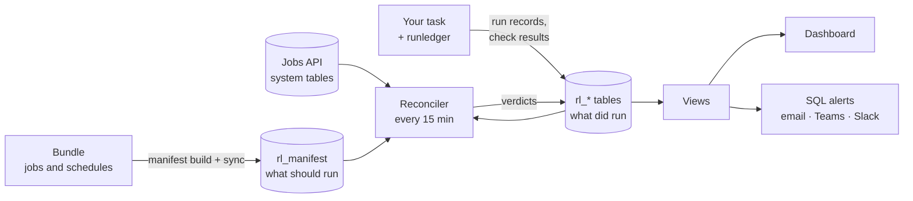

**Adoption is the main design constraint.** A team gets value with zero lines of code (missing-run
detection from the bundle), then one line, then decorators, and only later the full API
([§6](#6-getting-started-the-adoption-ladder)).

## 2. Why build it

The existing `databricks_event_logger` works, but it was built as a general event logger:

| Old project | runledger |
|---|---|
| One synchronous INSERT per event | Buffered: about one Delta commit per table per flush |
| One 40-column table; validation evidence buried in a `metadata_json` string | One typed table per kind of record; free-form data in `VARIANT` |
| Validation only as doc recipes, about 10 lines of boilerplate per check | Built-in rules, one Spark pass, a severity policy |
| No "started" event, so a crashed task leaves no trace | STARTED written at once; a reconciler also catches tasks that never started |
| Never checked on serverless or Spark Connect | Built and tested for serverless, classic, Spark Connect and LDP |

**Kept in spirit** (no code, schema or module layout is carried over): redaction of sensitive keys ·
stack-trace fingerprints · parent/child lineage through contextvars · delivery-health counters ·
"logging never breaks the job", with a strict mode · UTC `event_date` · checking the sink's schema ·
never auto-creating tables.

| Goals | Non-goals (please confirm) |
|---|---|
| One record of what every task did, and what it should have done, queryable with SQL | A general monitoring or tracing system; not a Datadog or Splunk replacement |
| Data checks that are cheap to write, cheap to run, and can stop bad data | Replacing native job notifications, retries or system tables: we build on them |
| The same behaviour on serverless, classic and LDP | Logging from executors or UDFs: logging is driver-only |
| Easier to use than not to use | Row-level lineage: Unity Catalog already does it |
| | A scheduler or orchestrator |

Already decided by the product owner: a separate repo (D1), the sinks (D2), Databricks-native
alerting first (D3), Python-first validation (D4), missing-run detection (D5). See
[§20](#20-decision-log).

## 3. Words used here

| Term | Meaning |
|---|---|
| **Bundle (DAB)** | The YAML project that deploys jobs with `databricks bundle deploy` |
| **Span** | A timed block of work inside a task, such as one function. Spans nest |
| **Event** | A log line, or the start or end of a span. Stored in `rl_events` |
| **Sink** | Where records go: console, stdout, Delta tables, or your own |
| **Flush** | Writing buffered records to the sinks |
| **Effective attempt** | The latest attempt or repair of a task in a job run. Earlier attempts stay as history |
| **Rule** or **check** | One data-quality test, such as `not_null("order_id")` |
| **Suite** | A named, versioned set of rules for one dataset |
| **Severity** | What a failing rule does: `info`, `warn`, `error` or `critical` |
| **`rule_key`** | A rule's stable name, so its history continues when thresholds change |
| **`definition_hash`** | A fingerprint of a rule's exact definition, thresholds included |
| **Trial** | A rule that runs and records results but can't fail a job or alert (`enforce` off) |
| **Write-audit-publish** | Write to staging, check that exact data, publish only if it passed |
| **Manifest** | The list of jobs and tasks we expect to run, with schedule, SLA and owner. Built from the bundle |
| **Slot** | One expected run of a task, for example "publish at 06:00 on 10 Nov" |
| **Reconciler** | A scheduled job that compares the manifest with what ran and writes a verdict per slot |
| **Verdict** | The reconciler's conclusion about a slot, such as `MISSED_SCHEDULE`, with a confidence |
| **Shadow mode** | Verdicts are recorded but don't alert. New jobs start this way for 7 days |
| **Canary** | A tiny scheduled job that proves the logging path works end to end |
| **Tier** | How important a job is: `high`, `medium` or `low`. Set as `criticality` |
| **Spark Connect** | The client-server Spark API used on serverless. `sparkContext` and RDDs don't exist there |
| **VARIANT** | A Delta column type for semi-structured data. Needs DBR 15.3+ |
| **Txn identity** | The Delta options `txnAppId` + `txnVersion`. Writing the same pair twice is a no-op |

## 4. Design principles

| # | Principle | In practice |
|---|---|---|
| 1 | **Append only** | No MERGE or UPDATE on the hot path. Current state is computed in views, so hundreds of concurrent tasks never conflict |
| 2 | **One table per kind of record** | Runs, events, metrics, check results and samples each get a typed table. Free-form data goes in `VARIANT`, never a JSON string |
| 3 | **Job parameters first** | Ids come from `{{job.run_id}}`-style parameters, which behave the same everywhere. Auto-detection is the fallback |
| 4 | **Buffered, idempotent, bounded writes** | About one commit per table per flush. STARTED flushes at once. Logging never blocks the job past a fixed time budget |
| 5 | **Few Spark passes** | Usually one `agg()` per dataset, without losing per-rule isolation |
| 6 | **LDP is a separate mode** | No side-effect writes inside a pipeline. Rules become expectations; the event log is ingested afterwards |
| 7 | **Light core** | No runtime dependencies. pyspark is imported lazily, never declared. A ruff rule bans `sparkContext`, `_jvm`, `.rdd` and `py4j` outside one module, keeping Spark Connect support |
| 8 | **Supported range** | Python 3.10+, DBR 15.4 LTS+ (for `VARIANT`), serverless environment v2+ |
| 9 | **Adoption first** | A one-line or decorator form for everything. No config needed. Missing tables mean stdout, not a crash. Errors say how to fix them |
| 10 | **A missing run is a signal** | The manifest says what should run; the reconciler raises the alarm when it doesn't |
| 11 | **Claim only what the evidence supports** | Missing telemetry is reported as a telemetry gap, not as a crash |
| 12 | **Separate facts stay separate** | "Did the code run", "did the data pass" and "did our records arrive" are three fields, never one |

## 5. Architecture

### Inside a task (on the driver)

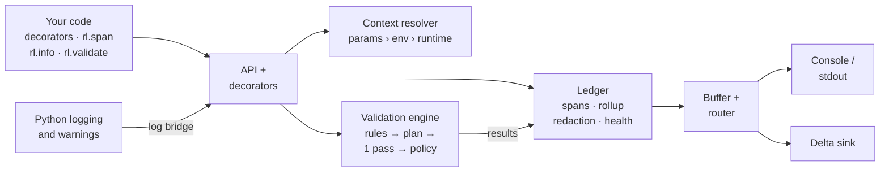

### Around the tasks

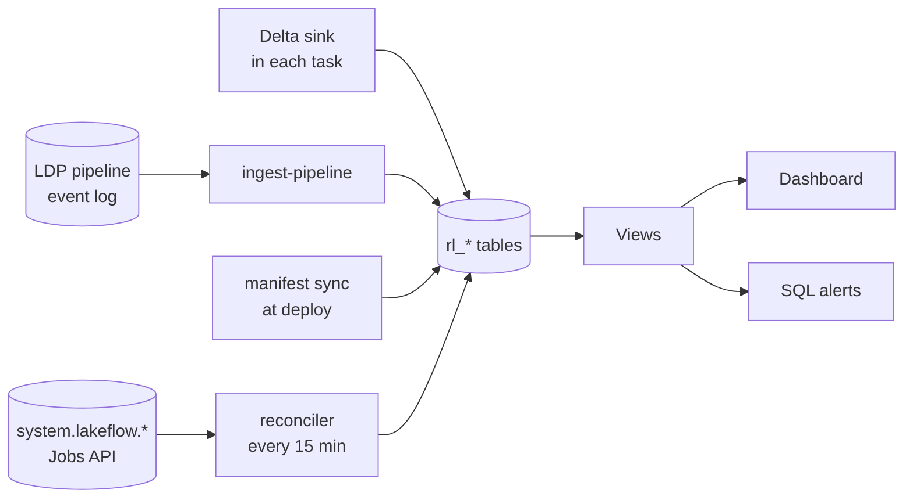

The ingest, sync and reconciler jobs ship in the bundle template ([§13](#13-storage-views-dashboard-and-alerts)).

### One task, start to finish

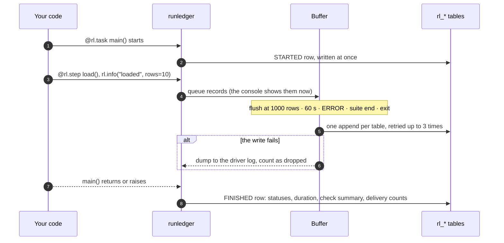

Console and stdout output goes to the driver log only. It is never stored in a table.

### Code layout

```text
pyproject.toml            hatchling; extras [sdk] = databricks-sdk, [dev] = pytest, hypothesis, ruff, pyspark, delta-spark
src/lakehouse_runledger/
  api.py                  init, current, span, info/warn/error, metric, validate, finish, task
  decorators.py           @rl.task, @rl.step, @rl.expect, @rl.expect_input
  notebook.py             `import lakehouse_runledger.auto`, cell spans, %%rl_step
  logbridge.py            logging + warnings → rl_events
  config.py               Config, precedence merge, provenance
  errors.py               ConfigError, SinkError, ValidationFailed, ValidationHalted
  context/                run context + providers: explicit, params, env, runtime, sdk
  core/                   ledger, buffer, spans, records, redaction, fingerprints, ids (uuid7), clock
  sinks/                  Sink protocol, router + circuit breaker, console, stdlog, memory, delta, spill
  notify/                 Notifier protocol (a seam only)
  schema/                 tables.py = the single source of truth for every table; ddl.py; views
  validation/             rules, checks, suite, plan (compiler), Spark executor, evaluate, policy, sampling
  ldp/                    expectations export, aggregate checks, event-log ingestion
  manifest/               model, build from bundle, sync, reconcile
  bundle/                 bundle mutator: injects runledger_ctx and the dependency
  integrations/           task values for condition tasks
  cli.py                  runledger ddl | doctor | setup | manifest | reconcile | ingest-pipeline
bundle_template/          the deployable bundle (§13)
tests/                    unit, spark, connect, integration (§17)
```

---

# Part 2 · How it works

## 6. Getting started: the adoption ladder

Each rung adds value. A team can stop on any rung.

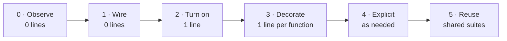

| Rung | You write | You get |
|---|---|---|
| **0 · Observe** | nothing: deploy the template | Expected vs actual runs, missed schedules, failures before any code ran, durations from system tables |
| **1 · Wire** | nothing: the bundle mutator (v1) injects `runledger_ctx` and the dependency | Job and run ids for the next rungs, without hand-written parameters |
| **2 · Turn on** | `import lakehouse_runledger.auto` or `@rl.task` | STARTED/FINISHED, status, duration, error fingerprint; your existing `logging` captured |
| **3 · Decorate** | `@rl.step`, `@rl.expect(...)` | Timed steps; checks on returned DataFrames |
| **4 · Explicit** | `rl.span()`, `rl.metric()`, `rl.validate(df)...run()` | Fine-grained control and custom metrics |
| **5 · Reuse** | shared `Suite` objects; YAML later | Versioned rules shared across jobs |

**Rung 0: deploy the template** (three commands)

```bash
databricks bundle init <runledger-repo>/bundle_template   # asks for catalog, schema, warehouse, alert destination
databricks bundle deploy -t dev
databricks bundle run runledger_setup -t dev               # creates the rl_* tables, views and grants
```

**Rung 1: the bundle mutator** (v1, opt-in)

```yaml
# databricks.yml
python:
  mutators:
    - "lakehouse_runledger.bundle:inject_context"
```

**Rung 2: one line**

```python
# Notebook: the first cell is the only change.
# Resolves context, writes STARTED, installs exit hooks, captures logging (WARNING+), writes FINISHED.
import lakehouse_runledger.auto
```

```python
# Wheel or script. Works bare or as @rl.task(app_name="orders_etl").
# Reads --runledger_ctx from sys.argv without touching your own arguments.
@rl.task
def main(): ...
```

**Rung 3: decorators** (the main "easy" API)

```python
@rl.task
def main():
    publish(clean(load_orders()))


@rl.step                                     # span "load_orders": status, duration, exception
def load_orders():
    return spark.table("main.raw.orders")


@rl.step(dataset="main.silver.orders")
@rl.expect(                                  # checks the RETURNED DataFrame, in one Spark pass
    c.not_null("order_id"),
    c.unique("order_id", severity="critical"),
    c.row_count(min=1),
)
def clean(df):
    return df.dropDuplicates(["order_id"])


@rl.step
@rl.expect_input("df", orders_suite)         # checks an ARGUMENT before the body runs
def publish(df):
    df.write.mode("overwrite").saveAsTable("main.silver.orders")
```

```python
%%rl_step load_orders
df = spark.table("main.raw.orders")          # v1: cell magic, a span around the whole cell
```

**Rung 4: the explicit API**

```python
rl.init(app_name="orders_etl")               # resolve config + context, write STARTED, install hooks

with rl.span("load_orders", dataset="main.raw.orders") as s:
    df = spark.table("main.raw.orders")
    s.metric("rows_read", df.count())
    rl.info("loaded", source_version=17, api_token="x")   # api_token → "[REDACTED]"

(rl.validate(df, dataset="main.raw.orders")
   .row_count(min=1)
   .not_null("order_id", "customer_id")
   .unique("order_id", severity="critical")
   .accepted_values("status", ["NEW", "SHIPPED", "CANCELLED"], severity="warn", mostly=0.99)
   .run())                                   # one Spark job; raises on error or critical

rl.finish()                                  # optional; safe to call twice
```

**Rung 5: reusable suites.** See [§10](#10-data-validation).

### What makes it easy

| Feature | Example |
|---|---|
| Zero config off Databricks: everything prints to the console | `rl.init(app_name="orders_etl"); rl.info("hello")` → `12:00:01 INFO  orders_etl  hello` |
| Safe before setup: missing tables fall back to stdout with one hint | `runledger: table ops.runledger.rl_events not found; writing to driver log instead. Run runledger setup.` |
| `runledger doctor` shows what was resolved and from where | see below |
| Type hints and docstrings everywhere, so autocomplete is the documentation | |
| A template example job that runs green on first deploy | |

```text
$ runledger doctor
job_run_id   = 8812731      (job_param)
task_key     = load         (job_param)
compute_type = serverless   (runtime)
sinks        = delta,stdlog (code)
⚠ rl_validation_samples not found. Run `runledger setup`.
```

**Decorator rules:** work with or without parentheses · sync functions in the MVP, async in v1 ·
generators rejected with a clear message · `functools.wraps` keeps names and signatures · no Spark
job unless you asked for validation (row counts are opt-in) · thin wrappers over the explicit API,
so behaviour is identical and easy to debug.

| Trade-off | Why |
|---|---|
| `lakehouse_runledger.auto` is its own module | It acts on import. `import lakehouse_runledger` alone has no side effects |
| Per-cell spans are opt-in (`rl.init(cell_spans=True)`, v1) | They can be noisy |
| `@rl.expect` runs a Spark job when the function returns | Documented; `suite.explain(df)` shows the work; `RUNLEDGER_VALIDATION_EVALUATE=false` turns it off. To gate a write, use write-audit-publish |
| No automatic hooks on `DataFrameWriter` | Monkey-patching is fragile under Spark Connect and surprising. Maybe an explicit opt-in later |

| ID | Feature | Phase |
|---|---|---|
| A1 | Zero-config console output off Databricks | MVP |
| A2 | One-line notebook import | MVP |
| A3 | `@rl.task` for wheels and scripts | MVP |
| A4 | `@rl.step` timed spans (async functions in v1) | MVP |
| A5 | Per-cell spans in notebooks | v1 |
| A6 | `%%rl_step` cell magic | v1 |
| A7 | Logging bridge: `logging` and `warnings` into `rl_events` (WARNING+ by default; `rl.init(capture_logging="INFO")`) | MVP |
| A8 | Bundle mutator: zero wiring | v1 |
| A9 | `runledger doctor` | MVP |

## 7. Run records

### Lifecycle

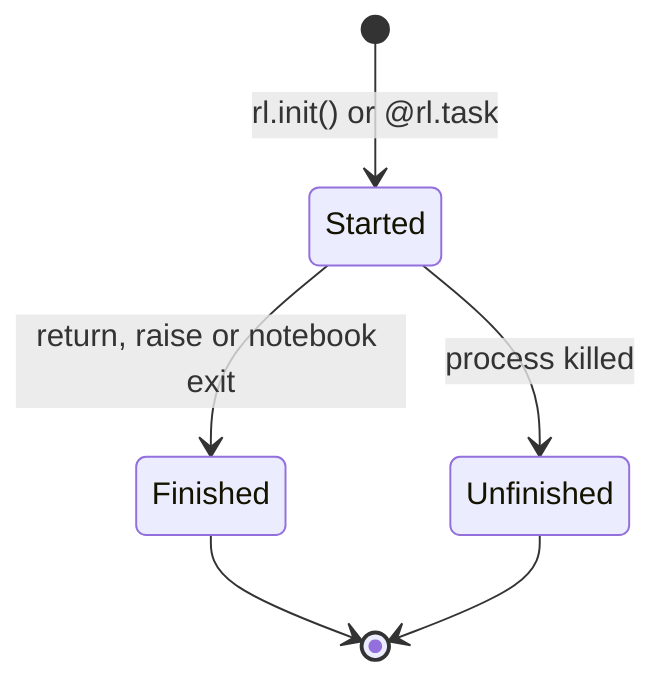

- **STARTED** is written at once, so even a crash leaves a row.
- **FINISHED** is written by whichever comes first: `rl.finish()`, the root span exiting, `atexit`,
  `sys.excepthook`, or the IPython exception hook (notebooks don't fire `sys.excepthook`).
- `dbutils.notebook.exit()` counts as success. An uncaught exception in a cell counts as FAILED.
- `rl_task_runs` holds one row per transition. The view shows `UNFINISHED` when STARTED has no FINISHED.

### Three statuses, never merged

| Status | Values | Answers |
|---|---|---|
| **Execution** | SUCCEEDED · FAILED · CANCELLED | Did the code run to completion? |
| **Quality** | PASSED · WARNED · FAILED · NOT_EVALUATED | Did the data pass, under the policy actually enforced? |
| **Telemetry completeness** | COMPLETE · PARTIAL · UNKNOWN | Did every record we produced arrive? |

A task can be SUCCEEDED + WARNED + COMPLETE: the code ran, a `warn` check failed, every record arrived.

**How status rolls up.** Only *uncaught* failures make a parent FAILED. Quality rolls up separately,
as the worst *enforced* check outcome.

```python
with rl.span("load"):                       # SUCCEEDED, had_caught_failures = true
    try:
        with rl.span("load.primary"):       # FAILED, still recorded in rl_events
            read_primary()
    except SourceDown:
        read_replica()

with rl.span("publish"):                    # SUCCEEDED, quality WARNED
    rl.validate(df).accepted_values("status", ["NEW"], severity="warn").run()
```

**Repairs.** Views use each task's *effective attempt*, so a successful repair turns the job run green:

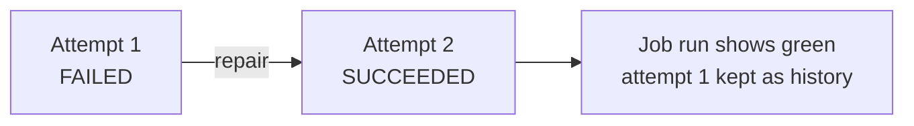

### Spans, events, metrics, errors

```python
with rl.span("load"):
    with rl.span("load.orders"):            # nested: parent_span_id points at "load"
        rl.info("file loaded", path="/Volumes/raw/orders/2026-11-10.csv", rows=10_000)
        rl.warn("late file", minutes_late=42)
        rl.metric("rows_written", 150_000, unit="rows", dataset="main.silver.orders")

rl.error("bad header", columns=["a", "b"])  # ERROR events flush immediately
rl.info("connecting", host="db1", api_token="abc123")   # api_token → "[REDACTED]"; oversized values truncated


def helper():                               # no logger object to pass around
    rl.current().metric("cache_hits", 42)


with rl.ThreadPoolExecutor(max_workers=8) as pool:      # v1: each call nests under the current span
    pool.map(load_partition, partitions)


@rl.step
def parse():
    raise ValueError("bad date '2026-13-01'")
# rl_events.error = {error_class: "ValueError", message: "...", fingerprint: "9f1c…"}
```

The **fingerprint** is the exception type plus frame locations. It groups recurring failures in
`rl_v_failure_groups`. Logging runs on the driver only, never inside UDFs.

| ID | Feature | Phase |
|---|---|---|
| B1 | STARTED/FINISHED lifecycle rows | MVP |
| B2 | Nested spans with parent/child lineage | MVP |
| B3 | Log events with attributes | MVP |
| B4 | Metrics | MVP |
| B5 | Status rollup: three statuses, caught failures, effective attempt | MVP |
| B6 | Exception capture and fingerprints | MVP |
| B7 | Redaction and size caps | MVP |
| B8 | Correct notebook endings | MVP |
| B9 | Ambient logger (`rl.current()`) | MVP |
| B10 | Thread propagation (`rl.ThreadPoolExecutor`, `rl.propagate()`) | v1 |

## 8. Run context and configuration

### Which job, run and task is this?

Values are merged field by field. The highest source wins, and each field records where it came from.

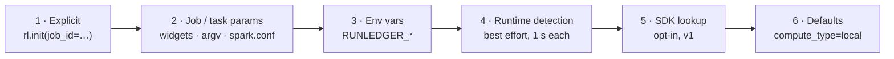

One compact parameter carries all the ids, the same on serverless, classic and wheel tasks:

```yaml
base_parameters:
  runledger_ctx: "job_id={{job.id}};job_run_id={{job.run_id}};task_key={{task.name}};task_run_id={{task.run_id}}"
```

```python
rl.current().context.job_run_id              # 8812731
rl.current().context.sources["job_run_id"]   # "job_param"
```

- **Params** come from notebook widgets, wheel `sys.argv` (parsed on a copy, so your arguments are
  untouched), or `spark.conf runledger.*` in LDP.
- **Runtime detection** tries the `dbruntime` context, the dbutils context JSON (classic only),
  `spark.databricks.clusterUsageTags.*`, Spark Connect detection and `DATABRICKS_RUNTIME_VERSION`.
- **Compute type** (`serverless`, `classic`, `ldp` or `local`) is stored on every run row.
- `runledger doctor` warns when `job_run_id` came from auto-detection instead of params.

### Configuration: the same code, four sources

```python
# (a) In code: the baseline the team commits
rl.init(config=rl.Config(catalog="ops", schema="runledger", sinks=["delta", "stdlog"],
                         validation=rl.ValidationPolicy(fail_on="error", sample_rows=20)))
```

```bash
# (b) Env var, e.g. on a laptop: console only
RUNLEDGER_SINKS=console
```

```yaml
# (c) Job parameters in the bundle: dev and prod differ only here
base_parameters:
  runledger_env: ${bundle.target}            # "dev" or "prod"
  runledger_catalog: ${var.ops_catalog}
  runledger_ctx: ${var.runledger_ctx}
```

```python
# (d) Where did each value come from?
rl.current().config.provenance   # {"catalog": "job_param", "sinks": "code", "env": "job_param", ...}
```

| ID | Feature | Phase |
|---|---|---|
| C1 | Context from job parameters, with provenance | MVP |
| C2 | Explicit overrides: `rl.init(env="prod", job_id=123)` | MVP |
| C3 | Env var overrides: `RUNLEDGER_ENV`, `RUNLEDGER_SINKS`, `RUNLEDGER_CATALOG`, … | MVP |
| C4 | Compute-type detection | MVP |
| C5 | SDK enrichment: one Jobs API call for job name, run-as, trigger (`enrich_from_api=True`) | v1 |

## 9. Writing to Delta

### The write path

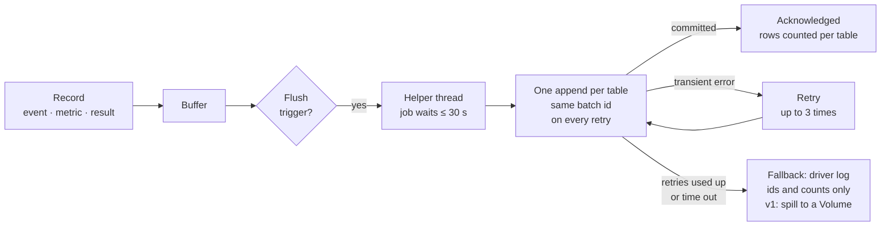

### When records are flushed

| Trigger | Becomes durable |
|---|---|
| `rl.init()` writes STARTED | at once |
| Any ERROR event | at once |
| End of every `Suite.run()` | at once |
| 1,000 rows or 16 MB buffered | at the trigger |
| 60 s since the last flush, **checked only when something is logged** | at the next log call |
| `finish()`, root span exit, `atexit`, exception hooks | at exit |

**An honest limit:** an event logged just before a 45-minute computation stays buffered until the
next log call or exit. Whether to add a background flusher is a Phase 0 question.

```python
rl.init(config=rl.Config(flush_max_rows=2000, flush_interval_s=30, flush_timeout_s=30))
```

### Never written twice

```python
(spark.createDataFrame(rows, staging_schema)                  # Arrow-based, Spark Connect-safe; VARIANT via parse_json
   .writeTo("ops.runledger.rl_events")
   .option("txnAppId", "runledger:job:1234:556677:rl_events")   # run_key + table
   .option("txnVersion", 3)                                    # batch number
   .append())
```

- **A batch's identity is fixed once it is numbered.** A retry, a late commit or a spill replay
  reuses it, so Delta skips a batch it has already committed.
- No process id in the identity. A retried task attempt gets a new `run_key`, so it never collides.
- Blind appends don't conflict with each other. The library never creates tables.

### Each table is acknowledged on its own

Partial success is normal: events can commit while metrics fail. There is no cross-table atomicity,
and we don't promise it. The FINISHED row records rows sent and acknowledged per table:

```sql
SELECT run_key, table_name, rows_sent, rows_present
FROM rl_v_delivery_completeness
WHERE rows_present < rows_sent;
```

### When something goes wrong

| Situation | What happens |
|---|---|
| Transient error: gRPC unavailable, 5xx, concurrent metadata change | Retry 3 times with backoff, within the time budget |
| Table missing, permission denied, incompatible schema | No retry. Fall back to the driver log with one hint |
| Retries used up | Count as `dropped`; dump as JSON lines. v1: spill to a UC Volume, recovered by the maintenance job |
| Buffer over its cap | Drop DEBUG, then INFO events first, and count them |
| Hard kill | Whatever is buffered is lost. The reconciler treats missing rows as a telemetry fact, not proof of a crash |

- Fallback output carries ids and counts only, **never sample rows or sensitive attributes**. Spill
  files get the same grants and retention as `rl_validation_samples`.
- Logging never raises, except with `strict=True` (useful in CI). Your own exception always wins.
- `rl.current().health` → `Health(emitted=812, flushed=812, dropped=0, retries=1, flush_failures=0)`

### Schema compatibility

- A table is **compatible** if it has every column the client writes, with compatible types. Extra
  columns must be nullable; they are ignored.
- Each client declares the minimum `runledger.schema_version` it supports.
- **Migration order:** add columns to the tables first, then upgrade clients ([§14](#14-governance)).
- Metadata-change conflicts during a migration are retried, and the check runs again.

### Cost

About 2 to 4 commits per task, roughly 3 to 10 seconds on serverless. For very short tasks,
`lifecycle_mode="finish_only"` writes one row at the end, at the cost of crash visibility.

### Sinks

| Sink | Use | Example |
|---|---|---|
| `console` | Local development; the default off Databricks | `rl.init(config=rl.Config(sinks=["console"]))` |
| `stdlog` | Driver log, JSON lines | `sinks=["delta", "stdlog"]` |
| `memory` | Tests | `sink = rl.MemorySink(); rl.init(sinks=[sink])` |
| `delta` | Unity Catalog tables | `rl.Config(catalog="ops", schema="runledger")` |
| spill (v1) | UC Volume for batches that failed | `rl.Config(spill_path="/Volumes/ops/runledger/rl_spill")` |
| Your own | Anything | A class with `name`, `record_types`, `validate()`, `write(batch)`, `close()` |

```python
class MySink:
    name = "my_sink"
    record_types = frozenset({rl.EventRecord})

    def validate(self): ...
    def write(self, batch): ...
    def close(self): ...


rl.init(sinks=["delta", MySink()])
```

Not now: Zerobus and SQL Statement API sinks. The `Sink` protocol leaves room for them.

| ID | Feature | Phase |
|---|---|---|
| D1 | Buffered, batched, bounded flushing | MVP |
| D2 | Idempotent appends with a stable batch identity; per-table acknowledgment | MVP |
| D3 | Schema compatibility check, circuit breaker, graceful fallback | MVP |
| D4 | Retries and delivery-health counters | MVP |
| D5 | Strict mode | MVP |
| D6 | Console, stdlog and memory sinks | MVP |
| D7 | Custom sinks | MVP |
| D8 | Spill to a UC Volume | v1 |

## 10. Data validation

### How a suite runs

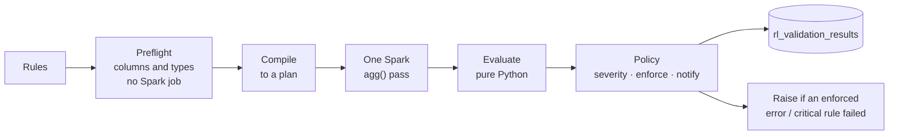

Extra Spark passes happen only when needed: duplicates were found, a row rule failed (to collect
samples), or a rule failed at runtime (to isolate it).

```python
(rl.validate(df, dataset="main.raw.orders")
   .row_count(min=1)
   .not_null("order_id", "customer_id")
   .unique("order_id", severity="critical")
   .run())
```

### Rule catalog

| Rule | Example | Spark cost | Phase |
|---|---|---|---|
| Schema contract | `c.schema({"order_id": "bigint", "amount": "decimal(18,2)"}, allow_extra=True, check_nullability=False)` | none: reads `df.schema` | MVP |
| Not null | `c.not_null("order_id", "customer_id")` | shared pass | MVP |
| Accepted values | `c.accepted_values("status", ["NEW", "SHIPPED"])` | shared pass | MVP |
| Range | `c.in_range("amount", min=0, max=1_000_000)` | shared pass | MVP |
| SQL expression | `c.expr("ship_date >= order_date", name="ship_after_order")` | shared pass | MVP |
| Row count | `c.row_count(min=1, max=50_000_000)` | shared pass | MVP |
| Unique (single or composite key) | `c.unique("order_id")` · `c.unique("account", "as_of_date")` | shared pass; +1 only if duplicates exist | MVP |
| Regex | `c.matches("email", r"^[^@]+@[^@]+$")` | shared pass | v1 |
| Freshness | `c.freshness("updated_at", max_age="6h")` | shared pass | v1 |
| Null ratio | `c.null_ratio("phone", max=0.2)` | shared pass | v1 |
| Statistic bounds | `c.stat_bounds("amount", mean=(90, 110), sum=(1e6, None))` | shared pass | v1 |
| Referential integrity | `c.references("customer_id", "main.ref.customers", "id")` | +1: anti join | v1 |
| Custom SQL | `c.sql("SELECT count(*) FROM {df} WHERE amount < 0", max=0)` | +1 each | v1 |
| Reconciliation to source | `c.reconcile(source=lambda: spark.table("raw.orders"), keys=["order_id"], measures=["amount"])` | +1; +1 more on mismatch | v1 |

- Row rules compile to `count_if(NOT coalesce(predicate, false))`, all in the same `agg()`.
- `references` skips null keys unless `allow_null=False`. Duplicate reference keys don't matter.
- `reconcile` compares count, sums and a `sum(xxhash64(...))` checksum, within a `tolerance`. A key
  diff runs only on a mismatch.

### What a failure does

| Severity | When the rule fails, or can't be evaluated |
|---|---|
| `info` | Record only |
| `warn` | Record; quality status WARNED |
| `error` | Raise `ValidationFailed` after the whole suite is evaluated and flushed |
| `critical` | As `error`, plus task value `runledger.validation_status=HALTED`; raise `ValidationHalted` |

- A failing check is just an exception, so native job notifications, retries and condition tasks
  keep working.
- Loosen per suite or in config, e.g. in dev: `rl.init(validation=rl.ValidationPolicy(fail_on="critical"))`.
- Handle it yourself with `on_failure="return"`. Quality is still recorded as FAILED:

```python
result = rl.validate(df).not_null("id").run(on_failure="return")
if not result.passed:
    notify_team(result.failures)
```

### Three switches: evaluate, enforce, notify

| Switch | Off means | Env var |
|---|---|---|
| `evaluate` | Checks don't run at all; no Spark cost; `@rl.expect` does nothing | `RUNLEDGER_VALIDATION_EVALUATE` |
| `enforce` | Failures are recorded but never raise: **trial mode** | `RUNLEDGER_VALIDATION_ENFORCE` |
| `notify` | Results can't trigger alerts | `RUNLEDGER_VALIDATION_NOTIFY` |

```python
rl.init(validation=rl.ValidationPolicy(enforce=False))   # trial: run and record, never fail the task
```

The effective policy is stored on every result, and alerts only consider results with `enforce`
and `notify` on. A rule on trial never pages anyone.

### Tolerances

```python
c.not_null("phone", mostly=0.95)                 # pass if at least 95% of rows are non-null
c.in_range("amount", min=0, max_failures=10)     # pass if at most 10 rows are out of range
```

### Uniqueness reports three numbers

```text
order_id:   A   A   B

duplicate_keys           = 1    A is the only key that repeats
excess_rows              = 1    count(*) - count(DISTINCT order_id) = 3 - 2   (the default basis)
rows_in_duplicate_groups = 2    both A rows
```

- A tolerance names the basis it uses; the result stores it in `failed_rows_basis`.
- `suite.split(df)` sends every row of a duplicate group to `bad`. `c.unique("order_id", keep="first")` keeps one.
- `approx=True` is **observational only**: it can warn but never block, because an approximate
  count can't prove there are zero duplicates.

### When a rule itself is broken

One broken rule must not silence the others.

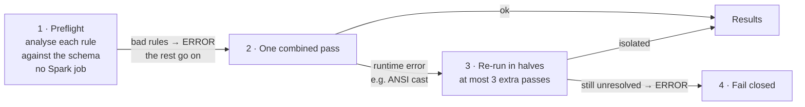

**Fail closed:** an `error` or `critical` rule that couldn't be evaluated counts as a failure. A
`warn` or `info` rule that couldn't be evaluated is only recorded. Override per rule with
`on_error="fail"` or `on_error="record"`.

```text
rule orders.amount_positive -> ERROR (analysis: column `amount_usd` not found)   [fails closed: severity=error]
rule orders.id_present      -> PASS
rule orders.id_unique       -> PASS
```

### See the plan before it runs

```python
orders_suite.explain(df)
```

```text
1 Spark pass (aggregate): not_null(order_id), row_count, unique(order_id) [exact]
+1 pass only if duplicates are found: rows_in_duplicate_groups
+1 pass only if a row rule fails: failing-row samples (20/rule)
Columns read: order_id, status, amount   Filter: as_of_date = '2026-11-10'
```

It shows the passes, columns, filters and exact vs approximate operations. It gives no runtime or
cost estimate.

### Reusable suites and rule identity

```python
orders_suite = rl.Suite(
    name="orders_silver", version="3", dataset="main.silver.orders",
    rules=[
        c.schema({"order_id": "bigint", "amount": "decimal(18,2)"}, allow_extra=True),
        c.not_null("order_id", key="orders.order_id.not_null"),
        c.unique("order_id", key="orders.order_id.unique", severity="critical"),
        c.in_range("amount", min=0),
        c.expr("ship_date >= order_date", name="ship_after_order", severity="warn"),
    ],
)
result = orders_suite.run(df)
orders_suite.to_dict()                          # JSON-safe; rl.Suite.from_dict() reads it back: the basis for YAML suites later
```

| Change | `rule_key` | `definition_hash` |
|---|---|---|
| Threshold `max=1_000_000` → `max=2_000_000` | same: history continues | new: the change is visible |
| Columns change, no explicit `key` | new: history splits | new |
| Columns change, explicit `key` set | same | new |

### Scope is recorded with every result

Each result stores the population it judged: the filter, the sample fraction, approx flags, the
source table and its Delta version, and the engine and library version. Trend charts only compare
results with the same scope.

```sql
SELECT rule_key, observed_value, scope:source_version
FROM rl_validation_results
WHERE dataset = 'main.silver.orders' AND scope:filter = 'as_of_date = current_date()';
```

### Samples, quarantine, cost controls, task values (v1)

```python
# Failing-row samples: one extra pass, only when a row rule fails; column allow-list applies
rl.validate(df, sample_rows=20, sample_columns=["order_id", "status"]).not_null("status").run()

# Quarantine: bad rows get an _rl_failed_rules column; you decide where they go
good, bad = orders_suite.split(df)
bad.write.mode("append").saveAsTable("main.quarantine.orders")
good.write.mode("overwrite").saveAsTable("main.silver.orders")

# Cost control on very large tables
rl.validate(df, where="as_of_date = '2026-11-10'").unique("id", approx=True).run()
```

```yaml
# Branch later tasks on the result (condition task)
condition_task:
  op: EQUAL_TO
  left: "{{tasks.validate.values.runledger.validation_status}}"
  right: "PASSED"
```

- Samples go to `rl_validation_samples` (restricted, 14 days). They never appear in fallback logs.
- **No caching by default.** Serverless DataFrame caching may exist as a preview (claim C3). If
  confirmed, it becomes an opt-in, capability-checked setting.

### Gating a write: write-audit-publish

Checking a DataFrame and then writing it can check different data from what gets published: the
source can change between the two reads, and the work is computed twice. The gate fixes that:

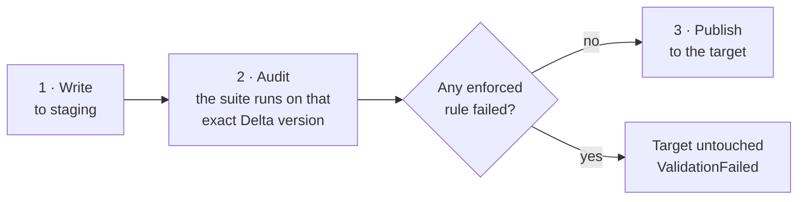

```python
with rl.publish_gate("main.silver.orders", suite=orders_suite) as gate:
    gate.write(clean(raw))
```

v1, and an MVP candidate if a pilot needs gating. **Open:** the publish mechanism. Options are a
staging table plus `INSERT OVERWRITE`/`MERGE` (recommended), a shallow-clone swap, or
write-then-restore. The last two can briefly expose bad data or have more edge cases.

| ID | Feature | Phase |
|---|---|---|
| E1 | Fluent validation in one Spark pass | MVP |
| E2 | Rule catalog: 7 rules in MVP, 7 more in v1 | MVP / v1 |
| E3 | Severity policy | MVP |
| E4 | Tolerances (`mostly`, `max_failures`) | MVP |
| E5 | `evaluate` / `enforce` / `notify` switches | MVP |
| E6 | Manual handling (`on_failure="return"`) | MVP |
| E7 | `@rl.expect` and `@rl.expect_input` | MVP |
| E8 | Reusable, versioned, serializable suites; `rule_key` + `definition_hash` | MVP |
| E9 | Failing-row samples | v1 |
| E10 | Quarantine split | v1 |
| E11 | Condition-task integration | v1 |
| E12 | Cost controls: `where=`, `sample_fraction=`, `approx=True` | v1 |
| E13 | Write-audit-publish gate | v1; MVP candidate |
| E14 | `suite.explain(df)` | MVP |
| E15 | Scope recorded with every result | MVP |
| E16 | Rule errors isolated; fail closed | MVP |

## 11. Lakeflow Declarative Pipelines

Inside a pipeline there are no side-effect writes. In LDP mode, `rl.init()` writes to stdlog only.
Rules become expectations, and results are read from the pipeline event log afterwards.

### Rules become expectations (v1)

| Rule | LDP action |
|---|---|
| `info`, `warn` | `expect`: keep rows, record |
| `error`, `critical` | `expect_or_fail`: fail the update |
| Any rule with `ldp_action="drop"` | `expect_or_drop`: drop rows. Explicit opt-in only |
| Rules with `mostly` or `max_failures` | Rejected when decorated, with a pointer to aggregate checks |

Reusing a suite never quietly turns "reject" into "delete".

```python
from pyspark import pipelines as dp
import lakehouse_runledger.ldp as rlp

rl.init()                                            # detects LDP → stdlog only


@dp.table(name="orders_silver")
@rlp.expectations(orders_suite)                      # error → expect_or_fail; never silently drop
def orders_silver():
    return spark.readStream.table("orders_bronze")


rlp.aggregate_checks(orders_suite, source="orders_silver")   # row_count, unique, freshness, reconcile

c.accepted_values("status", ["NEW", "SHIPPED"], ldp_action="drop")   # explicit opt-in to dropping
```

- Expectations are named `rl:{rule_key}:{name}`. Both `pyspark.pipelines` and the legacy `dlt`
  module are supported.
- **Aggregate checks are observational.** They run as a private materialized view over the
  published data, so they can't stop publication. To gate, put a validation task between the
  pipeline and its consumers, or use write-audit-publish.

### Getting the results out

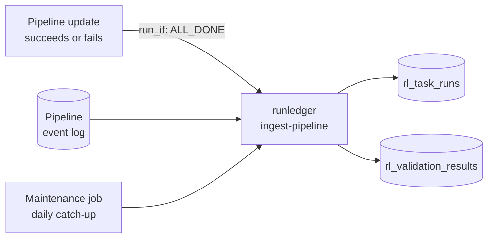

```yaml
- task_key: ingest_pipeline_results
  depends_on: [{task_key: run_pipeline}]
  run_if: ALL_DONE                       # runs even when the pipeline failed
  python_wheel_task:
    package_name: lakehouse_runledger
    entry_point: runledger
    parameters: ["ingest-pipeline", "--pipeline-id", "${resources.pipelines.orders.id}"]
```

- Expectation results, update status and **update errors** land in the same tables as job results.
- Counts the pipeline didn't record (fail-action expectations may not record metrics, claim C4) are
  stored as NULL with an `unavailable_reason`, never as 0.
- To evaluate in v1: the pipeline-events system table (claim C5) instead of publishing each
  pipeline's event log.

| ID | Feature | Phase |
|---|---|---|
| F1 | Export row rules as expectations | v1 |
| F2 | Aggregate checks inside a pipeline (observational) | v1 |
| F3 | Event-log ingestion | v1 |

## 12. Missing-run detection

Earlier drafts called this *never-start detection*.

### The problem

The library can only record runs that reach `rl.init()`. These leave no rows at all:

- the schedule never fired, or the job was paused
- the compute failed to start, or the library failed to install
- an upstream task failed, so this task never ran
- logging itself failed

So **a missing row proves nothing by itself.** Every conclusion combines two independent kinds of
evidence: **platform evidence** (Jobs API, system tables) and **telemetry evidence** (our rows,
delivery health, canary health).

### The pieces

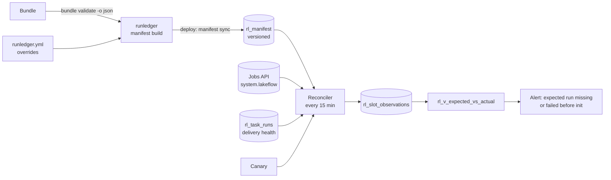

### The manifest: what should run

Generated from the bundle, which already knows every job, task, dependency, `run_if`, schedule and
target. Nobody hand-writes it. Overrides are optional:

```yaml
# runledger.yml
defaults: {grace_minutes: 30}
jobs:
  orders_daily:
    sla_max_duration_minutes: 90
    criticality: high
    owner: data-eng
    tasks:
      publish: {expected_datasets: [main.silver.orders]}
```

```bash
runledger manifest build     # reads `databricks bundle validate -o json`, writes runledger.manifest.json
runledger manifest sync      # at deploy time: resolves job ids, appends a new manifest_version
```

- Overridable: `sla_max_duration`, `grace`, `criticality`, `expected_datasets` and suites, `owner`, `exclude`.
- Each version has `effective_from` / `effective_to`, and every row includes the workspace id.
  Removing a task means a new version without it. A slot is judged against the version in effect
  at slot time.
- Jobs outside a bundle (v1): `runledger manifest add --job-id 123 --sla 2h --schedule "0 0 6 * * ?" --tz America/Chicago`.

### The reconciler: match first, then judge

1. **Slots.** Expected slots come from cron + timezone. Jobs without a fixed schedule (file arrival,
   continuous, external triggers) use "at least one run every N hours".
2. **Match.** Each slot is matched to an actual job run by trigger time, within the grace window.
3. **Eligibility.** Per task, from `depends_on`, `run_if` and the actual upstream states. A
   downstream task is late only relative to when its upstream tasks finished.
4. **Classify**, in two steps:

**Step A: did the task get a chance to run?**

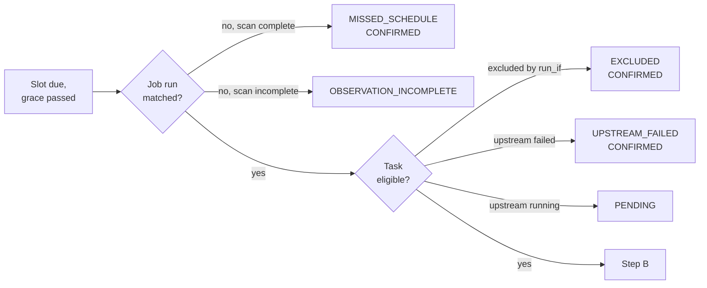

**Step B: compare the platform's view with our rows.**

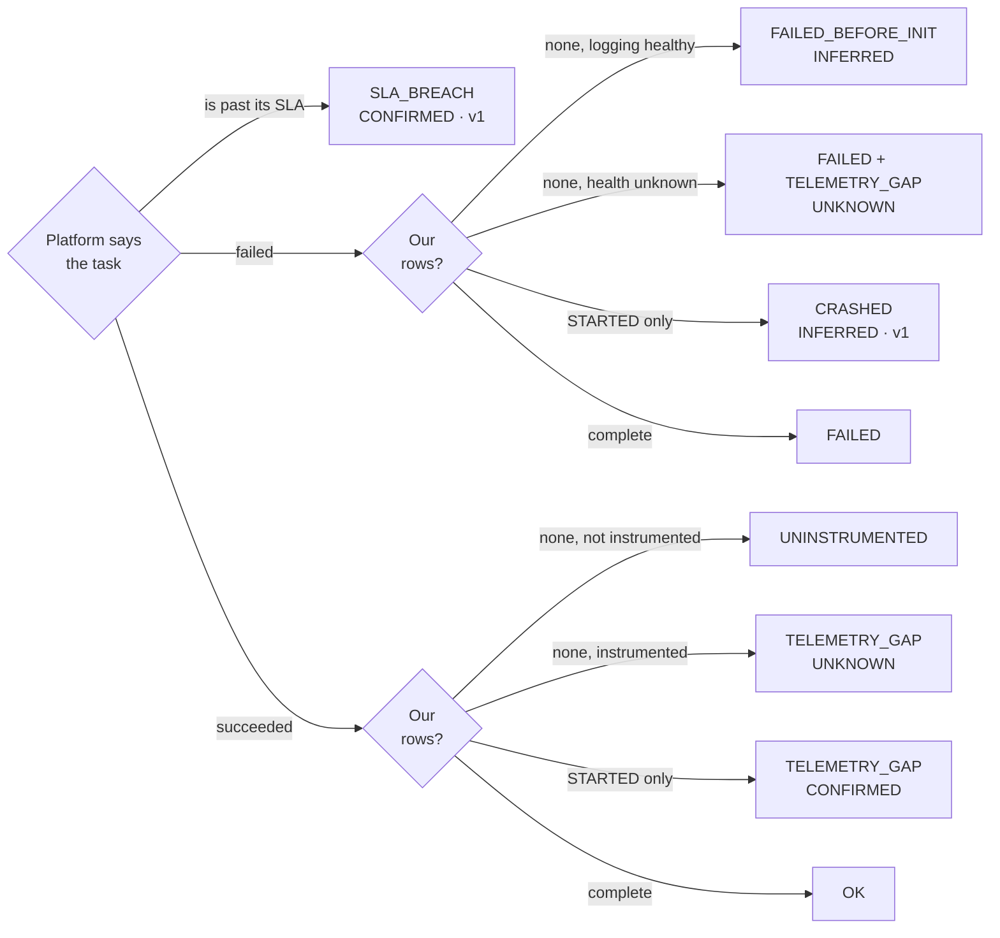

| Confidence | Means | Can alert? |
|---|---|---|
| **CONFIRMED** | Platform data proves it | yes |
| **INFERRED** | Strong indirect evidence, e.g. the canary was healthy | yes |
| **UNKNOWN** | Can't tell | never |

| Verdict | Meaning | Phase |
|---|---|---|
| `OK` | Ran, records complete | MVP |
| `MISSED_SCHEDULE` | No job run matched the slot (needs a complete API scan) | MVP |
| `EXCLUDED` | `run_if` excluded it, e.g. a failure handler on a good run. Info, never alerts | MVP |
| `UPSTREAM_FAILED` | Not run because an upstream task failed | MVP |
| `PENDING` | Waiting on upstream tasks that are still running. Not late | MVP |
| `FAILED_BEFORE_INIT` | Platform says failed; no STARTED row; logging path healthy | MVP |
| `UNINSTRUMENTED` | Ran, but doesn't use runledger yet. Info | MVP |
| `TELEMETRY_GAP` | Our records are missing or incomplete, and the cause isn't proven | MVP |
| `OBSERVATION_INCOMPLETE` | Platform data couldn't be read completely; no conclusion | MVP |
| `CRASHED` | STARTED, never FINISHED, and the platform says it failed | v1 |
| `SLA_BREACH` | Still running past its SLA | v1 |

An API error or a truncated listing gives `OBSERVATION_INCOMPLETE`, never `MISSED_SCHEDULE`.

```sql
SELECT slot_key, verdict, cause_confidence
FROM rl_v_expected_vs_actual
WHERE verdict NOT IN ('OK', 'EXCLUDED', 'PENDING') AND slot_ts > now() - INTERVAL 1 DAY;
```

### Verdicts can change

The reconciler appends observations; it never writes fake `rl_task_runs` rows. Late evidence
supersedes an earlier conclusion, and the history is kept:

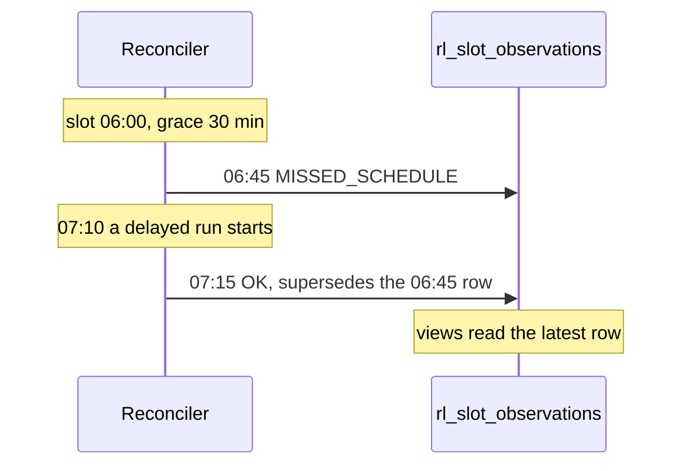

### Making verdicts trustworthy

A false "failed" or "missed" destroys trust quickly. Four safeguards:

| Safeguard | How |
|---|---|
| **Shadow mode** | A newly added job is observed without alerts for 7 days, or until the team turns alerts on |
| **Evidence stored** | Each observation keeps the manifest version, matched runs, evidence age and eligibility reasoning |
| **Explain and preview** | `runledger reconcile explain <slot_key>` shows why; `runledger reconcile preview` lists upcoming slots |
| **Canary** | A tiny job, every 15 min, writes a known record through the library and checks it reaches the views, plus the reconciler's freshness. Its own alert fires if either goes stale. Canary health is what upgrades `FAILED_BEFORE_INIT` from UNKNOWN to INFERRED |

```text
$ runledger reconcile explain expected:1234:987:publish:2026-11-10T06:00
verdict EXCLUDED (CONFIRMED)
  manifest v14 (effective 2026-11-01): publish depends_on [validate], run_if ALL_SUCCESS
  matched job run 5551 (triggered 06:00:04); validate result_state FAILED -> publish not eligible
  -> reclassified as UPSTREAM_FAILED
```

**Why this helps adoption.** The manifest and reconciler need only bundle metadata and platform
data. A team that deploys the template gets run-status coverage of every bundled job **before
writing a line of runledger code**. Each task then moves from `UNINSTRUMENTED` to instrumented.

| ID | Feature | Phase |
|---|---|---|
| G1 | Manifest built from the bundle | MVP |
| G2 | Reconciler with the evidence model (CRASHED and SLA_BREACH in v1) | MVP |
| G3 | Jobs outside a bundle: `manifest add` | v1 |
| G4 | Shadow mode, `reconcile explain`, `reconcile preview` | MVP |
| G5 | Canary | MVP |

## 13. Storage, views, dashboard and alerts

### Tables

Seven Unity Catalog managed Delta tables in one configurable `catalog.schema`, prefix `rl_`:

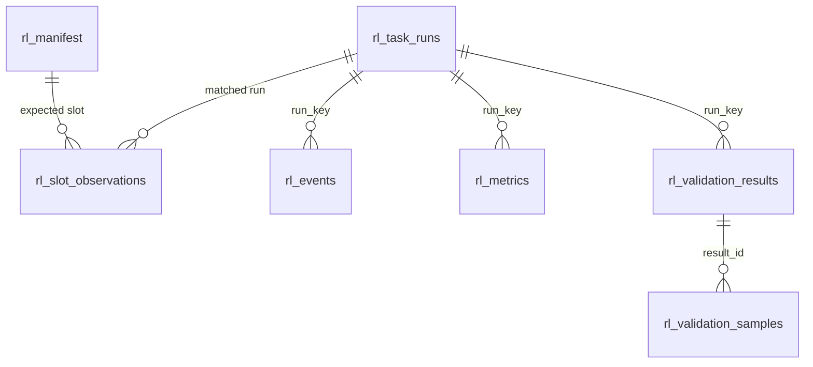

| Table | One row per | Main columns | Cluster by |
|---|---|---|---|
| `rl_task_runs` | lifecycle transition (STARTED, FINISHED) | ids, attempt, repair_count, trigger, compute_type, runtime_version, `client_version` (proposed, §14), execution_status, quality_status, had_caught_failures, duration, `error` STRUCT, `validation_summary` STRUCT, `delivery` STRUCT, params/tags MAP, `context_sources` MAP | event_date, job_id |
| `rl_events` | log line or span start/end | event_id, span_id, parent_span_id, seq, level, kind, name, message, status, duration_ms, `error` STRUCT, `attributes` VARIANT | event_date, job_id |
| `rl_metrics` | numeric fact | name, value DOUBLE, unit, dataset, tags | event_date, name |
| `rl_validation_results` | rule evaluation | suite name/version, dataset, rule_key, definition_hash, rule_type, columns, severity, outcome (PASS/FAIL/ERROR/NOT_EVALUATED/SKIPPED), `effective_policy`, total_rows, failed_rows + `failed_rows_basis`, failed_ratio, observed_value, `unavailable_reason`, `scope` VARIANT, threshold/observed/definition VARIANT, source (spark / ldp_event_log) | event_date, dataset |
| `rl_validation_samples` | failing row (bounded) | result_id, rule_key, `row_data` VARIANT, row_hash. Restricted grants, 14 days | event_date, dataset |
| `rl_manifest` | expected task per manifest version | manifest_version, workspace_id, effective_from/to, bundle, target, job_name, job_id, task_key, depends_on, run_if, is_failure_handler, schedule or trigger, grace, sla_max_duration, criticality, instrumented, expected datasets/suites, owner, active | job_id |
| `rl_slot_observations` | reconciler conclusion per slot | slot_key, observed_at, manifest_version, matched run, platform_state, task_eligibility, telemetry_state, verdict, cause, cause_confidence, `evidence` VARIANT, supersedes | event_date, job_id |

**Keys.** Job ids are unique only within a workspace, so every key includes the workspace id.

| Key | Format | Example |
|---|---|---|
| `run_key` (one task attempt) | `job:{workspace_id}:{task_run_id}` · `ldp:{workspace_id}:{pipeline_id}:{update_id}` · `local:{uuid7}` | `job:1234:556677` |
| `slot_key` (one expected run) | `expected:{workspace_id}:{job_id}:{task_key}:{slot_ts}` | `expected:1234:987:publish:2026-11-10T06:00` |
| `rule_key` (one rule) | given by you, or derived from type + dataset + columns | `orders.order_id.unique` |

**Conventions:**
- Liquid clustering, no Hive partitions. Predictive optimization, or optimizeWrite/autoCompact as a fallback.
- Every table carries a `runledger.schema_version` table property.
- `job_id`, `job_run_id`, `task_key` and `env` are copied onto every table, so alerts rarely need joins.
- `event_date` is UTC.
- `schema/tables.py` is the single source of truth. `runledger ddl` generates the SQL, and CI checks
  that the committed SQL hasn't drifted.

```bash
runledger ddl --catalog ops --schema runledger > 01_tables.sql
```

### Views

Dashboards, alerts and saved queries read views, not tables ([§14](#14-governance)).

| View | Shows |
|---|---|
| `rl_v_task_runs` | Current state per task, using the effective attempt. STARTED without FINISHED shows as `UNFINISHED` |
| `rl_v_job_runs` | Worst effective-attempt status per job run |
| `rl_v_expected_vs_actual` | Latest verdict per expected slot. Drives the missing-run alert and the coverage tile |
| `rl_v_delivery_completeness` | Rows reported in FINISHED vs rows present, per task and table |
| `rl_v_validation_latest` | Latest result per `rule_key` |
| `rl_v_failure_groups` | Failures grouped by fingerprint |
| `rl_v_events_dedup` | Safety net against duplicate events |
| `rl_v_governance_scorecard` | Proposed, v1: see [§14](#14-governance) |

```sql
SELECT fingerprint, error_class, count, last_seen FROM rl_v_failure_groups ORDER BY count DESC;
```

### The bundle template

```text
bundle_template/
  databricks.yml                   dev/prod targets; runledger_ctx and runledger_version variables
  runledger.schema.yml             schema + Volumes for spill and checkpoints
  runledger_setup.job.yml          runs 01_tables.sql, 02_views.sql, 03_grants.sql (generated) + manifest sync
  runledger_reconciler.job.yml     every 15 min, serverless; new jobs start in shadow mode
  runledger_canary.job.yml         writes a known record and checks it arrives; checks reconciler freshness
  runledger_maintenance.job.yml    daily: retention deletes, pipeline catch-up, spill recovery
  runledger.yml                    manifest overrides: SLA, grace, criticality, datasets, owner, exclude
  runledger.dashboard.yml          AI/BI dashboard
  runledger.alerts.yml             SQL alerts
  example_job.job.yml              notebook + wheel + pipeline + ingest task (run_if: ALL_DONE)
  example_pipeline.pipeline.yml    event log published to UC, runledger.mode=ldp
```

### Dashboard (v1)

| Page | Shows |
|---|---|
| Overview | Status, success rate, p50/p95 duration, unfinished and crashed runs, coverage |
| Failures | Top fingerprints, with links to runs |
| Data quality | Pass rates, observed-value trends, samples |
| Delivery health | Dropped, retried and incomplete deliveries |
| Governance (proposed) | The scorecard in [§14](#14-governance) |

### Alerts

SQL Alerts send to notification destinations: email, Teams or Slack. Check alerts only consider
results with `enforce` and `notify` on. Reconciler alerts skip shadow-mode slots and UNKNOWN verdicts.

| Alert | Phase |
|---|---|
| Expected run missing, or failed before init (CONFIRMED or INFERRED) | MVP |
| Canary or reconciler stale | MVP |
| Critical or error check failed, or couldn't be evaluated | v1 |
| Task FAILED or CRASHED in prod | v1 |
| Dataset not validated in 24 h | v1 |
| Delivery dropped > 0, or incomplete | v1 |
| Run UNFINISHED for more than X hours | v1 |

```sql
-- Critical check failing in the last 15 minutes (includes rules that couldn't be evaluated)
SELECT count(*) AS failures
FROM rl_v_validation_latest
WHERE outcome IN ('FAIL', 'ERROR') AND severity = 'critical'
  AND effective_policy.enforce AND effective_policy.notify
  AND evaluated_at > now() - INTERVAL 15 MINUTES;
```

### Extension points

```python
# Notifier seam: protocol in v1, implementations later.
# Called at finish() and suite end, never on the flush path. Deduplicated by fingerprint.
class TeamsNotifier:
    def wants(self, signal):
        return signal.kind == "ValidationFailed" and signal.severity == "critical"

    def send(self, signal):
        post(dbutils.secrets.get("ops", "teams_webhook"), signal.summary())


rl.init(notifiers=[TeamsNotifier()])
```

```yaml
# YAML suites (Later)
name: orders_silver
version: "3"
dataset: main.silver.orders
rules:
  - {type: not_null, columns: [order_id]}
  - {type: unique, columns: [order_id], severity: critical}
```

```python
rl.Suite.from_yaml("suites/orders_silver.yml").run(df)
c.anomaly("row_count", baseline_days=28, max_zscore=3)   # Later: compared with rl_validation_results history
```

| ID | Feature | Phase |
|---|---|---|
| H1 | Typed UC tables and generated DDL | MVP |
| H2 | Additive schema migrations (`add_columns_sql`) | MVP |
| H3 | Views | MVP |
| H4 | Bundle template: setup in three commands | MVP minimal; v1 full |
| H5 | AI/BI dashboard | v1 |
| H6 | SQL alerts | 1 in MVP; v1 full |
| H7 | Retention and maintenance job (`retention_days_events: 90`, `retention_days_samples: 14`) | v1 |
| I1 | Notifier seam for webhooks | protocol v1; implementations Later |
| I2 | YAML and table-driven suites | Later |
| I3 | Other sinks: `ZerobusSink`, `StatementApiSink`, OpenTelemetry export | Later |
| I4 | Anomaly rules from history | Later |

---

# Part 3 · Running it

## 14. Governance

> **Proposal.** A small team runs hundreds of jobs, so we can't check each job by hand. The rules
> live in **files, CI checks and one dashboard**, not in meetings. Open questions: G-Q1 to G-Q6 in
> [§21](#21-questions-about-our-needs).

### 14.1 How it works

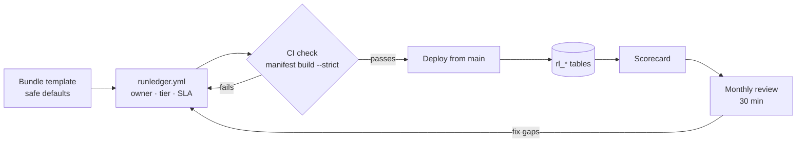

| Rule | In practice |
|---|---|
| **Defaults, not reviews** | A job that uses the template is compliant. Nobody has to sign it off |
| **Strict only where a change hits every job** | Table columns, key formats, the Python API: two approvals. Everything else: a normal PR |
| **Effort matches importance** | `high` jobs get everything. `low` jobs need almost nothing |
| **Measure with our own tables** | One scorecard query instead of audits |

| Risk we're guarding against | What it looks like |
|---|---|
| One change hits every job | A bad release breaks 300 tasks overnight |
| Too many jobs to check by hand | 300 jobs × 5 min = 25 hours, every review cycle |
| Noisy alerts get ignored | 20 false "missed run" alerts a day, so the real one is missed |
| Jobs drift apart | Five SLAs for the same kind of job; three library versions in prod |
| Knowledge in one head | Only one person knows how to release |

**Do these five before the pilot:** name the owners (14.2) · let CI spot risky changes (14.3) ·
pin one version and roll out in stages (14.5) · define job tiers and check them in CI (14.7) · set
permissions and write the emergency runbook (14.6, 14.9).

### 14.2 Who does what

| Role | Who | Owns |
|---|---|---|
| **Product owner** | 1 person + a deputy | Final decisions, scope, sign-off at each phase gate |
| **Maintainers** | at least 2 people | Library, template, releases, schema changes |
| **On-duty** | weekly rotation of maintainers | runledger's own alerts, emergency switches |
| **Job owner** | `owner` in `runledger.yml` | The job's tier, SLA, data checks and alerts |
| **Data owner** *(optional)* | owner of a published dataset | Approves `critical` checks on that dataset |

One person can hold several roles, but every role needs a name. Proposed answer to Q-O3: the
maintainers own the shared schema and the reconciler, deployed once per environment.

**Where an alert goes:**

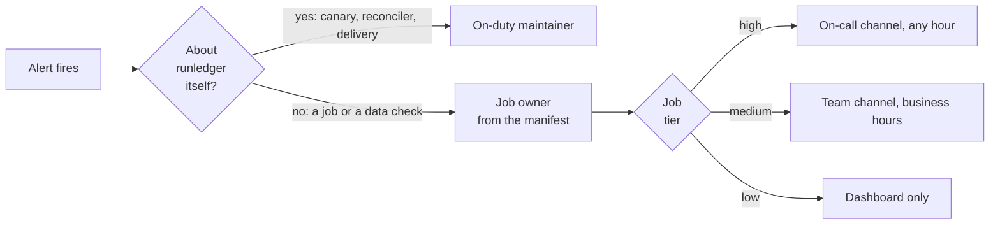

### 14.3 Changing runledger

Every PR is one of three types. Files decide the type, so nobody has to argue about it.

```mermaid
flowchart LR
  PR["PR opened"] --> Q1{"Touches<br/>tests/contracts/?"}
  Q1 -->|yes| C1["Contract change<br/>2 maintainer approvals<br/>+ decision log entry<br/>+ migration note"]
  Q1 -->|no| Q2{"Touches<br/>a default?"}
  Q2 -->|yes| C2["Default change<br/>1 approval + release note"]
  Q2 -->|no| C3["Internal change<br/>normal review"]
```

| Example | Type |
|---|---|
| Rename `failed_rows` to `bad_rows` | Contract |
| Add a new verdict `LATE` | Contract |
| Change how `rule_key` is generated | Contract |
| Flush time limit 30 s → 20 s | Default |
| Shadow period 7 → 14 days | Default |
| Add `password` to the redaction list | Default |
| Refactor the write buffer | Internal |

- **Snapshot tests** in `tests/contracts/` save each contract to a file: table and view columns,
  every status and verdict value, `to_dict()` per rule type, `rule_key` and `definition_hash` for a
  fixed set of rules, config keys, env vars and `runledger --help`.
- **CODEOWNERS** requires two maintainers on `tests/contracts/` and `schema/`. Defaults live in
  `config.py` and the alert SQL, so CODEOWNERS flags those too.
- **A default that would make more jobs fail or alert** ships switched off for one release first.

**Decision records.** Every decision gets an owner and a date. After this review, each one gets a
one-page file in `docs/decisions/`, and the quarterly review checks every *Revisit if* line:

```markdown
# 0007 · Dashboards and alerts read views, never tables
- Status: Decided · Owner: <name> · Date: 2026-12-01
- Decision: dashboards, alerts and saved queries read rl_v_* views only.
- Why: a view can absorb a table change; 300 saved queries can't.
- Revisit if: a view gets too slow for the dashboard.
```

### 14.4 Phase gates

```mermaid
flowchart LR
  P0["Phase 0<br/>spike"] --> G1{{"Gate 1"}} --> MVP["Build<br/>MVP"] --> G2{{"Gate 2"}} --> PI["Pilot<br/>in prod"] --> G3{{"Gate 3"}} --> F["All<br/>jobs"]
```

The product owner signs off each gate when every box is ticked:

| Gate | Pass when |
|---|---|
| **1** | ☐ Every spike item settled or its fallback chosen ☐ D10 decided |
| **2** | ☐ Test tiers 1–3 green ☐ Canary green for 7 days in dev ☐ Pilot jobs' shadow verdicts checked, no unexplained false alarms |
| **3** | ☐ 2+ weeks on pilots with 0 failures caused by runledger ☐ Health targets met (14.10) ☐ A runbook for every alert |

A feature joins a phase only if a pilot job needs it or it fixes a correctness problem. Everything
else waits on the *Later* list.

### 14.5 Releases and rollout

**Schema: add columns, never break them.**

```sql
-- ✅ Fine in any release: add a nullable column
ALTER TABLE ops_prod.runledger.rl_task_runs ADD COLUMNS (client_version STRING);

-- ❌ Major release only, after a deprecation period
ALTER TABLE ops_prod.runledger.rl_validation_results RENAME COLUMN failed_rows TO bad_rows;
```

**Views are what people read.** Tables can change; views stay stable.

```mermaid
flowchart LR
  subgraph CAN["Can change"]
    T[("rl_* tables<br/>add columns only")]
  end
  subgraph STABLE["Kept stable"]
    V["rl_v_* views"]
  end
  T --> V
  V --> D["Dashboards"]
  V --> A["SQL alerts"]
  V --> Q["Saved queries"]
```

**One pinned version for all jobs.**

```yaml
# databricks.yml
variables:
  runledger_version: {default: "0.3.2"}
targets:
  prod:
    variables: {runledger_version: "0.3.1"}   # prod stays one step behind until the pilots pass

# each job (or injected by the bundle mutator in v1)
environments:
  - environment_key: default
    spec:
      dependencies: ["lakehouse-runledger==${var.runledger_version}"]
```

- Upgrade = change one line. Roll back = revert it.
- The new `client_version` column on `rl_task_runs` makes "which jobs run which version" one query.
- We support the latest two minor versions. Anything removed logs a warning for one release first.

**Rollout stages.**

```mermaid
flowchart LR
  M["1 · Add new columns<br/>to tables"] --> S0["2 · Canary + integration tests<br/>must pass"]
  S0 --> S1["3a · Pilot jobs in prod<br/>3–7 days"]
  S0 --> S2["3b · All dev and test<br/>1–3 days"]
  S1 --> S3["4 · All prod jobs"]
  S2 --> S3
```

**Release checklist**
- [ ] Contract snapshot changes reviewed
- [ ] Old library works with the new tables, and so does the new library
- [ ] Release notes list every contract and default change
- [ ] Rollback tested

### 14.6 Emergency switches

```mermaid
flowchart TD
  X["Something is wrong across many jobs"] --> A{"What is happening?"}
  A -->|"jobs fail because of runledger"| R["Roll back runledger_version"]
  A -->|"Delta writes slow or failing"| S["RUNLEDGER_SINKS=stdlog"]
  A -->|"a data check wrongly fails jobs"| E["RUNLEDGER_VALIDATION_ENFORCE=false"]
  A -->|"false missing-run alerts"| H["Put reconciler alerts<br/>back in shadow mode"]
```

| Switch | Who can flip it in prod | Where it shows afterwards |
|---|---|---|
| Roll back `runledger_version` | On-duty | `client_version` |
| `RUNLEDGER_SINKS=stdlog` | On-duty | Gaps in `rl_v_delivery_completeness` |
| `RUNLEDGER_VALIDATION_ENFORCE=false` | On-duty during an incident; otherwise a PR | `effective_policy` on every result |
| `RUNLEDGER_VALIDATION_EVALUATE=false` | PR only | The "dataset not validated in 24 h" alert |
| Reconciler alerts → shadow mode | On-duty | Reconciler config in the bundle |

Every emergency flip gets a follow-up PR within one business day, to undo it or make it permanent.

> **Open (G-Q5):** flipping a switch for every job means redeploying every bundle. With many
> bundles that is slow during an incident. Alternative: a small settings file on a UC Volume that
> every job reads at start-up.

### 14.7 Job tiers

| | `high` | `medium` | `low` *(default)* |
|---|---|---|---|
| Listed in the manifest | ✅ | ✅ | ✅ |
| Owner | ✅ | ✅ | ✅ (bundle default is fine) |
| SLA and grace period | ✅ | ✅ | — |
| Code changes | `@rl.task` + `@rl.step` on publish steps | `@rl.task` or the one-line import | none |
| Data checks | enforced suite\* | trial suite | — |
| Alerts | on-call, any hour | team channel, business hours | dashboard only |

\* At least: schema contract, `row_count(min=…)`, and `not_null` + `unique` on key columns.

```yaml
# runledger.yml
defaults: {owner: data-eng, criticality: low, grace_minutes: 30}

jobs:
  orders_daily:
    criticality: high
    sla_max_duration_minutes: 90
    tasks:
      publish: {expected_datasets: [main.silver.orders]}
    waivers:                     # proposed: a temporary exception, with an end date
      - {requirement: enforced_suite, reason: "tuning thresholds", expires: 2027-01-15}
```

CI blocks the PR when a job doesn't meet its tier *(proposed output)*:

```text
$ runledger manifest build --strict
✗ orders_daily    high job has no sla_max_duration_minutes
✗ prices_eod      exclude has no reason
✗ risk_snapshot   waiver "enforced_suite" expired on 2027-01-15
3 problems. Fix them, or add a waiver with an end date.
```

- **Unclassified jobs default to `low`**, so onboarding 300 existing jobs doesn't wait on
  classifying them. The scorecard lists them until someone does (G-Q4).
- **Prod deploys run from CI on `main` only.** The manifest is synced at deploy time, so a deploy
  from a laptop would record a manifest that matches no commit.

### 14.8 Data check lifecycle

```mermaid
stateDiagram-v2
  [*] --> Trial: new check
  Trial --> Enforced: 7 days and 10 runs, reviewed
  Enforced --> Trial: threshold tightened
  Trial --> Retired: not useful
  Enforced --> Retired: removed
  Retired --> [*]
```

| Stage | Runs? | Can fail the job? | Can alert? |
|---|---|---|---|
| Trial | ✅ | — | — |
| Enforced | ✅ | ✅ | ✅ |
| Retired | — | — | — (history kept under its `rule_key`) |

```python
# New checks go in a trial suite: they run and record, but never fail the job or alert
orders_trial = rl.Suite(
    name="orders_silver_trial", dataset="main.silver.orders",
    policy=rl.ValidationPolicy(enforce=False, notify=False),   # per-suite override
    rules=[c.in_range("amount", min=0, max=1_000_000, key="orders.amount.range")],
)
```

- **Explicit `key`** on `error` and `critical` checks, named `<dataset>.<column>.<check>`. A
  generated key changes when a column is renamed, which splits the history ([§10](#10-data-validation)).
- **`critical` stops downstream tasks.** Say why in the PR; the data owner approves.
- **Loosening** a threshold can skip trial. **Tightening** can't.
- **On trial for 30+ days?** Promote it or delete it:

```sql
SELECT rule_key, dataset, min(evaluated_at) AS first_seen
FROM rl_validation_results
GROUP BY rule_key, dataset
HAVING min(evaluated_at) < now() - INTERVAL 30 DAYS
   AND NOT max_by(effective_policy.enforce, evaluated_at);   -- latest result is still on trial
```

### 14.9 Permissions and data

**A job can report on itself, but can't change what was expected of it or the verdict about it.**

```mermaid
flowchart LR
  J["Jobs<br/>group runledger-writers"] -->|append| R[("rl_task_runs · rl_events · rl_metrics<br/>rl_validation_results · rl_validation_samples")]
  S["Setup job"] -->|append| M[("rl_manifest")]
  C["Reconciler"] -->|append| O[("rl_slot_observations")]
  M -.->|read| C
  R --> V["rl_v_* views"]
  M --> V
  O --> V
  V -->|SELECT| U["Engineers and quants<br/>group runledger-readers"]
  R -.->|samples only| K["group runledger-sample-readers"]
```

```sql
GRANT USE CATALOG ON CATALOG ops_prod TO `runledger-writers`;
GRANT USE SCHEMA ON SCHEMA ops_prod.runledger TO `runledger-writers`;
GRANT MODIFY, SELECT ON TABLE ops_prod.runledger.rl_events TO `runledger-writers`;
GRANT SELECT ON TABLE ops_prod.runledger.rl_v_task_runs TO `runledger-readers`;
```

- **One catalog per environment** (`ops_dev`, `ops_prod`), so dev jobs can't write to the prod ledger.
- **Grant to groups**, never to individuals. Setup and migrations run as `runledger-admins`.
- The reconciler needs read access to Jobs and system tables.

`MODIFY` also allows updates and deletes (claim C7, Q-G6). Two cheap guards:

| Guard | How |
|---|---|
| **Detect** | Weekly, run `DESCRIBE HISTORY` on each table and flag anything that isn't an append, `OPTIMIZE` or the retention job |
| **Prevent** (only if Q-G1 needs tamper-proof records) | `SET TBLPROPERTIES ('delta.appendOnly' = 'true')` on runs, results, manifest and observations. Test it in the Phase 0 spike first |

**How long we keep data** (until Q-G1 and Q-G2 are answered):

| Table | Keep | Who can read |
|---|---|---|
| Runs, validation results, observations, metrics | 13 months (allows year-over-year) | all readers |
| `rl_events` | 90 days | all readers (sensitive keys redacted) |
| `rl_validation_samples` | 14 days | restricted group only |
| `rl_manifest` | forever (it is small) | all readers |

Failing-row samples are off in prod unless `sample_columns` lists the columns that may be stored.

### 14.10 Health targets and alert rules

| Health target for runledger itself | Goal |
|---|---|
| Canary last ran | < 30 min ago |
| Reconciler last ran | < 30 min ago |
| Rows delivered to the tables | ≥ 99.9% per day |
| Job failures caused by runledger | 0 |
| Alerts later proven wrong (superseded) | < 1% per week |

- One SQL alert per destination, filtered by owner and tier.
- Every alert links a runbook. Step 1 is always `runledger reconcile explain <slot_key>` or the
  failing `rule_key`.
- An alert that fires 3+ times in a week with no action gets its SLA or threshold reviewed.

### 14.11 The scorecard

One view, `rl_v_governance_scorecard`, and one dashboard page. An example of what it would show:

| Check | This week | Target |
|---|---|---|
| Prod jobs in no manifest | 3 | 0 |
| Jobs still on the default tier | 212 | going down |
| `high` / `medium` jobs with no SLA | 4 | 0 |
| `high` jobs with no runledger code | 1 | 0 |
| `high` datasets not validated in 24 h | 0 | 0 |
| Checks on trial for 30+ days | 6 | 0 |
| Checks that errored in the last 7 days | 2 | 0 |
| Jobs on an unsupported library version | 9 | 0 |
| Expired waivers | 1 | 0 |
| Unexpected updates or deletes on `rl_*` | 0 | 0 |
| Most alerts for one job this week | 5 | ≤ 3 |

The first row matters most: it is the only way to catch jobs created outside a bundle.

### 14.12 Calendar

| When | Who | What | Time |
|---|---|---|---|
| Every PR | CI | DDL drift, banned APIs, contract snapshots, compatibility tests, `manifest build --strict` | automatic |
| Weekly | On-duty | runledger alerts, noisy alerts, unexpected writes | 15 min |
| Monthly | Maintainers + job owners | Scorecard: promote or delete trial checks, classify jobs, close waivers | 30 min |
| Quarterly | Product owner + maintainers | *Revisit if* lines, supported versions, retention, health targets | 45 min |
| Each release | Maintainers | Release checklist and rollout stages | — |

---

# Part 4 · Plan

## 15. Build vs adopt

Build only what isn't already available. Please correct anything here that's wrong.

| Existing option | What it gives us | Gap for our needs | Proposed use |
|---|---|---|---|
| **System tables** (`system.lakeflow.*`) | Job, task and run history, from the platform | No app events, metrics or validation; may lag (to verify) | **Reuse:** reconciler backfill, crash inference, job names in views |
| **Native notifications, retries, `run_if`** | Alerts and recovery when a task fails | Nothing on data quality or runs that never happened; no history to query | **Keep:** check failures surface as task failures |
| **LDP expectations** | Row-level checks in pipelines, results in the event log | Pipelines only; row-level only | **Integrate:** export our rules, ingest the event log ([§11](#11-lakeflow-declarative-pipelines)) |
| **Databricks Labs DQX** | PySpark quality rules, valid/invalid split, YAML checks, profiling | Unclear: severity policy, task context, single-pass cost, results schema, long-term support | **Evaluate in the spike:** could be our rule engine (D10) |
| **Lakehouse Monitoring** | Table profiling, drift, freshness, completeness | Table-centric, not run-centric; doesn't fail a task | **Complement:** link from the dashboard; may feed anomaly rules later |
| **Great Expectations, Soda** | Mature data-quality ecosystems | Heavier setup; separate results store; no workflow context | Only if the team already uses one |
| **OpenTelemetry or an existing stack** | Central traces and logs | Not queryable next to the data in UC | **Later:** an exporter, if a central tool is required |

### D10: who runs the rules?

| Option | We own | For | Against |
|---|---|---|---|
| **(a) Build** our own compiler | Rule API, engine, results, policy | Single-pass cost control; exactly the result shape alerts need; our error semantics | About 2–3 more engineer-weeks; we maintain it |
| **(b) Wrap DQX** | Context, storage, policy | Saves about 2–3 engineer-weeks; a mature rule set (claim C6) | An external dependency; fit unclear on severity, single pass and gating |
| **(c) Our API, swappable engine** | Rule API, result format, policy; DQX can be one engine | Keeps both doors open | An abstraction layer to maintain |

**Recommendation:** a one-day, time-boxed comparison in the Phase 0 spike, built against our real
needs on a real table: result format, error semantics, blocking before the write, support on
serverless, classic and LDP, and total cost. Not just "five rules".

## 16. Roadmap

```mermaid
flowchart LR
  P0["Phase 0 · spike<br/>~1 week"] --> MVP["MVP 0.1<br/>~7–9 weeks"] --> PI["Pilot<br/>2–3 pipelines<br/>~2 weeks"] --> V1["v1.0<br/>~6–8 weeks"] --> L["Later"]
```

Effort is for one experienced engineer, assuming the spike finds no surprises. The MVP is about
2–3 weeks shorter if DQX is wrapped (D10), and grew after review round 1. The pilot overlaps v1.
Please sanity-check these numbers.

### Phase 0: one-week spike

Settle these on real serverless, classic and LDP compute before freezing the MVP. Every item has a
fallback, so none blocks the design. Findings go into `docs/platform-notes.md`.

| Item | How to verify | Fallback |
|---|---|---|
| Dynamic value reference names (`{{job.run_id}}`, `{{task.run_id}}`, repair count); can a job-level param use `{{task.*}}`? | A bundle job that prints its widgets and argv, on serverless and classic | Per-task parameters, injected by the mutator |
| Context auto-detection on serverless (`dbruntime`, `DATABRICKS_RUNTIME_VERSION`) | The same job logs its detection results | Parameters only |
| `writeTo().append()` with `txnAppId`/`txnVersion` on UC managed tables under Spark Connect (C12) | Write the same batch twice; count the rows | A dedup view |
| `parse_json` staging into `VARIANT` | Append a staged batch; read it back | STRING columns + `parse_json` in views |
| Commit latency for 1–4 small appends on serverless | Time it | Finish-only mode for very short tasks |
| Notebook end hooks: IPython `set_custom_exc`; how `dbutils.notebook.exit` is classified | Notebooks that succeed, raise and exit | Require `rl.finish()` in notebooks |
| `spark.sql(q, df=df)` under Spark Connect | Run a custom SQL rule | Register a temp view instead |
| LDP event-log JSON paths; metrics for `expect_or_fail` (C4) | A pipeline with a failing `expect_or_fail`; inspect `flow_progress` | NULL + `unavailable_reason` |
| System-table lag; `result_state` for skipped and upstream-failed tasks (C9) | Compare with the Jobs API over a day | Jobs API only |
| `bundle validate -o json` shape; Python mutators; the DAB `alerts` resource | CLI version check + a sample bundle | Manifest from YAML; alerts created by an SDK task |
| Rule-error isolation: preflight with no Spark job; ANSI runtime errors (C1) | A suite with one rule that fails analysis and one that fails at runtime | A runtime error marks the whole suite `ERROR` |
| Flush time budget: can a flush be abandoned mid-write under Connect? Is a background flusher needed? | Abandon a flush; check a late commit + replay leaves no duplicates | Synchronous flush with a documented worst case |
| Partial delivery and a lost acknowledgment | Fail one of two table writes; drop an ack and replay | Dedup and completeness views only |
| How repairs appear in the Jobs API and system tables (C8) | Fail → repair → success; inspect run ids and attempt numbers | Effective attempt by latest start time |
| Write-audit-publish mechanism | Staging + `INSERT OVERWRITE` vs shallow-clone swap on one table | Staging + publish |
| `delta.appendOnly` with liquid clustering and predictive optimization (§14.9) | Set it; run `OPTIMIZE` and the retention job | The weekly history check only |
| How long a fleet-wide redeploy takes (G-Q5) | Time a redeploy of every bundle | A shared settings file |
| **DQX comparison (D10)** | Build each option against the criteria in [§15](#15-build-vs-adopt) | Decide (a), (b) or (c) |
| Platform claims C1–C12 not settled in the review | See [§22](#22-platform-claims-to-settle) | See §22 |

### MVP (0.1)

| Area | Scope |
|---|---|
| Core | Ledger, spans, events, metrics, ambient logger, redaction, fingerprints, delivery health |
| Context | Explicit + params + env + basic detection |
| Sinks | Console, stdlog, memory, Delta (buffered, retried, idempotent, schema-checked, circuit breaker) |
| Tables | Task runs, events, metrics, validation results, manifest, slot observations, and their views |
| Validation | 7 rules (schema, not_null, unique, row_count, accepted_values, in_range, expr); one pass with error isolation; severity policy; evaluate/enforce/notify; `rule_key` + `definition_hash`; scope; `suite.explain` |
| Easy layer | `import lakehouse_runledger.auto`, `@rl.task`, `@rl.step` (sync), `@rl.expect`, `@rl.expect_input`, logging bridge |
| Missing runs | Manifest build + sync; reconciler on the Jobs API with the evidence model (7 verdicts: MISSED_SCHEDULE, EXCLUDED, UPSTREAM_FAILED, FAILED_BEFORE_INIT, UNINSTRUMENTED, TELEMETRY_GAP, OBSERVATION_INCOMPLETE); shadow mode; `reconcile explain`; `rl_v_expected_vs_actual`. In the MVP because it is the zero-code entry point |
| Visible for pilots | Coverage view, one alert (expected run missing or failed before init), canary, a recurring smoke test on serverless and classic |
| Tooling | CLI `ddl` and `doctor`; minimal bundle (schema, setup job, example job) |
| Governance (proposed) | Snapshot tests + CODEOWNERS; `client_version`; `runledger_version` + rollout stages; grants; tiers + `manifest build --strict`; views-only reads; emergency runbook |

### v1.0

| Area | Scope |
|---|---|
| Validation | freshness, matches, stat_bounds, sql, reconcile, references; samples table and `split()`; write-audit-publish (MVP candidate); task values; cost controls |
| Run records | Async decorators; `validation_summary` rollup; thread executor; SDK enrichment; spill and recovery |
| LDP | Expectations export, aggregate checks, event-log ingestion; evaluate the pipeline-events system table |
| Missing runs | `SLA_BREACH`, `CRASHED`, system-table backfill and crash inference; `manifest add` for non-bundle jobs |
| Easy layer | `cell_spans`, `%%rl_step`, the bundle mutator |
| Bundle | Dashboard, full alert set, maintenance job; published `Notifier` protocol |
| Testing | The Tier 4 CI matrix ([§17](#17-testing)) |
| Governance (proposed) | Scorecard, waivers, alert routing by owner and tier, retention + history check, lint for explicit rule keys |

### Later

YAML and table-driven suites with a `run-suite` task · webhook notifiers (Teams, Slack, email) ·
`ZerobusSink` and `StatementApiSink` · OpenTelemetry export · anomaly rules from history ·
background flusher · Lakehouse Monitoring interop · governance: a shared settings file for emergency
switches (if G-Q5), automatic exclusion of PII-tagged columns from samples, per-team schemas if a
second team adopts runledger.

### First implementation steps (after the review and the spike)

1. Packaging: `pyproject.toml`, src layout, ruff and pytest config, CODEOWNERS, `tests/contracts/`.
2. `schema/tables.py` and `ddl.py` first: everything else derives from them.
3. `config.py` and `context/`, with unit tests.
4. `core/`: records, spans, ledger, buffer, lifecycle, tested with `MemorySink`.
5. Console, stdlog and Delta sinks, with the Tier 2 tests.
6. `validation/` for the MVP rules.
7. The minimal bundle, run on a workspace (needs workspace access).

## 17. Testing

```mermaid
flowchart LR
  T1["Tier 1 · Unit<br/>no Spark<br/>every commit"] --> T2["Tier 2 · Local Spark<br/>pyspark 3.5 + 4.x<br/>delta-spark"] --> T3["Tier 3 · Spark Connect<br/>pyspark --remote local"] --> T4["Tier 4 · Databricks<br/>bundle target -t it"]
```

| Tier | Covers |
|---|---|
| **1 · Unit** | Config precedence and provenance · each context provider (fake env, argv, widgets, conf) · redaction, caps, fingerprint stability · flush triggers (fake clock + `MemorySink`) · retry classification, circuit breaker · lifecycle hooks · rollup (caught child failure leaves the parent SUCCEEDED; quality separate) · Hypothesis round-trips for rules and suites, `rule_key` stability, `definition_hash` changes · golden compiler output · evaluate and policy, including fail-closed and every evaluate/enforce/notify combination · uniqueness on `[A, A, B]` · LDP mapping (`error` never becomes drop without opt-in; `mostly` rejected) · reconciler verdicts from recorded evidence (late downstream task, excluded failure handler, partial scan, late evidence superseding, repaired run) · DDL drift · contract snapshots |
| **2 · Local Spark** | Real aggregation semantics (NULLs, uniqueness, freshness across timezones, reconcile) · appends to local Delta · refusing to create a missing table · txn duplicate suppression · VARIANT staging · the sampling pass · a rule that fails at runtime while the others still report · partial delivery and replay after a lost ack (no duplicates; completeness view right) · old and new clients after an additive migration · write-audit-publish: a failed audit leaves the target unchanged |
| **3 · Spark Connect** | The Tier 2 write and validation tests, re-run through a Connect session |
| **4 · Databricks** | **Matrix:** serverless notebook + wheel; classic DBR 15.4 LTS and the latest LTS; serverless LDP pipeline + ingest. **Scenarios:** success, raise, validation error and critical, `dbutils.notebook.exit`, `os._exit(1)`, cancelled run. A final `run_if: ALL_DONE` task asserts rows exist with context from params, crashes show as UNFINISHED or CRASHED, no duplicate event ids, commits within budget. **Missing runs:** broken library install, task excluded by `run_if`, paused job, fail → repair → success (job ends green), sink outage during a good task (`TELEMETRY_GAP`, not FAILED); verdicts appear within one reconcile interval and don't change on re-run without new evidence. **Ease of use:** a fresh notebook with only the one-line import, and a decorated wheel, produce complete rows with no other config |

**Performance gate:** 10k events plus a 10-rule suite on 10M rows. Validation takes one Spark job
when every rule passes, and commits stay within budget.

## 18. Risks

| Risk | Mitigation |
|---|---|
| Serverless context detection is unreliable | Params come first; `doctor` warns when they're missing |
| `VARIANT` staging or txn idempotency fails under Spark Connect | Each has a fallback in the spike |
| Commit latency: 2–4 commits per task, about 3–10 s on serverless | `lifecycle_mode="finish_only"` for very short tasks, at the cost of crash visibility |
| Small files at high concurrency | Predictive optimization or auto-compaction (Q-E6) |
| PII in samples and messages | Samples off in prod or a column allow-list; restricted grants; 14-day retention; redaction |
| pyspark 3.5 (15.4 LTS) vs 4.x (serverless) | CI tests both |
| Every job's run-as principal needs `MODIFY` | A writers group; setup runs as a privileged principal ([§14.9](#149-permissions-and-data)) |
| Reconciler accuracy: cron vs actual trigger times, non-cron triggers, timezone and DST edges, paused jobs | "At least one run per N hours" SLAs for non-cron jobs; the evidence model; Tier 4 scenarios |
| A false "failed" or "missed" verdict destroys trust | Confidence levels, shadow mode, explanations, the canary |
| Decorator magic vs explicitness | Decorators are thin wrappers over the explicit API |
| Cost of rule-error isolation | The bisect is capped; preflight catches most errors without a Spark job |
| Shared tables aren't write-only (C7) | Detect and prevent guards; per-team schemas only if needed (Q-G6) |
| Validated data differs from published data | The write-audit-publish gate |
| One bad release hits every job | Pinned version, rollout stages, emergency switches ([§14](#14-governance)) |
| A small team maintaining a custom library | At least two maintainers; scope control at phase gates; D10 |

---

# Part 5 · For the review

## 19. Where I'm least confident

Please push on these.

| # | Concern | The question |
|---|---|---|
| 1 | **Commit latency on short tasks** | STARTED + FINISHED is at least two commits, about 3–10 s on serverless. Acceptable for tasks that run in seconds? The alternative, finish-only mode, gives up crash visibility (Q-S4) |
| 2 | **Small files at high concurrency** | Many tasks appending small batches relies on predictive optimization or auto-compaction. Is predictive optimization on for us? (Q-E6) |
| 3 | **Notebook end-of-run hooks** | The most fragile part of the one-liner. If unreliable, notebooks need an explicit `rl.finish()`, which raises the barrier |
| 4 | **Reconciler accuracy** | Cron slots are easy. File-arrival, continuous and externally triggered jobs are not, and false "missed" alerts hurt trust fast (Q-E11) |
| 5 | **Decorators that run Spark jobs** | `@rl.expect` validates when the function returns. Is it the right *default* for validation, or should it be reserved for observing? |
| 6 | **MVP scope** | It grew after review round 1. Too big? The first cuts would be the rarer reconciler verdicts or the logging bridge |
| 7 | **Cost of rule-error isolation** | The bisect is capped at 3 extra passes. Acceptable on our largest tables (Q-S3), or should a runtime error mark the whole suite `ERROR`? |

## 20. Decision log

**Decided:** set by the product owner; revisit only with a strong reason. **Proposed:** a design
choice to challenge. **Open:** needs answers from [§21](#21-questions-about-our-needs).
Fill in **Owner** during the review (§14.3).

| # | Decision | Status | Why | Revisit if… | Owner |
|---|---|---|---|---|---|
| D1 | A new package; the old `databricks_event_logger` is a feature reference only | Decided | The old design had structural limits: one INSERT per event, one wide table, validation only in docs | — | |
| D2 | Sinks: console, stdout/logging, UC Delta, plus a pluggable interface | Decided | Dev ergonomics plus a durable store | — | |
| D3 | Alerting is Databricks-native first (SQL Alerts, dashboard); webhooks later through a `Notifier` seam | Decided | No secrets or egress needed in tasks; one place to manage alerts | Alerts must arrive in under a minute; owners outgrow a handful of alert destinations | |
| D4 | Validation is built in and Python-first; YAML suites later | Decided | Lowest barrier for engineers; rules stay serializable | Data stewards own the thresholds (Q-V3) | |
| D5 | Missing-run detection through a bundle-generated manifest and a reconciler | Decided | Covers failures the library can never see | Jobs are mostly triggered from outside Databricks (Q-E11) | |
| D6 | One table per kind of record instead of one wide table | Proposed | Typed evidence, simpler alert SQL, different retention and grants per table | The team prefers one table | |
| D7 | Append-only writes; current state from views; no MERGE on the hot path | Proposed | Hundreds of concurrent tasks never conflict; a crash can't leave a half-updated row | — | |
| D8 | Writes via `createDataFrame` + `writeTo().append()`, buffered, with a stable per-table batch identity, per-table acks and a time budget per flush | Proposed | Runs on the task's own compute and identity; Spark Connect-safe; logging can't stall the job | Commit latency is too high, or a flush can't be abandoned safely | |
| D9 | Context mainly from job parameters; auto-detection as fallback | Proposed | Dynamic references behave the same on all compute | The spike shows auto-detection is reliable on serverless | |
| D10 | Rule engine: (a) build, (b) wrap DQX, or (c) our API with a swappable engine | **Open** | Control over cost, typed results, error semantics, severity policy | The DQX comparison shows it meets result format, error semantics and gating needs | |
| D11 | Minimum DBR 15.4 LTS, because `VARIANT` needs it | **Open** | Free-form fields without JSON strings | Older runtimes are in use (Q-E3) | |
| D12 | Naming: install `lakehouse-runledger`, import `lakehouse_runledger`; CLI, `rl_` tables and `RUNLEDGER_*` use the short name | Proposed | Short names where people type or query them | — | |
| D13 | Three separate statuses: execution, quality, telemetry completeness | Proposed | Repairs, caught failures, trial mode and sink outages each made one status misleading | — | |
| D14 | The reconciler's evidence model: confidence per verdict, `TELEMETRY_GAP`, superseding observations, shadow mode, canary | Proposed | False "failed" or "missed" verdicts would destroy trust | Too complex for the MVP; could ship with fewer verdicts | |
| D15 | In LDP, severity and action are separate: `error` fails the update; dropping rows needs opt-in; aggregate checks observe | Proposed | Reusing a suite must never quietly turn "reject" into "delete" | — | |
| D16 | Gate writes with write-audit-publish: check the exact Delta version that will be published | Proposed | Checking a DataFrame then writing it can check different data | Teams find a staging step too heavy; it could stay opt-in | |
| D17 | Governance through defaults and CI: named roles, PR types spotted by snapshot tests, one pinned version rolled out in stages, job tiers checked in CI, grants model, scorecard ([§14](#14-governance)) | Proposed | A small team can't check hundreds of jobs by hand | A second team with separate permissions adopts runledger | |

## 21. Questions about our needs

Each answer changes part of the plan. Capture answers live in the **Answer** column.

### Scale and workload

| # | Question | Why it matters | Answer |
|---|---|---|---|
| Q-S1 | How many jobs and tasks run per day? Peak number running at once? | Commit volume, small files, whether batching is enough or a streaming sink (Zerobus) is needed | |
| Q-S2 | Mix of task types: notebooks, wheels/scripts, SQL, dbt, LDP, `run_job` chains? | Where the one-liner vs decorators matter; SQL and dbt tasks get manifest coverage only | |
| Q-S3 | Typical and largest row counts of datasets we'd validate? | Exact vs approximate uniqueness, partition filters, whether one pass stays cheap | |
| Q-S4 | How short are the shortest tasks? | Whether commit latency matters (§19, item 1) | |
| Q-S5 | Any streaming or continuous workloads? | A continuous job never "finishes"; periodic flushing | |

### Platform and environment

| # | Question | Why it matters | Answer |
|---|---|---|---|
| Q-E1 | Which cloud? How many workspaces (dev/test/prod)? Do they share a metastore? | One shared `rl_*` schema vs one per workspace; cross-workspace dashboards | |
| Q-E2 | Is Unity Catalog enabled everywhere? Any Hive-metastore-only jobs? | The design assumes UC managed tables | |
| Q-E3 | Which DBR versions are in use? Is serverless approved for jobs? | The 15.4 LTS floor (D11); pyspark 3.5 vs 4.x testing | |
| Q-E4 | Classic clusters: dedicated or standard access mode? | Standard mode has Spark Connect-like limits that affect context detection | |
| Q-E5 | Are system tables (`system.lakeflow`, `system.access`) enabled and readable by a service principal? | Reconciler backfill, crash detection, job names | |
| Q-E6 | Is predictive optimization enabled on the target catalog? | Small-file handling (§19, item 2) | |
| Q-E7 | Is a serverless SQL warehouse available for alerts and dashboards? | Alerts and the dashboard need one | |
| Q-E8 | Are bundles the standard for deploying jobs? What share is bundled vs UI or Terraform? | The manifest comes from bundles; other jobs need `manifest add` | |
| Q-E9 | Which CI/CD: GitHub Actions, Azure DevOps, other? | Where DDL drift, contract snapshots, integration tests and `--strict` run | |
| Q-E10 | How are internal Python packages distributed: private PyPI/Artifactory, a UC Volume wheel, workspace files? Can jobs reach PyPI? | How teams install the library; pinning `runledger_version` | |
| Q-E11 | Is anything outside Databricks triggering jobs (ADF, Airflow, Control-M, an API)? | Missing-run detection needs the real schedule owner | |

### Data quality

| # | Question | Why it matters | Answer |
|---|---|---|---|
| Q-V1 | Which checks matter most today: nulls, duplicates, row counts, freshness, reconciliation to source, schema drift, business rules? | Order of the MVP rule set | |
| Q-V2 | What data-quality tooling exists already (DQX, Great Expectations, LDP expectations, custom)? | Build vs wrap (D10) and migration effort | |
| Q-V3 | Who owns rules and thresholds: engineers in code, or stewards and analysts? | If stewards, YAML or table-driven suites move up from Later; who approves `critical` (G-Q6) | |
| Q-V4 | When a critical check fails, should downstream tasks always stop, or sometimes continue with a flag? | Default severity policy; condition tasks | |
| Q-V5 | Is reconciliation against source systems a core need? | `reconcile` might move from v1 into the MVP | |
| Q-V6 | Should failing-row samples be stored at all? | PII exposure vs debugging value | |

### Governance and security

| # | Question | Why it matters | Answer |
|---|---|---|---|
| Q-G1 | Any regulatory or audit requirements for keeping run and validation evidence (how long, tamper-proof)? | Retention; whether to set `delta.appendOnly` (§14.9) | |
| Q-G2 | What data classification applies to log contents? Can messages or samples hold PII? | Redaction rules, sample defaults, grants | |
| Q-G3 | Who should read the `rl_*` tables: all engineers, owners only, auditors? | Grants; row filters | *Proposed:* everyone reads views; samples restricted (§14.9) |
| Q-G4 | Which identity do jobs run as: a service principal per team, or shared? | `MODIFY` grants; reconciler permissions | *Proposed:* whatever they are, grant to one writers group |
| Q-G5 | Is outbound network access from jobs allowed (for future webhooks)? | Whether in-task webhooks are viable | |
| Q-G6 | Shared tables mean every producing job has `MODIFY` and could change others' rows (C7). Acceptable, or per-team schemas with union views? | Grants model and template layout | *Proposed:* accept, with the detect and prevent guards (§14.9) |

### Alerting and operations

| # | Question | Why it matters | Answer |
|---|---|---|---|
| Q-O1 | Who receives alerts (team channels, on-call, email), and through which tool (Teams, Slack, PagerDuty, ServiceNow)? | Notification destinations; whether a webhook notifier is needed early | |
| Q-O2 | What alert latency is acceptable: minutes, or hourly? | Alert schedules; reconciler frequency | |
| Q-O3 | Who owns the shared `rl_*` schema and the reconciler: a platform team or each domain team? | Central vs per-team deployment | *Proposed:* the maintainers, one deployment per environment (§14.2) |
| Q-O4 | Is there an existing alert-fatigue problem? | Default alert set and thresholds | |

### Adoption

| # | Question | Why it matters | Answer |
|---|---|---|---|
| Q-A1 | How many teams and engineers would adopt it? Notebook-first or package-first? | Where to invest: the notebook one-liner or decorators | |
| Q-A2 | Is there a standard job or bundle template teams already copy? | The best place to ship the zero-wiring setup | |
| Q-A3 | Which two or three pilot pipelines, and what does success look like for them? | MVP acceptance criteria | |
| Q-A4 | Do teams follow a logging standard (stdlib `logging` with a set format)? | The logging bridge might deliver most of the value on day one | |

### Governance model

| # | Question | What the answer changes | Answer |
|---|---|---|---|
| G-Q1 | Who is the product owner? Who are the two or more maintainers? | Every approval needs a name | |
| G-Q2 | Does our team own every job, or do other teams own some? | One team: shared tables and one alert channel are fine. Several: routing and Q-G6 matter more | |
| G-Q3 | Roughly how many bundles hold the jobs? | Whether one version variable and redeploy-based switches are practical | |
| G-Q4 | Default tier `low` (quiet) or `medium` (safer, noisier)? | How many alerts on day one | |
| G-Q5 | Emergency switches by redeploy, or a shared settings file read at start-up? | Incident speed vs one extra read per task | |
| G-Q6 | Who approves `critical` checks: engineers or data owners? | Who reviews rule changes (same as Q-V3) | |

## 22. Platform claims to settle

The round 1 reviewer cited documentation for these, but none has been checked on our workspace.
Settle what we can in the review; the rest goes to the spike.

| # | Claim | Our confidence | If false | How to check |
|---|---|---|---|---|
| C1 | Serverless runs with ANSI SQL mode on, so bad casts and overflows raise instead of returning NULL ([docs](https://docs.databricks.com/aws/en/compute/serverless/limitations)) | Medium | Runtime errors are rarer; bisect still needed on classic with ANSI on | `SELECT CAST('x' AS INT)` on serverless vs classic; read `spark.sql.ansi.enabled` |
| C2 | Serverless job queries have no execution timeout by default (same page) | Medium | Less risk of an unbounded flush; the time budget stays | Docs; default `STATEMENT_TIMEOUT` for jobs |
| C3 | DataFrame caching works on serverless as a preview, environment v5+ ([docs](https://docs.databricks.com/aws/en/compute/serverless/dataframe-cache)) | Low: the plan assumes no cache | Keep "no cache"; if true, offer opt-in caching and revisit the env v2+ floor | `df.cache()` on env v4 vs v5 |
| C4 | `expect_or_fail` expectations don't record the normal metrics in the event log ([docs](https://docs.databricks.com/aws/en/ldp/expectations#expectation-tracking-metrics)) | Medium | Ingestion can report counts for failed updates | A pipeline with a failing `expect_or_fail`; inspect `flow_progress` |
| C5 | A regional pipeline-events system table exists (Beta) ([docs](https://docs.databricks.com/aws/en/ldp/monitor-and-query-events)) | Low | Keep per-pipeline event-log publishing | Check availability in our region and metastore; compare latency |
| C6 | DQX provides per-check summary metrics, fingerprints, stored results and a Beta `FailPipeline` action ([metrics](https://databrickslabs.github.io/dqx/docs/guide/summary_metrics/), [actions](https://databrickslabs.github.io/dqx/docs/guide/actions_and_alerts/)) | Low: not evaluated yet | Strengthens option (a) for D10 | Part of the D10 comparison |
| C7 | UC `MODIFY` permits updates and deletes, so a shared table isn't write-only between teams ([docs](https://docs.databricks.com/aws/en/data-governance/unity-catalog/access-control/privileges-reference)) | High | Shared tables are fine as planned | Docs; Q-G6 decides what we do |
| C8 | Repairs re-run tasks inside the original job run: same job run id, new task run ids ([docs](https://docs.databricks.com/api/jobs/v2/repair)) | High | The effective-attempt logic keys on something else | Spike: fail → repair → success; inspect the ids |
| C9 | "Excluded by `run_if`" and "upstream failed" are distinct task states in the Jobs API and system tables ([docs](https://docs.databricks.com/aws/en/jobs/run-if)) | Medium | The reconciler reports both as "not run" | Spike: a job with a failure-handler task; inspect `result_state` and `termination_details` |
| C10 | The default `run_if` is ALL_SUCCESS, so a task after a failed pipeline is skipped unless it uses ALL_DONE (same page) | High | No change needed; ALL_DONE is harmless | Docs |
| C11 | Concurrent metadata changes (`ALTER TABLE ADD COLUMNS`) can fail concurrent blind appends ([docs](https://docs.databricks.com/aws/en/optimizations/isolation)) | High | The retry rule for metadata conflicts isn't needed | Docs; spike during the migration test |
| C12 | Delta skips a batch whose `(txnAppId, txnVersion)` it already committed; keeping that identity stable is the writer's job ([docs](https://docs.databricks.com/aws/en/structured-streaming/delta-lake#use-foreachbatch-for-idempotent-table-writes)) | High for `foreachBatch`; **unverified for batch `writeTo` under Connect** | Fall back to dedup views | Spike: write the same batch twice; count rows |

Older plan claims already on the spike list: `VARIANT` needs DBR 15.3+ (the 15.4 LTS floor) · the
dynamic value reference names · whether a job-level parameter can use `{{task.*}}` · the IPython
exception hook and `dbutils.notebook.exit` · the DAB `alerts` resource and Python mutators.

## 23. Review round 1: what changed

An external architecture review (Codex) raised 17 challenges (A1–A17) and 7 ideas (B1–B7). This is
what each changed, so the session can confirm or overturn it.

| Ref | Finding | Outcome | What changed | Where |
|---|---|---|---|---|
| A1 | One combined aggregation can't isolate a failing rule | Accepted | Preflight; bisect on runtime errors (capped); fail closed | [§10](#10-data-validation) |
| A2 | In LDP, reusing a suite turned `error` into dropping rows | Accepted | Severity separate from LDP action; dropping needs opt-in; `mostly` rejected | [§11](#11-lakeflow-declarative-pipelines) |
| A3 | Aggregate checks in LDP don't gate publication | Accepted | Labelled observational; gate with a task or write-audit-publish | [§11](#11-lakeflow-declarative-pipelines) |
| A4 | Ingestion skipped failed pipeline runs; unrecorded counts | Accepted | `run_if: ALL_DONE`; update errors ingested; NULL + reason, not 0 | [§11](#11-lakeflow-declarative-pipelines) |
| A5 | Missing telemetry ≠ crash or failed-before-init | Accepted | Evidence model with confidence; `TELEMETRY_GAP`; canary as evidence | [§12](#12-missing-run-detection) |
| A6 | Not every task starts in the job's window; failure handlers are excluded on good runs | Accepted | Slot → job run → task eligibility; `EXCLUDED`, `UPSTREAM_FAILED`, `PENDING`, `OBSERVATION_INCOMPLETE` | [§12](#12-missing-run-detection) |
| A7 | Late evidence; keys lacked the workspace | Accepted | Workspace-qualified keys; dated manifest versions; superseding observations | [§12](#12-missing-run-detection), [§13](#13-storage-views-dashboard-and-alerts) |
| A8 | "Worst status ever" mishandles repairs and caught exceptions | Accepted | Effective attempt; only uncaught failures propagate; separate quality status | [§7](#7-run-records) |
| A9 | Txn dedup ≠ complete delivery; a process id broke replay | Accepted | Stable batch identity per table; per-table acks; completeness view | [§9](#9-writing-to-delta) |
| A10 | Logging could block; the 60 s interval only fires on a log call | Accepted | Time budget per flush; buffer byte cap; durability stated honestly | [§9](#9-writing-to-delta) |
| A11 | Additive migrations could disable older clients | Accepted | Compatibility = "has at least my columns"; migration order; retryable conflicts | [§9](#9-writing-to-delta) |
| A12 | Samples could leak through fallback logs and spill; `MODIFY` isn't write-only | Accepted | Samples never in fallback; spill has the same controls; Q-G6 | [§9](#9-writing-to-delta), [§14](#14-governance) |
| A13 | "Failed rows" is ambiguous for uniqueness; approx can't prove zero | Accepted | Three uniqueness numbers with a named basis; approx observational only | [§10](#10-data-validation) |
| A14 | Validated data may not equal published data | Accepted, extended | Write-audit-publish gate (v1, MVP candidate) | [§10](#10-data-validation) |
| A15 | Trial mode, evaluation and alerting were conflated | Accepted | Separate `evaluate` / `enforce` / `notify`; effective policy stored; alerts filter on it | [§10](#10-data-validation) |
| A16 | The DQX comparison was too narrow | Accepted | D10 widened to three options with full criteria | [§15](#15-build-vs-adopt) |
| A17 | The MVP postponed visible value | Partly accepted | Coverage view, one alert, canary and smoke tests in the MVP; async decorators to v1; logging bridge stays in the MVP | [§16](#16-roadmap) |
| B1 | Record the scope of each validation | Adopted (MVP) | `scope` on every result | [§10](#10-data-validation) |
| B2 | An independent canary | Adopted (MVP) | Canary job and staleness alert | [§12](#12-missing-run-detection) |
| B3 | Explain verdicts; preview slots | Adopted (MVP) | `reconcile explain` / `preview`; shadow mode | [§12](#12-missing-run-detection) |
| B4 | Pipeline-events system table | To evaluate (v1) | Depends on claim C5 | [§11](#11-lakeflow-declarative-pipelines) |
| B5 | Explain the validation plan before running | Adopted (MVP) | `suite.explain(df)` | [§10](#10-data-validation) |
| B6 | Referential-integrity rule | Adopted (v1) | `c.references(...)` | [§10](#10-data-validation) |
| B7 | Stable business rule identity | Adopted (MVP) | `rule_key` + `definition_hash` | [§10](#10-data-validation) |
