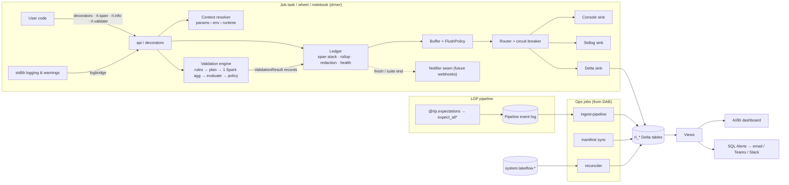
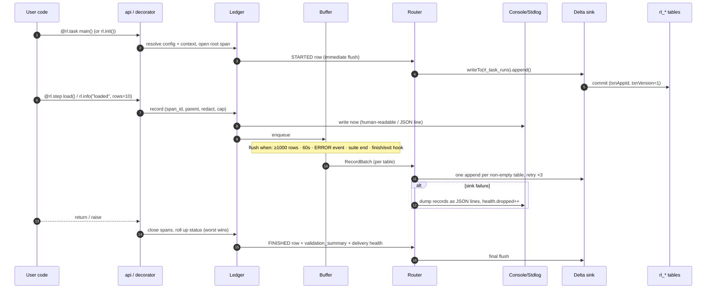
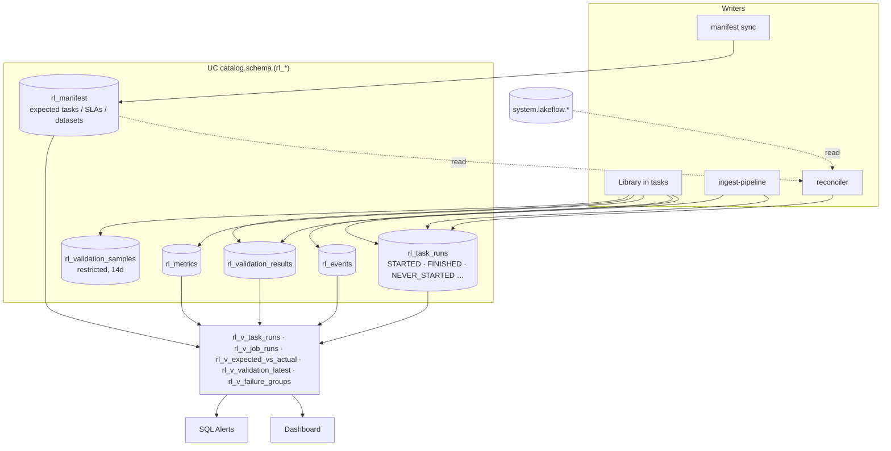

# runledger — a Databricks Workflows event + data-validation logger

> Every feature, with an example, is listed in [features.md](features.md).

## Context

`databricks_event_logger` (this repo) works, but it was built as a general event logger. Validation exists only as documentation recipes (about 10 lines of boilerplate per check). It writes to Delta with one synchronous INSERT per event. Its 40-column table buries validation evidence in a `metadata_json` string. It has no "started" event, so a crashed task leaves no trace. Its behaviour on serverless and Spark Connect was never checked.

The goal is a **new, separate package** that is built around Databricks Workflows from the start. It treats data validation as a first-class feature. It works on serverless jobs, classic job clusters and Lakeflow Declarative Pipelines (LDP). Alerting uses Databricks itself (Delta tables → dashboard + SQL Alerts), with a seam for webhooks later.

The old project is used **only** as a list of features worth keeping in spirit:
- redaction of sensitive keys
- stack-trace fingerprints to group failures
- parent/child lineage through contextvars
- delivery-health counters
- "logging never breaks the job", with a strict mode
- UTC `event_date`
- schema validation of the sink
- never auto-creating tables

No code, schema or module layout is carried over.

**Decisions so far:**
- Separate repo.
- Sinks: console (dev), stdout/`logging`, Unity Catalog Delta tables, and a pluggable `Sink` protocol.
- Webhooks later, through a `Notifier` seam.
- Python-first validation now; rules serializable so YAML suites can come later.
- Config in code, overridable by env vars and job params, plus a Declarative Automation Bundle (DAB) template.
- Working name **`runledger`**. Renaming is cheap, and the PyPI name still has to be checked.

**Location:** a new repo at `C:\Users\aarba\pydev\runledger` (sibling of this repo). The first commit adds this plan as `docs/design.md`.

---

## Guiding principles

1. **Append-only.** No MERGE or UPDATE on the hot path. Current state (running, finished, crashed) is worked out in views, so hundreds of concurrent tasks never conflict.
2. **One table per grain.** Run lifecycle, log events, metrics, rule results and failing samples each get a typed table. Free-form data goes in `VARIANT`, never a JSON string.
3. **Job parameters are the main source of context; auto-detection is the fallback.** Dynamic value references (`{{job.run_id}}` …) behave the same on serverless, classic and wheel tasks.
4. **Buffered, batched, idempotent writes.** About one Delta commit per table per flush. `STARTED` is flushed immediately so a crash still leaves a row.
5. **Validation compiles to as few Spark passes as possible.** Usually one `agg()` per dataset. A second pass happens only for failures.
6. **LDP is a separate mode.** No side-effect writes inside a pipeline. Rules become expectations, and the pipeline event log is ingested afterwards.
7. **Core has no runtime dependencies and needs no Spark.** pyspark is imported lazily and never declared as a dependency, because the Databricks runtime provides it. A ruff `banned-api` rule forbids `sparkContext`/`_jvm`/`.rdd`/`py4j` outside one guarded module, which keeps Spark Connect compatibility.
8. **Supported range:** Python 3.10+, DBR 15.4 LTS+ (needed for `VARIANT`), serverless env v2+.
9. **Adoption comes first.** Every capability is reachable from a one-line or decorator form before the explicit API. Defaults need no configuration. When the tables don't exist yet, output falls back to stdout instead of failing. Error messages say how to fix the problem.
10. **A missing run is a signal too.** A run manifest records which tasks are expected and when. A reconciler raises the alarm when they don't run, even if no library code ever executed.

---

## Package layout

```
runledger/
  pyproject.toml            hatchling; extras [sdk]=databricks-sdk, [dev]=pytest,hypothesis,ruff,pyspark,delta-spark
  src/runledger/
    api.py                  ambient functions: init, current, span, info/warn/error, metric, validate, finish, task
    config.py               frozen Config + precedence merge + provenance (which source set each field)
    errors.py               ConfigError, SinkError(retryable), ValidationFailed, ValidationHalted
    context/                RunContext model, resolver, compute-type detection, providers/
                            (explicit, params, env, runtime, sdk)
    core/                   ledger (buffer, flush, lifecycle, rollup, health), span, records, ambient
                            ContextVar, redaction, attributes (caps), fingerprint, ids (uuid7), clock
    sinks/                  base (Sink protocol, RecordBatch), router (fan-out + circuit breaker),
                            console, stdlog, memory, delta, spill (v1)
    notify/                 Notifier protocol + Signal model (seam only; no implementations in v1)
    schema/                 tables.py = SINGLE source of truth (columns, types, clustering, tblprops,
                            version); ddl.py; sql/views/*.sql
    validation/             rules + registry, checks (factories), suite (fluent builder, run, split),
                            plan (compiler → IR), exec_spark, evaluate (pure), policy, sampling,
                            reconcile, result
    ldp/                    detect, expectations export, aggregate checks, event-log ingestion
    integrations/           task_values (for condition tasks)
    cli.py                  runledger ddl | doctor | ingest-pipeline | setup
  bundle_template/          DAB template (see below)
  tests/{unit,spark,connect,integration}/
  docs/
```

Additions for ease of use and never-start detection:

```
    decorators.py           @rl.task, @rl.step, @rl.expect, @rl.expect_input (thin wrappers over api.py)
    notebook.py             `import runledger.auto`, per-cell spans (IPython events), %%rl_step cell magic
    logbridge.py            logging.Handler + warnings capture → rl_events
    manifest/               model (ExpectedTask, Schedule, SLA, ExpectedDataset), build-from-bundle,
                            sync (writes rl_manifest), reconcile (manifest × rl_task_runs × system tables)
    bundle/                 DAB Python mutator: inject runledger_ctx + dependency into every task (zero wiring)
```

---

## Architecture diagrams

### 1. Primary components



### 2. How an event is emitted and logged



### 3. Where results are persisted



Stdout and console output goes to the driver log only and is never stored in a table.

---

## Data model (UC managed Delta, one configurable `catalog.schema`, prefix `rl_`)

- **Clustering:** liquid clustering, no Hive partitions.
- **Compaction:** predictive optimization, or optimizeWrite/autoCompact as a fallback.
- **Versioning:** every table carries a `runledger.schema_version` tblprop.
- **Join key:** `run_key` = one task attempt. It is `job:{workspace_id}:{task_run_id}`, `ldp:{pipeline_id}:{update_id}` or `local:{uuid7}`.
- **Denormalized filters:** `job_id`, `job_run_id`, `task_key` and `env` are copied onto every table so alerts rarely need joins.

| Table | Grain | Key columns | Cluster by |
|---|---|---|---|
| `rl_task_runs` | one row per lifecycle transition (STARTED / FINISHED) | status (RUNNING / SUCCEEDED / WARNED / FAILED / CANCELLED), job/run/task ids, attempt, repair_count, trigger, compute_type, runtime_version, params/tags MAP, `context_sources` MAP, duration, `error STRUCT<class,message,fingerprint,frames>`, `validation_summary STRUCT`, `delivery STRUCT` (health counters) | event_date, job_id |
| `rl_events` | log lines + span start/end | event_id, span_id, parent_span_id, seq, level, kind, name, message, status, duration_ms, error STRUCT, `attributes VARIANT` | event_date, job_id |
| `rl_metrics` | numeric facts | name, value DOUBLE, unit, dataset, tags | event_date, name |
| `rl_validation_results` | one row per rule evaluation | suite_name/version, dataset, rule_id (stable hash of type+params), rule_type, columns, severity, outcome (PASS / FAIL / ERROR / SKIPPED), action, total_rows, failed_rows, failed_ratio, observed_value, `threshold`/`observed`/`rule_definition` VARIANT, source (spark / ldp_event_log) | event_date, dataset |
| `rl_manifest` | one row per expected task per manifest version | manifest_version, bundle_name, target/env, job_name, job_id (filled at sync), task_key, schedule (cron + tz), expected_window (grace), sla_max_duration, criticality, instrumented BOOL, expected_datasets/suites ARRAY, owner, active BOOL | job_id |
| `rl_validation_samples` | bounded failing-row samples | result_id, rule_id, `row VARIANT`, row_hash. Short retention (14d), separate grants (may hold PII) | event_date, dataset |

**Views:**
- `rl_v_task_runs`: latest transition per run. STARTED with no FINISHED shows as `UNFINISHED`, or as `CRASHED` when an optional join to `system.lakeflow.job_task_run_timeline` confirms the run ended.
- `rl_v_job_runs`: the worst task status per job run.
- `rl_v_validation_latest`
- `rl_v_failure_groups`: failures grouped by fingerprint.
- `rl_v_events_dedup`: a safety net against duplicates.

---

## Context resolution (works on serverless, classic and LDP)

Values are merged field by field, highest precedence first. The source of each field is recorded in `context_sources`.

1. **Explicit:** `rl.init(job_id=...)` or `Config`.
2. **Job/task params:**
   - notebook widgets
   - wheel `sys.argv` (`parse_known_args` on a copy, so the user's own arguments are untouched)
   - LDP `spark.conf runledger.*`
   - Single compact param: `runledger_ctx="job_id={{job.id}};job_run_id={{job.run_id}};task_key={{task.name}};task_run_id={{task.run_id}};..."`
3. **Env vars:** `RUNLEDGER_*`. `DATABRICKS_RUNTIME_VERSION` is used to detect Databricks and serverless.
4. **Best-effort runtime detection**, each step guarded with a 1s budget:
   - the `dbruntime` REPL context
   - the dbutils context JSON (classic, non-Connect only)
   - `spark.databricks.clusterUsageTags.*`
   - Spark Connect detection
5. **Optional SDK enrichment** (off by default): one `jobs.get_run` call.
6. **Defaults:** `compute_type=local`, `run_key=local:<uuid7>`.

`runledger doctor` prints the resolved context with each field's source. It warns when `job_run_id` came from auto-detection rather than params.

---

## Write path

- **Flush triggers:**
  - `STARTED` at `init()`
  - any ERROR+ event
  - end of every `Suite.run()`
  - buffered rows ≥ 1000
  - more than 60s since the last flush (checked on each emit)
  - `finish()` / root span exit / `atexit` / excepthook
  - IPython `set_custom_exc`, because notebooks don't fire `sys.excepthook`

  MVP has no background thread.
- **Delta write**, once per non-empty table: `spark.createDataFrame(rows, staging_schema)` → `parse_json` the VARIANT columns → `.writeTo(fqn).option("txnAppId", f"runledger:{run_key}:{pid}").option("txnVersion", flush_seq).append()`.
  - Arrow-based and Spark Connect-safe.
  - Never creates tables.
  - Blind appends don't conflict with each other.
  - The txn options make a retried flush exactly-once.
- **`validate()` on first flush:** compare `spark.table(fqn).schema` with `TableSpec`. If the table is missing or doesn't match, a circuit breaker stops writes to that sink and records fall back to stdlog. Strict mode raises instead.
- **Retries:**
  - Transient errors (gRPC unavailable, 5xx) get 3 attempts with backoff.
  - Non-retryable errors: table not found, permission denied, schema mismatch.
  - When retries run out: count `dropped`, then dump the records as JSON lines to stdlog. v1 adds a spill to a UC Volume.
- **Failures:** logging never raises (except with `strict=True`). The application's own exception always wins.
- **Crash semantics:** a hard kill loses at most one flush interval of events. `STARTED` and error events are already durable.
- **Threads:** `rl.current()` falls back to a process-global ledger. `rl.ThreadPoolExecutor` / `rl.propagate()` copy context so span parentage works in worker threads. Logging is driver-only (never from UDFs).
- **Rollup:** status order is `SUCCEEDED < WARNED < FAILED`. A span takes the worst of itself and its children. The root span's status becomes the FINISHED status.
- **Not now:** Zerobus and SQL Statement API sinks. The `Sink` protocol leaves room for them.

---

## Validation engine

- **Rule model:** frozen dataclasses with a `type` registry, `severity` (info / warn / error / critical), and tolerance via `mostly` (minimum pass ratio) or `max_failures`.
  - `to_dict` / `from_dict` serialize rules, which is all YAML suites will need later.
  - `rule_id` = hash of type + canonical params, excluding name and severity, so trends survive renaming or downgrading a rule.
- **Compilation (`plan.py` → engine-neutral IR):**

  | Category | Rules | Spark cost |
  |---|---|---|
  | Metadata | `schema(contract, allow_extra, check_nullability)` | No job (`df.schema`) |
  | Row predicates | `not_null`, `accepted_values`, `in_range`, `matches`, `expr`. Each becomes `count_if(NOT coalesce(pred,false))` | Single `agg` |
  | Aggregates | `row_count`, `freshness`, `null_ratio`, `stat_bounds` | Same `agg` |
  | Uniqueness | `unique(*cols)`: `count(*) - count(DISTINCT struct(cols))`, with `approx=True` available | Same `agg` (≤2 key sets), else +1 |
  | Custom SQL | `sql("... {df} ...")` via `spark.sql(q, df=df)` | +1 each |
  | Reconciliation | `reconcile(source, keys, measures, tolerance)`: count + sums + `sum(xxhash64(...))` checksum. A key diff runs only on mismatch | +1 (+1 on failure) |

  No `.cache()`, because serverless doesn't support it. `where=` and `sample_fraction=` limit the cost on very large tables.
- **Evaluate:** a pure Python function turns metrics + threshold into a `RuleResult`. An exception in one rule gives outcome `ERROR` and does not abort the suite.
- **Sampling:** one extra pass, only when a row rule fails. Up to N rows per rule go to `rl_validation_samples`, filtered by a column allow-list or redact-list first.
- **Quarantine:** `good, bad = suite.split(df)` adds an `_rl_failed_rules` column. The user decides where `bad` goes; the library never writes full quarantine data itself.
- **Severity policy:**

  | Severity | Action when the rule fails |
  |---|---|
  | info | record only |
  | warn | record + span WARNED |
  | error | raise `ValidationFailed` after the whole suite is evaluated and flushed |
  | critical | as error, plus task value `runledger.validation_status=HALTED`, raising `ValidationHalted` |

  - Overrides per suite or in Config (e.g. `fail_on="critical"` in dev).
  - `enforce=False` is observe mode, for rolling out new rules.
  - `on_failure="return"` hands back the `SuiteResult` without raising.
  - Failing the task is just an exception, so native job notifications, retries and condition tasks all keep working.
- **LDP:**
  - `@rlp.expectations(suite)` maps row rules to `expect_all` / `_or_drop` / `_or_fail` by severity. Expectations are named `rl:{rule_id}:{name}`. Both `pyspark.pipelines` and the legacy `dlt` module are supported.
  - `rlp.aggregate_checks(suite, source=...)` creates a private MV that holds the aggregate rules.
  - In LDP mode `init()` only writes to stdlog.
  - `runledger ingest-pipeline` is a job task that runs after the pipeline. It streams the UC-published event log (`availableNow` + checkpoint) into `rl_validation_results` / `rl_task_runs`.

---

## Never-start detection: run manifest + reconciler

The library can only record runs that reach `rl.init()`. Several failures happen before that, or with no run at all:

| Case | Platform has a run? | runledger STARTED? | Reconciler status |
|---|---|---|---|
| Schedule didn't fire, job paused or deleted, trigger broken | no | no | `MISSED_SCHEDULE` |
| Task skipped because upstream failed or `run_if` excluded it | task record says skipped (**VERIFY** result_state) | no | `SKIPPED_UPSTREAM` |
| Cluster or serverless env failed, library install failed, import error before init | yes, failed | no | `FAILED_BEFORE_INIT` |
| Task ran but was never instrumented | yes, succeeded | no | `UNINSTRUMENTED` (info) |
| Started but no FINISHED, and the platform says it ended | yes | yes | `CRASHED` |
| Ran longer than the SLA | yes, running | yes | `SLA_BREACH` |

**Manifest: what should run.**
- The manifest is **generated from the bundle**, because the bundle already knows every job, task, schedule and target. Nobody hand-writes it.
- `runledger manifest build` reads `databricks bundle validate -o json` and writes `runledger.manifest.json`.
- Optional overrides go in `runledger.yml`:
  - `sla_max_duration`
  - `grace` (the expected window)
  - `criticality`
  - `expected_datasets` and suites
  - `owner`
  - `exclude`
- `runledger manifest sync` runs as a deploy-time task in the setup job. It resolves job_ids through the SDK and appends a new `manifest_version` to `rl_manifest`. The table is append-only and versioned, so the history of what was expected is kept.

**Reconciler: what actually happened.**
- A serverless job, scheduled every 15 min by default.
- For each active manifest entry and each expected window, it left-joins:
  - the expected time slots (computed from cron + tz)
  - `rl_task_runs`
  - platform truth: `system.lakeflow.job_run_timeline` / `job_task_run_timeline`, or the Jobs API `list_runs` for low latency. System tables can lag, which is a **VERIFY** item, so the Jobs API is the default and system tables are the backfill.
- It appends synthetic `rl_task_runs` rows with `transition='RECONCILED'`, `source='reconciler'`, the status from the table above, and a deterministic `run_key`: `expected:{job_id}:{task_key}:{slot_ts}`. Re-running it is a no-op because of txnAppId plus a dedup view.
- `rl_v_expected_vs_actual` gives one row per expected slot with its outcome. It drives the "expected run missing" SQL alert and the dashboard's coverage tile.

**Why this also helps adoption.** The manifest and reconciler use only bundle metadata and platform data. A team that deploys the template gets run-status coverage of every bundled job **before adding a single line of runledger code**. Each task then moves from `UNINSTRUMENTED` to fully instrumented as the team adopts the library.

**Non-bundle jobs:** `runledger manifest add --job-id 123 --sla 2h`, or a small YAML file. This covers jobs managed in the UI.

---

## Ease of use: an adoption ladder

The plan is progressive disclosure: each rung adds value, and a team can stop on any rung. Recommended defaults are in **bold**.

| Rung | Effort | What you write | What you get |
|---|---|---|---|
| 0 · Observe | **0 lines** (deploy template) | nothing | Manifest + reconciler: expected vs actual runs, missed schedules, failures before init, durations from system tables |
| 1 · Wire | **0 lines** with the bundle mutator | nothing. The mutator injects `runledger_ctx` and the library dependency into every task | Context for later rungs. No hand-written `{{job.run_id}}` parameters |
| 2 · Turn on | **1 line** | `import runledger.auto` (notebook) or `@rl.task` (wheel) | STARTED/FINISHED, status, duration, error class and fingerprint, existing `logging`/`warnings` captured into `rl_events` |
| 3 · Decorate | 1 line per function | `@rl.step`, `@rl.expect(...)` | Per-step spans and timing; validation of returned DataFrames |
| 4 · Explicit | as needed | `with rl.span()`, `rl.metric()`, `rl.validate(df)...run()` | Fine-grained control, custom metrics |
| 5 · Reuse | shared module | `Suite(...)` objects, LDP export, later YAML | Governed, versioned rules across teams |

### Rung 2: one-line options

```python
# Notebook: the first cell is the only change. It reads widgets/env, writes STARTED, installs exit hooks,
# and bridges `logging` (WARNING+ by default).
import runledger.auto
```
```python
# Opt-in: every notebook cell becomes a span, using IPython pre/post_run_cell events (no other code)
import runledger as rl

rl.init(cell_spans=True)
```
```python
# Wheel / script
import runledger as rl


@rl.task  # works bare or as @rl.task(app_name=...)
def main(): ...
```

### Rung 3: decorators (the main "easy" API)

```python
import runledger as rl
from runledger import checks as c


@rl.task
def main():
    publish(clean(load_orders()))


@rl.step  # span named "load_orders"; status/duration/exception
def load_orders():
    return spark.table("main.raw.orders")


@rl.step(dataset="main.silver.orders")
@rl.expect(
    c.not_null("order_id"),  # validates the RETURNED DataFrame (one Spark pass)
    c.unique("order_id", severity="critical"),
    c.row_count(min=1),
)
def clean(df):
    return df.dropDuplicates(["order_id"])


@rl.step
@rl.expect_input("df", orders_suite)  # validates an ARGUMENT before the body runs
def publish(df):
    df.write.mode("overwrite").saveAsTable("main.silver.orders")
```

```python
%%rl_step load_orders
df = spark.table("main.raw.orders")                 # notebook cell magic = a span around the whole cell
```

**Decorator rules:**
- They work with or without parentheses.
- They support sync and async functions.
- Generators are rejected with a clear message.
- `functools.wraps` is used so docs and signatures survive.
- Nothing runs a Spark job unless you asked for validation; row counts are opt-in.

### Ways to make it feel easy

- **One import, one name:** `import runledger as rl`.
- Type hints and docstrings on everything, so autocomplete is the documentation.
- **Zero-config locally:** the console sink runs when there's no Databricks.
- **Safe on Databricks before setup:** if the `rl_*` tables don't exist, output degrades to stdout with a single "run `runledger setup`" hint instead of an error.
- `runledger doctor` shows what was resolved and why.
- Copy-paste snippets in the README, ordered by rung.
- A template example job that runs green on first deploy.

### Trade-offs to keep in mind

- `runledger.auto` runs on import, so it is a separate module. `import runledger` alone has **no** side effects.
- `cell_spans` can be noisy, so it is opt-in.
- `@rl.expect` on a lazily evaluated DataFrame triggers a Spark job at return. The docs say so, and it can be turned off globally with `RUNLEDGER_VALIDATION_ENFORCE=false`.
- Auto-instrumenting `DataFrameWriter` (monkey-patching writes) is deliberately **not** planned. It is fragile under Spark Connect and surprising. It may become an explicit opt-in later.

---

## Usage examples (including the config/deploy examples you asked for)

**1. Notebook task**

```python
import runledger as rl

rl.init(app_name="orders_etl")  # resolve config+context, write STARTED, install hooks

with rl.span("load_orders", dataset="main.raw.orders") as s:
    df = spark.table("main.raw.orders")
    s.metric("rows_read", df.count())
    rl.info("loaded", source_version=17, api_token="x")  # api_token → "[REDACTED]"

rl.validate(df, dataset="main.raw.orders").row_count(min=1).not_null(
    "order_id", "customer_id"
).unique("order_id", severity="critical").accepted_values(
    "status", ["NEW", "SHIPPED", "CANCELLED"], severity="warn", mostly=0.99
).run()  # one Spark job; raises on error/critical

rl.finish()  # optional; idempotent
```

**2. Python wheel task**

```python
import runledger as rl


@rl.task(app_name="orders_etl")  # init + finish + reads --runledger_ctx from argv
def main():
    with rl.span("transform"):
        ...
```

**3. Reusable, serializable suite**

```python
from runledger import Suite, checks as c

orders_suite = Suite(
    name="orders_silver",
    version="3",
    dataset="main.silver.orders",
    rules=[
        c.schema({"order_id": "bigint", "amount": "decimal(18,2)"}, allow_extra=True),
        c.not_null("order_id"),
        c.unique("order_id", severity="critical"),
        c.in_range("amount", min=0),
        c.expr("ship_date >= order_date", name="ship_after_order", severity="warn"),
    ],
)
result = orders_suite.run(df)
orders_suite.to_dict()  # → future YAML / table-driven suites
```

**4. Configuration: the same code, with values from four places** (highest wins)

```python
# (a) In code: the baseline the team commits
rl.init(
    config=rl.Config(
        catalog="ops",
        schema="runledger",
        sinks=["delta", "stdlog"],
        validation=rl.ValidationPolicy(fail_on="error", sample_rows=20),
    )
)
```
```bash
# (b) Env var on a cluster or a laptop: send everything to the console for local dev
RUNLEDGER_SINKS=console
```
```yaml
# (c) Job parameter in the bundle: the prod and dev targets differ only here
tasks:
  - task_key: load_orders
    notebook_task:
      notebook_path: ../src/load_orders.py
      base_parameters:
        runledger_env: ${bundle.target}            # "dev" or "prod"
        runledger_catalog: ${var.ops_catalog}
        runledger_ctx: ${var.runledger_ctx}        # job/run/task ids via {{...}} references
```
```python
# (d) Check what was resolved and where each value came from
rl.current().config.provenance  # {"catalog": "job_param", "sinks": "code", "env": "job_param", ...}
```

```bash
runledger doctor
```

**5. Deploying the template**

```bash
databricks bundle init <runledger-repo>/bundle_template   # prompts: catalog, schema, warehouse, alert destination
```

```bash
databricks bundle deploy -t dev
```

```bash
databricks bundle run runledger_setup -t dev               # creates rl_* tables + views + grants
```

**6. LDP pipeline**

```python
from pyspark import pipelines as dp
import runledger as rl, runledger.ldp as rlp

rl.init()  # detects LDP → stdlog only


@dp.table(name="orders_silver")
@rlp.expectations(orders_suite)
def orders_silver():
    return spark.readStream.table("orders_bronze")


rlp.aggregate_checks(orders_suite, source="orders_silver")
```

**Extension seams:**
- `Sink` protocol: `name`, `record_types`, `validate()`, `write(batch)`, `close()`.
- `Notifier` protocol: `wants(signal)`, `send(signal)`. Notifiers are called at `finish()` and at the end of a suite, never on the flush path. Dedup is by fingerprint, and secrets come from `dbutils.secrets`.

---

## DAB template (`bundle_template/`)

- **`databricks.yml`:** dev/prod targets and the `runledger_ctx` variable.
- **`runledger.schema.yml`:** the schema plus Volumes for spill and checkpoints.
- **`runledger_setup.job.yml`:** serverless SQL tasks that run `01_tables.sql`, `02_views.sql` and `03_grants.sql`. These files are generated by `runledger ddl` from `schema/tables.py`, and CI checks they haven't drifted.
- **`runledger_maintenance.job.yml`:** daily retention deletes, `ingest-pipeline`, and spill recovery.
- **`runledger_reconciler.job.yml`:** every 15 min on serverless, running `runledger reconcile`. The setup job also runs `runledger manifest sync` on each deploy.
- **`runledger.yml`:** optional manifest overrides (SLA, grace, criticality, expected datasets, owner, exclude).
- **Bundle Python mutator (opt-in):** injects `runledger_ctx` and the library dependency into every task, so teams wire nothing by hand.
- **`runledger.dashboard.yml`:** an AI/BI dashboard with four pages: Overview (status, success rate, p50/p95, unfinished/crashed), Failures (top fingerprints with run links), Data quality (pass rate, observed-value trends, samples), and Delivery health.
- **`runledger.alerts.yml`:** five SQL Alerts to notification destinations, covering:
  - a critical or error validation FAIL
  - a task FAILED or CRASHED in prod
  - a dataset not validated in 24h
  - delivery dropped > 0
  - a run UNFINISHED for more than X hours
  - an expected run that is missing or failed before init (from `rl_v_expected_vs_actual`)
- **Examples:** `example_job.job.yml` (notebook + wheel + pipeline + ingest) and `example_pipeline.pipeline.yml` (event log published to UC, `runledger.mode=ldp`).

---

## Roadmap

**Phase 0: one-week spike.** Settle these on real serverless, classic and LDP before freezing the MVP:
- the names of the dynamic references, and whether a job-level param can use `{{task.*}}`
- `dbruntime` context on serverless
- the value of `DATABRICKS_RUNTIME_VERSION` on serverless
- `txnAppId` with `writeTo` under Connect on UC managed tables
- `parse_json` → VARIANT staging
- the IPython `set_custom_exc` hook, and how `dbutils.notebook.exit` is classified
- `spark.sql(q, df=df)` under Connect
- the JSON paths in the LDP event log
- support for the DAB `alerts` resource
- system-table latency and the task `result_state` values for skipped or upstream-failed tasks
- the `bundle validate -o json` shape
- support for DAB Python mutators

The findings go into `docs/platform-notes.md`, and each one has a fallback ready (STRING instead of VARIANT, a dedup view instead of txn idempotency, a setup task using the SDK for alerts).

**Phase 1: MVP (0.1)**
- core: ledger, spans, events, metrics, ambient logger, redaction, fingerprint, health
- context: explicit + params + env + basic detection
- sinks: console, stdlog, memory, delta (buffered, retried, idempotent, validated, with circuit breaker)
- the four main tables and their views; STARTED/FINISHED for notebook and wheel tasks
- validation: schema, not_null, unique, row_count, accepted_values, in_range, expr, compiled to a single pass, with the severity policy and observe mode
- CLI `ddl` and `doctor`; a minimal DAB (schema, setup job, example job)
- the easy layer: `import runledger.auto`, `@rl.task`, `@rl.step`, `@rl.expect` / `@rl.expect_input`, and the logging bridge
- manifest v0: `manifest build` + `sync` from the bundle, plus a reconciler that uses the Jobs API to detect MISSED_SCHEDULE, FAILED_BEFORE_INIT and UNINSTRUMENTED, and `rl_v_expected_vs_actual`. Never-start detection is in the MVP because it is the zero-code entry point.

**Phase 2: v1.0**
- validation: freshness, matches, stat_bounds, sql, reconcile
- the samples table and `split()`
- rollups including `validation_summary`
- LDP: expectations, aggregate checks, event-log ingestion
- crash inference from system tables
- thread executor
- SDK enrichment
- task values
- spill and recovery
- full DAB: dashboard, alerts, maintenance
- the Tier 4 CI matrix
- a published `Notifier` protocol
- reconciler: SKIPPED_UPSTREAM, SLA_BREACH and a system-table backfill; `cell_spans` and the `%%rl_step` magic; the bundle mutator; `manifest add` for non-bundle jobs

**Later**
- YAML and table-driven suites, plus a `run-suite` task
- webhook notifiers for Teams, Slack and email
- `ZerobusSink` and `StatementApiSink`
- OpenTelemetry export
- anomaly rules against the history in `rl_validation_results`
- background flusher
- interop with Lakehouse Monitoring

---

## Key risks and open questions

- **Serverless context detection.** Mitigated: params come first and `doctor` warns when they're missing.
- **VARIANT staging and txn idempotency under Connect.** Each has a fallback, listed in Phase 0.
- **Commit latency.** About 2 to 4 commits per task, roughly 3 to 10 seconds on serverless. `lifecycle_mode="finish_only"` helps very short tasks, at the cost of crash visibility.
- **Small files at high concurrency.** Relies on predictive optimization or auto-compaction.
- **PII in samples and messages.** Samples off by default in prod, or controlled by a column allow-list. Restricted grants and 14-day retention.
- **pyspark 3.5 (15.4 LTS) vs 4.x (serverless).** CI tests both.
- **Permissions.** Each job's run-as principal needs MODIFY on the `rl_*` tables. Setup runs as a privileged principal.
- **Reconciler accuracy.** Cron slots vs actual trigger times, file-arrival and continuous triggers that have no fixed schedule (these use "at least one run per N hours" SLAs instead), timezone/DST edges, and paused jobs. The reconciler principal needs read access to Jobs and system tables.
- **Decorator magic vs explicitness.** Keep the decorators thin wrappers over the explicit API, so behaviour is identical and debuggable.

---

## Verification (how we will know it works)

- **Tier 1: unit tests, no Spark installed**, run on every commit. They cover:
  - config precedence and provenance
  - each context provider (fake env, argv, widgets, conf)
  - redaction, caps and fingerprint stability
  - flush triggers (fake clock + MemorySink)
  - retry classification and circuit breaker
  - lifecycle hooks
  - rollup
  - Hypothesis round-trips for Rule/Suite and `rule_id`
  - golden compiler IR
  - pure evaluate and policy
  - DDL drift
- **Tier 2: local pyspark 3.5 and 4.x with delta-spark.** Covers:
  - real aggregation semantics: NULLs, uniqueness, freshness across timezones, reconcile
  - appends to local Delta tables
  - refusal to create a missing table
  - txnAppId duplicate suppression
  - VARIANT staging
  - the sampling pass
- **Tier 3: Spark Connect** (`pyspark --remote local`). Re-runs the Tier 2 write and validation tests through a Connect session.
- **Tier 4: Databricks, via the bundle `-t it` target.**
  - Matrix: serverless notebook + wheel, classic DBR 15.4 LTS and the latest LTS, and a serverless LDP pipeline + ingest.
  - Scenarios: success, raise, validation error and critical, `dbutils.notebook.exit`, `os._exit(1)`, and a cancelled run.
  - A final `run_if: ALL_DONE` task asserts:
    - rows exist, with context filled from params
    - crashes show as UNFINISHED or CRASHED
    - there are no duplicate event_ids
    - the commit count stays within budget
  - Never-start scenarios:
    - a deliberately broken library install
    - a task excluded by `run_if`
    - a paused scheduled job

    Assert the reconciler emits FAILED_BEFORE_INIT, SKIPPED_UPSTREAM and MISSED_SCHEDULE within one reconcile interval, and stays idempotent on re-run.
  - Ease-of-use check: a fresh notebook containing only `import runledger.auto`, plus a decorated wheel, produce complete rows with no other configuration.
- **Performance gate:** 10k events plus a 10-rule suite on 10M rows. Validation uses one Spark job when every rule passes, and commits stay within budget.

## First implementation steps (after approval)

1. Create `C:\Users\aarba\pydev\runledger`: git init, `pyproject.toml`, src layout, ruff/pytest config, and this plan as `docs/design.md`.
2. Write `schema/tables.py` and `ddl.py` first, since everything else derives from them.
3. Build `config.py` and `context/` with their unit tests.
4. Build `core/` (records, span, ledger, buffer, lifecycle) with MemorySink tests.
5. Add the console, stdlog and Delta sinks, plus the Tier 2 tests.
6. Build `validation/` for the MVP rules.
7. Write the Phase 0 spike notebooks plus the minimal DAB, and run them on a workspace (needs your workspace access).
