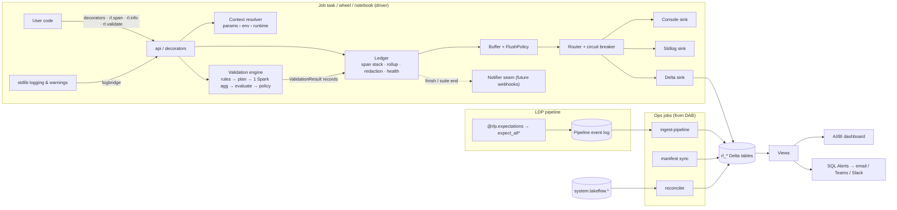
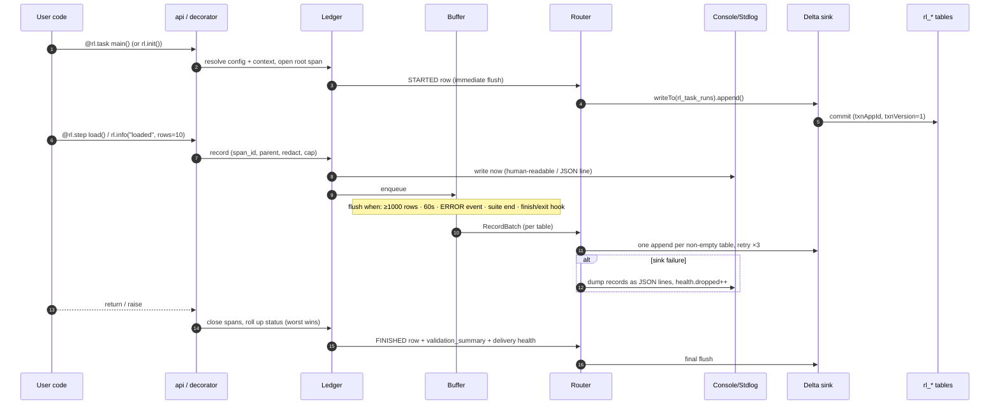
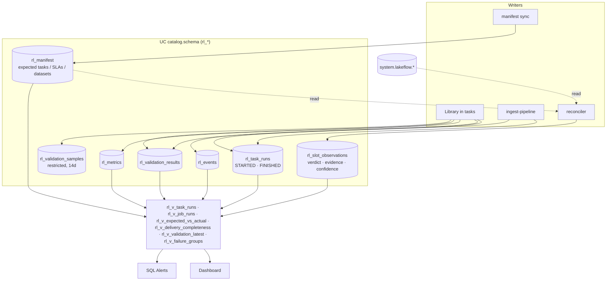

# lakehouse_runledger: a Databricks Workflows event + data-validation logger

> **Status: planning.** Nothing is implemented. The plan is under review; see
> [review-brief.md](review-brief.md) for the decision log, open questions and the review agenda.
> Every feature, with an example, is listed in [features.md](features.md).
> **Revised after review round 1** (an external architecture review). What changed and why is in
> [review-brief.md §11](review-brief.md#11-review-round-1-what-changed); platform claims still to
> settle are in [§12](review-brief.md#12-platform-claims-to-settle-in-the-design-review).

## Context

`databricks_event_logger` (the existing project) works, but it was built as a general event logger. Validation exists only as documentation recipes (about 10 lines of boilerplate per check). It writes to Delta with one synchronous INSERT per event. Its 40-column table buries validation evidence in a `metadata_json` string. It has no "started" event, so a crashed task leaves no trace. Its behaviour on serverless and Spark Connect was never checked.

The goal is a **new, separate package** that is built around Databricks Workflows from the start. It treats data validation as a first-class feature. It works on serverless jobs, classic job clusters and Lakeflow Declarative Pipelines (LDP). Alerting uses Databricks itself (Delta tables → dashboard + SQL Alerts), with a seam for webhooks later.

The old project is used **only** as a list of features worth keeping in spirit:
- redaction of sensitive keys
- stack-trace fingerprints to group failures
- parent/child lineage through contextvars
- delivery-health counters
- "logging never breaks the job", with a strict mode
- UTC `event_date`
- schema validation of the sink
- never auto-creating tables

No code, schema or module layout is carried over.

**Decisions so far:**
- Separate repo.
- Sinks: console (dev), stdout/`logging`, Unity Catalog Delta tables, and a pluggable `Sink` protocol.
- Webhooks later, through a `Notifier` seam.
- Python-first validation now; rules serializable so YAML suites can come later.
- Config in code, overridable by env vars and job params, plus a Declarative Automation Bundle (DAB) template.
- Name: distribution `lakehouse-runledger`, import package `lakehouse_runledger` (used as `import lakehouse_runledger as rl`). The short name **runledger** is kept for the CLI (`runledger ...`), the `rl_` table prefix, `RUNLEDGER_*` env vars and `runledger.*` config keys and table properties.

**Location:** `C:\Users\aarba\pydev\lakehouse_runledger`, remote https://github.com/arbaizam/lakehouse_runledger. This plan lives in the repo as `docs/design.md`.

---

## Guiding principles

1. **Append-only.** No MERGE or UPDATE on the hot path. Current state (running, finished, crashed) is worked out in views, so hundreds of concurrent tasks never conflict.
2. **One table per grain.** Run lifecycle, log events, metrics, rule results and failing samples each get a typed table. Free-form data goes in `VARIANT`, never a JSON string.
3. **Job parameters are the main source of context; auto-detection is the fallback.** Dynamic value references (`{{job.run_id}}` …) behave the same on serverless, classic and wheel tasks.
4. **Buffered, batched, idempotent, bounded writes.** About one Delta commit per table per flush. `STARTED` is flushed immediately so a crash still leaves a row. Logging may never block the job for longer than a fixed time budget.
5. **Validation compiles to as few Spark passes as possible, without losing per-rule isolation.** Usually one `agg()` per dataset. Extra passes happen only for failures, or to isolate a rule that errors.
6. **LDP is a separate mode.** No side-effect writes inside a pipeline. Rules become expectations, and the pipeline event log is ingested afterwards.
7. **Core has no runtime dependencies and needs no Spark.** pyspark is imported lazily and never declared as a dependency, because the Databricks runtime provides it. A ruff `banned-api` rule forbids `sparkContext`/`_jvm`/`.rdd`/`py4j` outside one guarded module, which keeps Spark Connect compatibility.
8. **Supported range:** Python 3.10+, DBR 15.4 LTS+ (needed for `VARIANT`), serverless env v2+.
9. **Adoption comes first.** Every capability is reachable from a one-line or decorator form before the explicit API. Defaults need no configuration. When the tables don't exist yet, output falls back to stdout instead of failing. Error messages say how to fix the problem.
10. **A missing run is a signal too.** A run manifest records which tasks are expected and when. A reconciler raises the alarm when they don't run, even if no library code ever executed.
11. **Claim only what the evidence supports.** Missing telemetry is reported as a telemetry gap, not as a crash or a failure, unless other evidence confirms the cause.
12. **Separate facts stay separate.** Whether code ran (execution status), whether data passed (quality status) and whether our records arrived (telemetry completeness) are three different fields, never merged into one status.

---

## Package layout

```
runledger/
  pyproject.toml            hatchling; extras [sdk]=databricks-sdk, [dev]=pytest,hypothesis,ruff,pyspark,delta-spark
  src/lakehouse_runledger/
    api.py                  ambient functions: init, current, span, info/warn/error, metric, validate, finish, task
    config.py               frozen Config + precedence merge + provenance (which source set each field)
    errors.py               ConfigError, SinkError(retryable), ValidationFailed, ValidationHalted
    context/                RunContext model, resolver, compute-type detection, providers/
                            (explicit, params, env, runtime, sdk)
    core/                   ledger (buffer, flush, lifecycle, rollup, health), span, records, ambient
                            ContextVar, redaction, attributes (caps), fingerprint, ids (uuid7), clock
    sinks/                  base (Sink protocol, RecordBatch), router (fan-out + circuit breaker),
                            console, stdlog, memory, delta, spill (v1)
    notify/                 Notifier protocol + Signal model (seam only; no implementations in v1)
    schema/                 tables.py = SINGLE source of truth (columns, types, clustering, tblprops,
                            version); ddl.py; sql/views/*.sql
    validation/             rules + registry, checks (factories), suite (fluent builder, run, split),
                            plan (compiler → IR), exec_spark, evaluate (pure), policy, sampling,
                            reconcile, result
    ldp/                    detect, expectations export, aggregate checks, event-log ingestion
    integrations/           task_values (for condition tasks)
    cli.py                  runledger ddl | doctor | ingest-pipeline | setup
  bundle_template/          DAB template (see below)
  tests/{unit,spark,connect,integration}/
  docs/
```

Additions for ease of use and never-start detection:

```
    decorators.py           @rl.task, @rl.step, @rl.expect, @rl.expect_input (thin wrappers over api.py)
    notebook.py             `import lakehouse_runledger.auto`, per-cell spans (IPython events), %%rl_step cell magic
    logbridge.py            logging.Handler + warnings capture → rl_events
    manifest/               model (ExpectedTask, Schedule, SLA, ExpectedDataset), build-from-bundle,
                            sync (writes rl_manifest), reconcile (manifest × rl_task_runs × system tables)
    bundle/                 DAB Python mutator: inject runledger_ctx + dependency into every task (zero wiring)
```

---

## Architecture diagrams

### 1. Primary components



### 2. How an event is emitted and logged



### 3. Where results are persisted



Stdout and console output goes to the driver log only and is never stored in a table.

---

## Data model (UC managed Delta, one configurable `catalog.schema`, prefix `rl_`)

- **Clustering:** liquid clustering, no Hive partitions.
- **Compaction:** predictive optimization, or optimizeWrite/autoCompact as a fallback.
- **Versioning:** every table carries a `runledger.schema_version` tblprop.
- **Keys.** Job ids are only unique within a workspace, so every key includes the workspace id.
  - `run_key` is one task attempt. It is `job:{workspace_id}:{task_run_id}`, `ldp:{workspace_id}:{pipeline_id}:{update_id}` or `local:{uuid7}`.
  - `slot_key` is one *expected* task run: `expected:{workspace_id}:{job_id}:{task_key}:{slot_ts}`.
  - `rule_key` is the stable business identity of a rule. It is user-provided, or derived from type + dataset + columns. `definition_hash` covers the full definition, including thresholds. Changing a threshold keeps the history (same `rule_key`) but is still visible (new `definition_hash`). *(review B7)*
- **Denormalized filters:** `job_id`, `job_run_id`, `task_key` and `env` are copied onto every table so alerts rarely need joins.
- **Three statuses, never merged** *(review A5, A8, A15)*:

  | Status | Values | Answers |
  |---|---|---|
  | execution status | SUCCEEDED / FAILED / CANCELLED | Did the code run to completion? |
  | quality status | PASSED / WARNED / FAILED / NOT_EVALUATED | Did the data pass, under the policy actually enforced? |
  | telemetry completeness | COMPLETE / PARTIAL / UNKNOWN | Did every record we produced arrive? |

| Table | Grain | Key columns | Cluster by |
|---|---|---|---|
| `rl_task_runs` | one row per lifecycle transition (STARTED / FINISHED) | execution_status, quality_status, `had_caught_failures`, workspace/job/run/task ids, attempt, repair_count, trigger, compute_type, runtime_version, params/tags MAP, `context_sources` MAP, duration, `error STRUCT<class,message,fingerprint,frames>`, `validation_summary STRUCT`, `delivery STRUCT` (health counters, plus rows sent and acknowledged per table) | event_date, job_id |
| `rl_events` | log lines + span start/end | event_id, span_id, parent_span_id, seq, level, kind, name, message, status, duration_ms, error STRUCT, `attributes VARIANT` | event_date, job_id |
| `rl_metrics` | numeric facts | name, value DOUBLE, unit, dataset, tags | event_date, name |
| `rl_validation_results` | one row per rule evaluation | suite_name/version, dataset, `rule_key`, `definition_hash`, rule_type, rule_columns, severity, outcome (PASS / FAIL / ERROR / NOT_EVALUATED / SKIPPED), `effective_policy STRUCT<evaluate,enforce,notify>`, action, total_rows, failed_rows + `failed_rows_basis` (violating_rows / excess_rows / rows_in_duplicate_groups), failed_ratio, observed_value, `unavailable_reason`, `scope VARIANT` (filter, sample fraction, approx flags, source table + Delta version, engine and library version), `threshold`/`observed`/`rule_definition` VARIANT, source (spark / ldp_event_log) | event_date, dataset |
| `rl_validation_samples` | bounded failing-row samples | result_id, rule_key, `row_data VARIANT`, row_hash. Short retention (14d), separate grants (may hold PII). Never copied into fallback logs | event_date, dataset |
| `rl_manifest` | one row per expected task per manifest version | manifest_version, workspace_id, `effective_from`, `effective_to`, bundle_name, target/env, job_name, job_id (filled at sync), task_key, `depends_on ARRAY`, `run_if`, `is_failure_handler`, schedule (cron + tz) or trigger kind, grace, sla_max_duration, criticality, instrumented BOOL, expected_datasets/suites ARRAY, owner, active BOOL | job_id |
| `rl_slot_observations` | one row per expected slot per reconciler conclusion | slot_key, observed_at, manifest_version, matched job_run_id / run_key, platform_state, task_eligibility, telemetry_state, verdict, cause, `cause_confidence` (CONFIRMED / INFERRED / UNKNOWN), `evidence VARIANT`, `supersedes` | event_date, job_id |

**Views:**
- `rl_v_task_runs`: current state of each task, using the **effective attempt**, i.e. the latest attempt or repair of that task in its job run. Earlier attempts stay as history. STARTED with no FINISHED shows as `UNFINISHED`. *(review A8)*
- `rl_v_job_runs`: worst effective-attempt status per job run, so a successful repair turns the job run green.
- `rl_v_expected_vs_actual`: the latest observation for each expected slot.
- `rl_v_delivery_completeness`: compares the per-table row counts in each FINISHED row with the rows actually present. *(review A9)*
- `rl_v_validation_latest` (by `rule_key`), `rl_v_failure_groups` (by fingerprint), and `rl_v_events_dedup` (safety net).

---

## Context resolution (works on serverless, classic and LDP)

Values are merged field by field, highest precedence first. The source of each field is recorded in `context_sources`.

1. **Explicit:** `rl.init(job_id=...)` or `Config`.
2. **Job/task params:**
   - notebook widgets
   - wheel `sys.argv` (`parse_known_args` on a copy, so the user's own arguments are untouched)
   - LDP `spark.conf runledger.*`
   - Single compact param: `runledger_ctx="job_id={{job.id}};job_run_id={{job.run_id}};task_key={{task.name}};task_run_id={{task.run_id}};..."`
3. **Env vars:** `RUNLEDGER_*`. `DATABRICKS_RUNTIME_VERSION` is used to detect Databricks and serverless.
4. **Best-effort runtime detection**, each step guarded with a 1s budget:
   - the `dbruntime` REPL context
   - the dbutils context JSON (classic, non-Connect only)
   - `spark.databricks.clusterUsageTags.*`
   - Spark Connect detection
5. **Optional SDK enrichment** (off by default): one `jobs.get_run` call.
6. **Defaults:** `compute_type=local`, `run_key=local:<uuid7>`.

`runledger doctor` prints the resolved context with each field's source. It warns when `job_run_id` came from auto-detection rather than params.

---

## Write path

- **Flush triggers:**
  - `STARTED` at `init()`
  - any ERROR+ event
  - end of every `Suite.run()`
  - buffered rows ≥ 1000, or buffered bytes ≥ the cap (default 16 MB)
  - more than 60s since the last flush, **checked only when something is logged**
  - `finish()` / root span exit / `atexit` / excepthook
  - IPython `set_custom_exc`, because notebooks don't fire `sys.excepthook`

  **Durability, stated honestly** *(review A10)*:
  - STARTED, ERROR+ events and suite results are durable when they are emitted.
  - Everything else becomes durable at the next trigger. An event logged just before a 45-minute computation stays buffered until the next log call or exit.

  Whether to add a background flusher for time-based durability is a Phase 0 question.
- **Bounded blocking** *(review A10)*:
  - The flush runs on a helper thread, and the job waits at most a time budget (default 30s per flush).
  - When the budget runs out, the batch goes to fallback and the job carries on.
  - A commit that lands late is harmless, because a replay reuses the same batch identity (see the next point).
  - Above the buffer cap, DEBUG then INFO events are dropped first and counted.
- **Delta write**, once per non-empty table: `spark.createDataFrame(rows, staging_schema)` → `parse_json` the VARIANT columns → `.writeTo(fqn).option("txnAppId", f"runledger:{run_key}:{table}").option("txnVersion", batch_seq).append()`.
  - Arrow-based and Spark Connect-safe.
  - Never creates tables.
  - Blind appends don't conflict with each other.
  - **Batch identity is fixed once assigned** *(review A9)*. A batch is immutable once numbered. A retry, a late flush or a spill replay reuses the same `(txnAppId, txnVersion)`, so Delta skips a batch that has already committed.
  - The identity contains no process id. A retried task attempt gets a new `run_key`, so it never collides with the old one.
- **Per-table acknowledgment and completeness** *(review A9)*:
  - Each table's write is acknowledged on its own.
  - Partial success is normal: events can commit while metrics fail. There is no cross-table atomicity, and we don't promise it.
  - The FINISHED row records rows sent and acknowledged per table, and `rl_v_delivery_completeness` lets readers see any gaps.
- **Schema compatibility contract** *(review A11)*:
  - A table is compatible if it has every column the client writes, with compatible types. Extra table columns must be nullable and are ignored.
  - Each client declares the minimum `runledger.schema_version` it supports.
  - Migration order: run the additive `ALTER TABLE ... ADD COLUMNS` on the tables first, then upgrade clients.
  - Concurrent metadata-change conflicts during a migration are retryable, and the compatibility check runs again after them.
- **Retries:**
  - Transient errors (gRPC unavailable, 5xx, concurrent metadata change) get 3 attempts with backoff, within the time budget.
  - Non-retryable errors: table not found, permission denied, incompatible schema.
  - When retries run out: count `dropped`, then dump the records as JSON lines to stdlog. v1 adds a spill to a UC Volume.
- **Fallback output and sensitive data** *(review A12)*:
  - The stdlog fallback never contains sample rows or attributes flagged as sensitive. It carries identities and counts only.
  - Spill files (v1) go to a Volume with the same grants and retention as `rl_validation_samples`.
- **Failures:** logging never raises (except with `strict=True`). The application's own exception always wins.
- **Crash semantics:** a hard kill loses whatever is buffered. The reconciler treats missing rows as a telemetry fact, not as proof of a crash (see Never-start detection).
- **Threads:** `rl.current()` falls back to a process-global ledger. `rl.ThreadPoolExecutor` / `rl.propagate()` copy context so span parentage works in worker threads. Logging is driver-only (never from UDFs).
- **Rollup** *(review A8)*:
  - **Execution status:** only *uncaught* failures propagate to the parent span. A child failure that was caught sets `had_caught_failures=true` on the parent and stays visible in `rl_events`, but the parent can still succeed.
  - **Quality status** rolls up separately: the worst *enforced* validation outcome.
  - Job-level views use the effective attempt, so repairs are handled.
- **Not now:** Zerobus and SQL Statement API sinks. The `Sink` protocol leaves room for them.

---

## Validation engine

- **Rule model:** frozen dataclasses with a `type` registry, `severity` (info / warn / error / critical), and tolerance via `mostly` (minimum pass ratio) or `max_failures`.
  - `to_dict` / `from_dict` serialize rules, which is all YAML suites will need later.
  - Identity is `rule_key` (stable business identity) plus `definition_hash` (exact definition). See Data model. *(review B7)*
- **Compilation (`plan.py` → engine-neutral IR):**

  | Category | Rules | Spark cost |
  |---|---|---|
  | Metadata | `schema(contract, allow_extra, check_nullability)` | No job (`df.schema`) |
  | Row predicates | `not_null`, `accepted_values`, `in_range`, `matches`, `expr`. Each becomes `count_if(NOT coalesce(pred,false))` | Single `agg` |
  | Aggregates | `row_count`, `freshness`, `null_ratio`, `stat_bounds` | Same `agg` |
  | Uniqueness | `unique(*cols)`; see the uniqueness metrics below | Same `agg` for excess rows; +1 for duplicate groups, only when duplicates exist |
  | Referential integrity (v1) | `references("customer_id", "main.ref.customers", "id")`: left anti join. Null keys are skipped unless `allow_null=False`; duplicate reference keys don't matter | +1 |
  | Custom SQL | `sql("... {df} ...")` via `spark.sql(q, df=df)` | +1 each |
  | Reconciliation | `reconcile(source, keys, measures, tolerance)`: count + sums + `sum(xxhash64(...))` checksum. A key diff runs only on mismatch | +1 (+1 on failure) |

  - **No caching by default.** Serverless DataFrame caching may now exist in preview (claim C3, to settle). If it's confirmed, it becomes an opt-in, capability-checked setting, never an assumption.
  - `where=` and `sample_fraction=` limit the cost on very large tables.
- **Uniqueness metrics** *(review A13)*. For keys `[A, A, B]`:

  | Metric | Value | Meaning |
  |---|---|---|
  | `duplicate_keys` | 1 | keys that appear more than once |
  | `excess_rows` | 1 | `count(*) - count(DISTINCT key)` |
  | `rows_in_duplicate_groups` | 2 | every row whose key is duplicated |

  - Tolerances name the basis they use; the default is `excess_rows`. Results store it in `failed_rows_basis`.
  - `split()` sends every row in a duplicate group to `bad` by default (`keep="first"` keeps one).
  - `approx=True` is **observational only**: it can warn, but it can never block, because an approximate count can't prove zero duplicates.
- **Per-rule error isolation** *(review A1)*:
  1. **Preflight.** Before anything runs, each rule's expressions are analyzed against the DataFrame's schema. Analysis needs no Spark job. A rule with a missing column or a type error gets outcome `ERROR` immediately, and the others go ahead.
  2. **Runtime isolation.** If the combined pass fails at runtime (for example, an ANSI cast or overflow error), the rules are re-run in halves, bisecting up to a cap (default 3 extra passes). Rules that are still unresolved get `ERROR`, and the rest get real results.
  3. **Fail closed.** An `error` or `critical` rule that couldn't be evaluated counts as a failure at its severity. A `warn` or `info` rule that couldn't be evaluated is recorded only. This can be overridden per rule with `on_error="fail" | "record"`.
- **Evaluate:** a pure Python function turns metrics + threshold into a `RuleResult`.
- **`suite.explain(df)`** *(review B5)* shows the plan before running anything:
  - the columns read and the filters applied
  - exact vs approximate distinct operations
  - the expected number of Spark passes
  - when sampling or key-diff passes would trigger

  It gives no runtime or cost estimate.
- **Scope recorded with every result** *(review B1)*. The population each result judged: the filter, the sample fraction, approx flags, the source table and its Delta version (when the input is a table read), and the engine and library version. Trend charts only compare results with the same scope.
- **Sampling:** one extra pass, only when a row rule fails. Up to N rows per rule go to `rl_validation_samples`, after a column allow-list or redact-list is applied. Samples never go to fallback logs.
- **Quarantine:** `good, bad = suite.split(df)` adds an `_rl_failed_rules` column. The user decides where `bad` goes; the library never writes full quarantine data itself.
- **Write-audit-publish** *(review A14)*. Validating a DataFrame and then writing it can validate data that differs from what gets published: the source can change between the two reads, and the work is computed twice. For gating, the library offers a publish gate:
  1. **Write:** the data goes to a staging table or to a new version.
  2. **Audit:** the suite runs against exactly that Delta version.
  3. **Publish:** the target is updated only if no enforced rule failed.

  The publishing mechanism is open for the review: staging table plus `INSERT OVERWRITE`/`MERGE`, a shallow-clone swap, or write-then-restore. The recommendation is staging table plus publish, because the other two can briefly expose bad data or have more edge cases.
- **Three independent policy settings** *(review A15)*:

  | Setting | Off means | Env var |
  |---|---|---|
  | `evaluate` | checks don't run at all; no Spark cost; `@rl.expect` does nothing | `RUNLEDGER_VALIDATION_EVALUATE` |
  | `enforce` | failures are recorded but never raise (observe mode) | `RUNLEDGER_VALIDATION_ENFORCE` |
  | `notify` | results are not eligible for alerts | `RUNLEDGER_VALIDATION_NOTIFY` |

  - The effective policy is stored on every result, and alerts filter on `enforce` and `notify`, so a rule being trialled in observe mode never pages anyone.
  - `on_failure="return"` never raises. Quality status is still recorded as FAILED; execution status changes only if the caller raises.
- **Severity policy** (applies when `enforce` is on):

  | Severity | Action when the rule fails, or can't be evaluated |
  |---|---|
  | info | record only |
  | warn | record; quality status WARNED |
  | error | raise `ValidationFailed` after the whole suite is evaluated and flushed |
  | critical | as error, plus task value `runledger.validation_status=HALTED`, raising `ValidationHalted` |

  - Overrides per suite or in Config (e.g. `fail_on="critical"` in dev).
  - Failing the task is just an exception, so native job notifications, retries and condition tasks all keep working.
- **LDP** *(review A2, A3, A4)*:
  - **Severity and LDP action are separate.** By default `info`/`warn` → `expect` (keep rows, record) and `error`/`critical` → `expect_or_fail`. Dropping rows (`expect_or_drop`) happens only when a rule says `ldp_action="drop"` explicitly, so reusing a suite never silently turns "reject" into "delete".
  - Rules with `mostly` or `max_failures` can't become row expectations. They are rejected when decorated, with a message pointing to aggregate checks.
  - Expectations are named `rl:{rule_key}:{name}`. Both `pyspark.pipelines` and the legacy `dlt` module are supported.
  - `rlp.aggregate_checks(suite, source=...)` is **observational**. It reads the published dataset and can't stop publication. For gating, put a validation task between the pipeline and its downstream consumers, or use write-audit-publish.
  - In LDP mode `init()` only writes to stdlog.
  - `runledger ingest-pipeline` runs after the pipeline with `run_if: ALL_DONE`, so failed updates are captured. It also ingests update errors.
    - Counts that weren't recorded (fail-action expectations may not record metrics; claim C4) are stored as NULL with an `unavailable_reason`, never as 0.
    - The scheduled catch-up run stays.
  - To evaluate: the pipeline-events system table (claim C5), as an alternative to publishing each pipeline's event log.

---

## Never-start detection: run manifest + reconciler

The library can only record runs that reach `rl.init()`. Several failures happen before that, or with no run at all. The library also keeps going when logging fails, so **a missing row is not proof of anything by itself** *(review A5)*.

**Evidence model.** Each conclusion combines two independent sources:
- **platform evidence:** the Jobs API or system tables
- **telemetry evidence:** our rows, delivery health and canary health

A cause is reported only when the evidence supports it, and `cause_confidence` says how strongly.

| Platform says | Our telemetry | Verdict | Confidence |
|---|---|---|---|
| no job run matched the slot after grace | — | `MISSED_SCHEDULE` | CONFIRMED if the API scan was complete; otherwise the verdict is `OBSERVATION_INCOMPLETE` |
| job run exists; task excluded by its `run_if` (e.g. a failure handler on a good run) | — | `EXCLUDED` (info, never alerts) | CONFIRMED |
| task not run because an upstream task failed | — | `UPSTREAM_FAILED` | CONFIRMED |
| upstream still running | — | `PENDING` (not late) | — |
| task failed; no STARTED row; sink and canary healthy | none | `FAILED_BEFORE_INIT` | INFERRED |
| task failed; no STARTED row; sink health unknown or bad | none | `FAILED` + `TELEMETRY_GAP` | UNKNOWN |
| task succeeded; no rows; manifest says not instrumented | none | `UNINSTRUMENTED` (info) | CONFIRMED |
| task succeeded; no rows; manifest says instrumented | none | `TELEMETRY_GAP` | UNKNOWN |
| task failed or ended; STARTED but no FINISHED | partial | `CRASHED` | INFERRED |
| task succeeded; STARTED but no FINISHED | partial | `TELEMETRY_GAP` (final flush lost) | CONFIRMED |
| task still running past its SLA | any | `SLA_BREACH` | CONFIRMED |

**Matching, in order** *(review A6)*:
1. Expected job slots come from cron + tz. Non-cron triggers (file arrival, continuous, external) use "at least one run per N hours" instead.
2. Each slot is matched to an actual job run, by trigger time within the grace window.
3. Per task, eligibility comes from `depends_on` and `run_if` (from the bundle) and the actual task states in that run. A downstream task is late only relative to when its upstream tasks finished, not to when the job started.
4. Only then is the slot classified.

An API error or a truncated listing produces `OBSERVATION_INCOMPLETE`, never `MISSED_SCHEDULE`.

**Manifest: what should run.**
- The manifest is **generated from the bundle**, because the bundle already knows every job, task, dependency, `run_if`, schedule and target. Nobody hand-writes it.
- `runledger manifest build` reads `databricks bundle validate -o json` and writes `runledger.manifest.json`.
- Optional overrides go in `runledger.yml`:
  - `sla_max_duration`
  - `grace` (the expected window)
  - `criticality`
  - `expected_datasets` and suites
  - `owner`
  - `exclude`
- `runledger manifest sync` runs as a deploy-time task in the setup job.
  - It resolves job_ids through the SDK and appends a new `manifest_version`.
  - Each version has `effective_from` / `effective_to`, and each row is workspace-qualified.
  - Removing a task means a new version without it. Slots are judged against the version that was in effect at slot time *(review A7)*.

**Reconciler: what actually happened.**
- A serverless job, scheduled every 15 min by default.
- It appends **observations** to `rl_slot_observations`. It never writes synthetic `rl_task_runs` rows.
- **Observations can be superseded** *(review A7)*:
  - A slot marked `MISSED_SCHEDULE` can later be matched to a delayed run, or to telemetry that was recovered. A new observation then supersedes the old one, and views read the latest.
  - Identical observations are de-duplicated, but a conclusion is allowed to change.
- **Explanations** *(review B3)*. Each observation stores its evidence: the manifest version, the matched runs, the age of the evidence and the eligibility reasoning.
  - `runledger reconcile explain <slot_key>` shows why a verdict was reached.
  - `runledger reconcile preview` lists upcoming expected slots.
- **Shadow mode first.** For a newly added job, observations are recorded but don't alert for a trial period (default 7 days), or until the team turns alerts on. Teams see false positives before anyone is paged.
- **Canary** *(review B2)*:
  - A tiny scheduled job writes a known record through the library, then confirms it appears in the views.
  - It also records how fresh the reconciler's last pass is.
  - A separate alert fires if the canary or the reconciler goes stale.
  - Canary health is the evidence that upgrades `FAILED_BEFORE_INIT` from UNKNOWN to INFERRED.
- `rl_v_expected_vs_actual` gives one row per expected slot with its latest verdict. It drives the "expected run missing" alert and the dashboard's coverage tile.

**Why this also helps adoption.** The manifest and reconciler use only bundle metadata and platform data. A team that deploys the template gets run-status coverage of every bundled job **before adding a single line of runledger code**. Each task then moves from `UNINSTRUMENTED` to fully instrumented as the team adopts the library.

**Non-bundle jobs:** `runledger manifest add --job-id 123 --sla 2h`, or a small YAML file. This covers jobs managed in the UI.

---

## Ease of use: an adoption ladder

The plan is progressive disclosure: each rung adds value, and a team can stop on any rung. Recommended defaults are in **bold**.

| Rung | Effort | What you write | What you get |
|---|---|---|---|
| 0 · Observe | **0 lines** (deploy template) | nothing | Manifest + reconciler: expected vs actual runs, missed schedules, failures before init, durations from system tables |
| 1 · Wire | **0 lines** with the bundle mutator | nothing. The mutator injects `runledger_ctx` and the library dependency into every task | Context for later rungs. No hand-written `{{job.run_id}}` parameters |
| 2 · Turn on | **1 line** | `import lakehouse_runledger.auto` (notebook) or `@rl.task` (wheel) | STARTED/FINISHED, status, duration, error class and fingerprint, existing `logging`/`warnings` captured into `rl_events` |
| 3 · Decorate | 1 line per function | `@rl.step`, `@rl.expect(...)` | Per-step spans and timing; validation of returned DataFrames |
| 4 · Explicit | as needed | `with rl.span()`, `rl.metric()`, `rl.validate(df)...run()` | Fine-grained control, custom metrics |
| 5 · Reuse | shared module | `Suite(...)` objects, LDP export, later YAML | Governed, versioned rules across teams |

### Rung 2: one-line options

```python
# Notebook: the first cell is the only change. It reads widgets/env, writes STARTED, installs exit hooks,
# and bridges `logging` (WARNING+ by default).
import lakehouse_runledger.auto
```
```python
# Opt-in: every notebook cell becomes a span, using IPython pre/post_run_cell events (no other code)
import lakehouse_runledger as rl

rl.init(cell_spans=True)
```
```python
# Wheel / script
import lakehouse_runledger as rl


@rl.task  # works bare or as @rl.task(app_name=...)
def main(): ...
```

### Rung 3: decorators (the main "easy" API)

```python
import lakehouse_runledger as rl
from lakehouse_runledger import checks as c


@rl.task
def main():
    publish(clean(load_orders()))


@rl.step  # span named "load_orders"; status/duration/exception
def load_orders():
    return spark.table("main.raw.orders")


@rl.step(dataset="main.silver.orders")
@rl.expect(
    c.not_null("order_id"),  # validates the RETURNED DataFrame (one Spark pass)
    c.unique("order_id", severity="critical"),
    c.row_count(min=1),
)
def clean(df):
    return df.dropDuplicates(["order_id"])


@rl.step
@rl.expect_input("df", orders_suite)  # validates an ARGUMENT before the body runs
def publish(df):
    df.write.mode("overwrite").saveAsTable("main.silver.orders")
```

```python
%%rl_step load_orders
df = spark.table("main.raw.orders")                 # notebook cell magic = a span around the whole cell
```

**Decorator rules:**
- They work with or without parentheses.
- They support sync functions in the MVP; async functions in v1.
- Generators are rejected with a clear message.
- `functools.wraps` is used so docs and signatures survive.
- Nothing runs a Spark job unless you asked for validation; row counts are opt-in.

### Ways to make it feel easy

- **One import, one name:** `import lakehouse_runledger as rl`.
- Type hints and docstrings on everything, so autocomplete is the documentation.
- **Zero-config locally:** the console sink runs when there's no Databricks.
- **Safe on Databricks before setup:** if the `rl_*` tables don't exist, output degrades to stdout with a single "run `runledger setup`" hint instead of an error.
- `runledger doctor` shows what was resolved and why.
- Copy-paste snippets in the README, ordered by rung.
- A template example job that runs green on first deploy.

### Trade-offs to keep in mind

- `lakehouse_runledger.auto` runs on import, so it is a separate module. `import lakehouse_runledger` alone has **no** side effects.
- `cell_spans` can be noisy, so it is opt-in.
- `@rl.expect` on a lazily evaluated DataFrame triggers a Spark job at return. The docs say so, `suite.explain(df)` shows the work in advance, and `RUNLEDGER_VALIDATION_EVALUATE=false` turns evaluation off entirely. For gating a write, prefer write-audit-publish over decorating the function that returns the DataFrame.
- Auto-instrumenting `DataFrameWriter` (monkey-patching writes) is deliberately **not** planned. It is fragile under Spark Connect and surprising. It may become an explicit opt-in later.

---

## Usage examples (including the config/deploy examples you asked for)

**1. Notebook task**

```python
import lakehouse_runledger as rl

rl.init(app_name="orders_etl")  # resolve config+context, write STARTED, install hooks

with rl.span("load_orders", dataset="main.raw.orders") as s:
    df = spark.table("main.raw.orders")
    s.metric("rows_read", df.count())
    rl.info("loaded", source_version=17, api_token="x")  # api_token → "[REDACTED]"

rl.validate(df, dataset="main.raw.orders").row_count(min=1).not_null(
    "order_id", "customer_id"
).unique("order_id", severity="critical").accepted_values(
    "status", ["NEW", "SHIPPED", "CANCELLED"], severity="warn", mostly=0.99
).run()  # one Spark job; raises on error/critical

rl.finish()  # optional; idempotent
```

**2. Python wheel task**

```python
import lakehouse_runledger as rl


@rl.task(app_name="orders_etl")  # init + finish + reads --runledger_ctx from argv
def main():
    with rl.span("transform"):
        ...
```

**3. Reusable, serializable suite**

```python
from lakehouse_runledger import Suite, checks as c

orders_suite = Suite(
    name="orders_silver",
    version="3",
    dataset="main.silver.orders",
    rules=[
        c.schema({"order_id": "bigint", "amount": "decimal(18,2)"}, allow_extra=True),
        c.not_null("order_id"),
        c.unique("order_id", severity="critical"),
        c.in_range("amount", min=0),
        c.expr("ship_date >= order_date", name="ship_after_order", severity="warn"),
    ],
)
result = orders_suite.run(df)
orders_suite.to_dict()  # → future YAML / table-driven suites
```

**4. Configuration: the same code, with values from four places** (highest wins)

```python
# (a) In code: the baseline the team commits
rl.init(
    config=rl.Config(
        catalog="ops",
        schema="runledger",
        sinks=["delta", "stdlog"],
        validation=rl.ValidationPolicy(fail_on="error", sample_rows=20),
    )
)
```
```bash
# (b) Env var on a cluster or a laptop: send everything to the console for local dev
RUNLEDGER_SINKS=console
```
```yaml
# (c) Job parameter in the bundle: the prod and dev targets differ only here
tasks:
  - task_key: load_orders
    notebook_task:
      notebook_path: ../src/load_orders.py
      base_parameters:
        runledger_env: ${bundle.target}            # "dev" or "prod"
        runledger_catalog: ${var.ops_catalog}
        runledger_ctx: ${var.runledger_ctx}        # job/run/task ids via {{...}} references
```
```python
# (d) Check what was resolved and where each value came from
rl.current().config.provenance  # {"catalog": "job_param", "sinks": "code", "env": "job_param", ...}
```

```bash
runledger doctor
```

**5. Deploying the template**

```bash
databricks bundle init <runledger-repo>/bundle_template   # prompts: catalog, schema, warehouse, alert destination
```

```bash
databricks bundle deploy -t dev
```

```bash
databricks bundle run runledger_setup -t dev               # creates rl_* tables + views + grants
```

**6. LDP pipeline**

```python
from pyspark import pipelines as dp
import lakehouse_runledger as rl, lakehouse_runledger.ldp as rlp

rl.init()  # detects LDP → stdlog only


@dp.table(name="orders_silver")
@rlp.expectations(orders_suite)
def orders_silver():
    return spark.readStream.table("orders_bronze")


rlp.aggregate_checks(orders_suite, source="orders_silver")
```

**Extension seams:**
- `Sink` protocol: `name`, `record_types`, `validate()`, `write(batch)`, `close()`.
- `Notifier` protocol: `wants(signal)`, `send(signal)`. Notifiers are called at `finish()` and at the end of a suite, never on the flush path. Dedup is by fingerprint, and secrets come from `dbutils.secrets`.

---

## DAB template (`bundle_template/`)

- **`databricks.yml`:** dev/prod targets and the `runledger_ctx` variable.
- **`runledger.schema.yml`:** the schema plus Volumes for spill and checkpoints.
- **`runledger_setup.job.yml`:** serverless SQL tasks that run `01_tables.sql`, `02_views.sql` and `03_grants.sql`. These files are generated by `runledger ddl` from `schema/tables.py`, and CI checks they haven't drifted.
- **`runledger_maintenance.job.yml`:** daily retention deletes, catch-up `ingest-pipeline`, and spill recovery.
- **`runledger_canary.job.yml`:** writes a known record through the library and checks it reaches the views; also checks how fresh the reconciler is.
- **`runledger_reconciler.job.yml`:** every 15 min on serverless, running `runledger reconcile`. New jobs start in shadow mode. The setup job also runs `runledger manifest sync` on each deploy.
- **`runledger.yml`:** optional manifest overrides (SLA, grace, criticality, expected datasets, owner, exclude).
- **Bundle Python mutator (opt-in):** injects `runledger_ctx` and the library dependency into every task, so teams wire nothing by hand.
- **`runledger.dashboard.yml`:** an AI/BI dashboard with four pages: Overview (status, success rate, p50/p95, unfinished/crashed), Failures (top fingerprints with run links), Data quality (pass rate, observed-value trends, samples), and Delivery health.
- **`runledger.alerts.yml`:** SQL Alerts to notification destinations. Validation alerts only consider results with `enforce` and `notify` on, and reconciler alerts skip slots in shadow mode. They cover:
  - a critical or error validation FAIL (including rules that couldn't be evaluated)
  - a task FAILED or CRASHED in prod
  - a dataset not validated in 24h
  - delivery dropped > 0
  - a run UNFINISHED for more than X hours
  - an expected run that is missing or failed before init (from `rl_v_expected_vs_actual`, only CONFIRMED or INFERRED verdicts)
  - the canary or reconciler is stale
  - incomplete delivery (`rl_v_delivery_completeness`)
- **Examples:** `example_job.job.yml` (notebook + wheel + pipeline + an ingest task with `run_if: ALL_DONE`) and `example_pipeline.pipeline.yml` (event log published to UC, `runledger.mode=ldp`).

---

## Roadmap

**Phase 0: one-week spike.** Settle these on real serverless, classic and LDP before freezing the MVP:
- the names of the dynamic references, and whether a job-level param can use `{{task.*}}`
- `dbruntime` context on serverless
- the value of `DATABRICKS_RUNTIME_VERSION` on serverless
- `txnAppId` with `writeTo` under Connect on UC managed tables
- `parse_json` → VARIANT staging
- the IPython `set_custom_exc` hook, and how `dbutils.notebook.exit` is classified
- `spark.sql(q, df=df)` under Connect
- the JSON paths in the LDP event log
- support for the DAB `alerts` resource
- system-table latency and the task `result_state` values for skipped or upstream-failed tasks
- the `bundle validate -o json` shape
- support for DAB Python mutators
- rule-error isolation: preflight analysis with no Spark job, and how runtime errors surface under ANSI mode
- flush time budget: can a flush be abandoned safely while a Spark Connect operation is in flight? Is a background flusher needed?
- partial multi-table delivery, and a replay after a lost acknowledgment
- how repairs appear in the Jobs API and system tables (task run ids, attempt numbers)
- write-audit-publish mechanism: staging + publish vs shallow-clone swap
- the platform claims in [review-brief.md §12](review-brief.md#12-platform-claims-to-settle-in-the-design-review) that the design review couldn't settle

The findings go into `docs/platform-notes.md`, and each one has a fallback ready (STRING instead of VARIANT, a dedup view instead of txn idempotency, a setup task using the SDK for alerts).

**Phase 1: MVP (0.1)**
- core: ledger, spans, events, metrics, ambient logger, redaction, fingerprint, health
- context: explicit + params + env + basic detection
- sinks: console, stdlog, memory, delta (buffered, retried, idempotent, validated, with circuit breaker)
- tables: task runs, events, metrics, validation results, manifest and slot observations, with their views; STARTED/FINISHED for notebook and wheel tasks
- validation: schema, not_null, unique, row_count, accepted_values, in_range, expr
  - compiled to a single pass, with per-rule error isolation
  - the severity policy and the evaluate/enforce/notify settings
  - `rule_key` + `definition_hash`, recorded scope, and `suite.explain`
- CLI `ddl` and `doctor`; a minimal DAB (schema, setup job, example job)
- the easy layer: `import lakehouse_runledger.auto`, `@rl.task`, `@rl.step` (sync only), `@rl.expect` / `@rl.expect_input`, and the logging bridge
- manifest v0: `manifest build` + `sync` from the bundle
- a reconciler that uses the Jobs API with the evidence model:
  - verdicts: MISSED_SCHEDULE, EXCLUDED, UPSTREAM_FAILED, FAILED_BEFORE_INIT, UNINSTRUMENTED, TELEMETRY_GAP, OBSERVATION_INCOMPLETE
  - shadow mode and `reconcile explain`
  - `rl_v_expected_vs_actual`
  
  Never-start detection is in the MVP because it is the zero-code entry point.
- **something visible for pilots** *(review A17)*: the coverage view, one alert (expected run missing / failed before init), the canary, and a small recurring integration smoke test on serverless and classic

**Phase 2: v1.0**
- validation: freshness, matches, stat_bounds, sql, reconcile, references (referential integrity)
- the write-audit-publish gate (an MVP candidate if a pilot needs gating; decide in the review)
- async support in decorators
- the samples table and `split()`
- rollups including `validation_summary`
- LDP: expectations, aggregate checks, event-log ingestion
- crash inference from system tables
- thread executor
- SDK enrichment
- task values
- spill and recovery
- full DAB: dashboard, alerts, maintenance
- the Tier 4 CI matrix
- a published `Notifier` protocol
- reconciler: SLA_BREACH, CRASHED and a system-table backfill; evaluate the pipeline-events system table; `cell_spans` and the `%%rl_step` magic; the bundle mutator; `manifest add` for non-bundle jobs

**Later**
- YAML and table-driven suites, plus a `run-suite` task
- webhook notifiers for Teams, Slack and email
- `ZerobusSink` and `StatementApiSink`
- OpenTelemetry export
- anomaly rules against the history in `rl_validation_results`
- background flusher
- interop with Lakehouse Monitoring

---

## Key risks and open questions

- **Serverless context detection.** Mitigated: params come first and `doctor` warns when they're missing.
- **VARIANT staging and txn idempotency under Connect.** Each has a fallback, listed in Phase 0.
- **Commit latency.** About 2 to 4 commits per task, roughly 3 to 10 seconds on serverless. `lifecycle_mode="finish_only"` helps very short tasks, at the cost of crash visibility.
- **Small files at high concurrency.** Relies on predictive optimization or auto-compaction.
- **PII in samples and messages.** Samples off by default in prod, or controlled by a column allow-list. Restricted grants and 14-day retention.
- **pyspark 3.5 (15.4 LTS) vs 4.x (serverless).** CI tests both.
- **Permissions.** Each job's run-as principal needs MODIFY on the `rl_*` tables. Setup runs as a privileged principal.
- **Reconciler accuracy.** Cron slots vs actual trigger times, file-arrival and continuous triggers that have no fixed schedule (these use "at least one run per N hours" SLAs instead), timezone/DST edges, and paused jobs. The reconciler principal needs read access to Jobs and system tables.
- **Decorator magic vs explicitness.** Keep the decorators thin wrappers over the explicit API, so behaviour is identical and debuggable.
- **Cost of rule-error isolation.** Bisecting after a runtime failure adds passes. It is capped, and preflight catches most errors without a job.
- **Trust in reconciler verdicts.** A false "failed" or "missed" destroys trust quickly. Mitigated by the evidence model, the confidence levels, shadow mode, explanations and the canary.
- **Shared tables are not write-only.** UC `MODIFY` lets one team's jobs change other teams' rows (claim C7). The options are per-team schemas with union views, or accepting it. Open question Q-G6.
- **Validated vs published data.** Without write-audit-publish, a gate can pass data that differs from what is written. The docs steer gating to the publish gate.

---

## Verification (how we will know it works)

- **Tier 1: unit tests, no Spark installed**, run on every commit. They cover:
  - config precedence and provenance
  - each context provider (fake env, argv, widgets, conf)
  - redaction, caps and fingerprint stability
  - flush triggers (fake clock + MemorySink)
  - retry classification and circuit breaker
  - lifecycle hooks
  - rollup: a caught child failure leaves the parent SUCCEEDED; quality status rolls up separately
  - Hypothesis round-trips for Rule/Suite, `rule_key` stability and `definition_hash` changes
  - golden compiler IR
  - pure evaluate and policy, including fail-closed for rules that couldn't be evaluated and the evaluate/enforce/notify combinations
  - uniqueness metrics on `[A, A, B]` (excess 1, groups 2, keys 1)
  - LDP mapping: `error` never becomes drop without `ldp_action="drop"`; `mostly` is rejected
  - reconciler classification from recorded evidence fixtures: late downstream task, failure handler excluded, partial API scan, late evidence superseding, repaired run
  - DDL drift
- **Tier 2: local pyspark 3.5 and 4.x with delta-spark.** Covers:
  - real aggregation semantics: NULLs, uniqueness, freshness across timezones, reconcile
  - appends to local Delta tables
  - refusal to create a missing table
  - txnAppId duplicate suppression
  - VARIANT staging
  - the sampling pass
  - rule-error isolation: one rule that raises at runtime; the others still produce results
  - partial multi-table delivery and a replay after a lost acknowledgment (no duplicates, completeness view correct)
  - mixed client versions after an additive migration
  - write-audit-publish: a failed audit leaves the target unchanged
- **Tier 3: Spark Connect** (`pyspark --remote local`). Re-runs the Tier 2 write and validation tests through a Connect session.
- **Tier 4: Databricks, via the bundle `-t it` target.**
  - Matrix: serverless notebook + wheel, classic DBR 15.4 LTS and the latest LTS, and a serverless LDP pipeline + ingest.
  - Scenarios: success, raise, validation error and critical, `dbutils.notebook.exit`, `os._exit(1)`, and a cancelled run.
  - A final `run_if: ALL_DONE` task asserts:
    - rows exist, with context filled from params
    - crashes show as UNFINISHED or CRASHED
    - there are no duplicate event_ids
    - the commit count stays within budget
  - Never-start scenarios:
    - a deliberately broken library install
    - a task excluded by `run_if`
    - a paused scheduled job

    Also: a failure → repair → success sequence (the job run ends green), and a sink outage during a successful task (TELEMETRY_GAP, not FAILED).

    Assert the reconciler emits the expected verdicts within one reconcile interval, and that re-running it doesn't change conclusions unless new evidence arrives.
  - Ease-of-use check: a fresh notebook containing only `import lakehouse_runledger.auto`, plus a decorated wheel, produce complete rows with no other configuration.
- **Performance gate:** 10k events plus a 10-rule suite on 10M rows. Validation uses one Spark job when every rule passes, and commits stay within budget.

## First implementation steps (after the design review and Phase 0 spike)

1. Add packaging to this repo: `pyproject.toml`, src layout, ruff/pytest config.
2. Write `schema/tables.py` and `ddl.py` first, since everything else derives from them.
3. Build `config.py` and `context/` with their unit tests.
4. Build `core/` (records, span, ledger, buffer, lifecycle) with MemorySink tests.
5. Add the console, stdlog and Delta sinks, plus the Tier 2 tests.
6. Build `validation/` for the MVP rules.
7. Write the Phase 0 spike notebooks plus the minimal DAB, and run them on a workspace (needs your workspace access).
