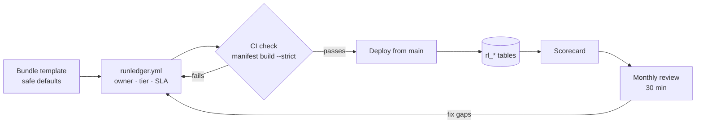
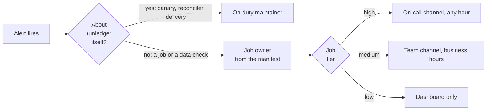
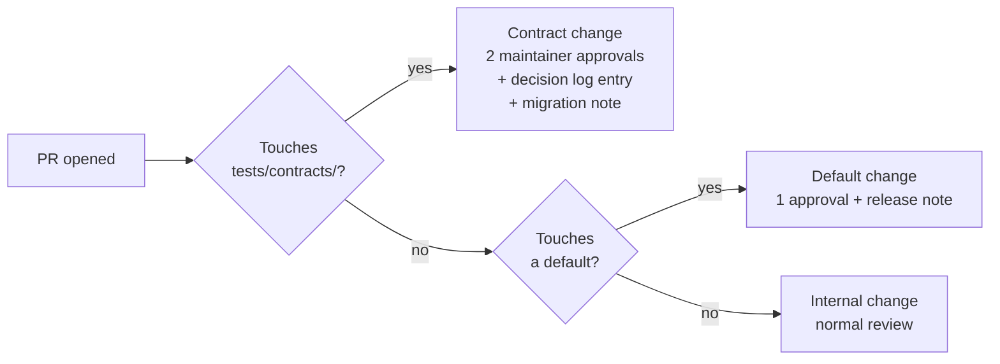
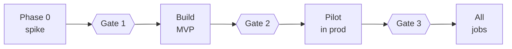
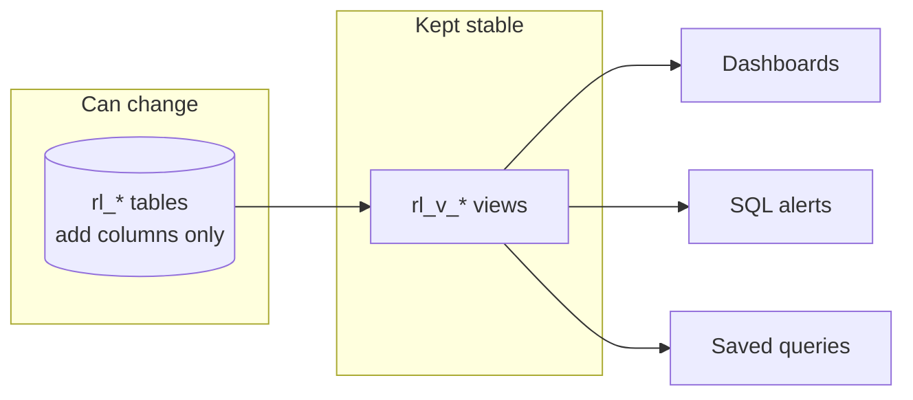
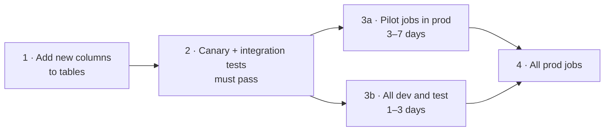
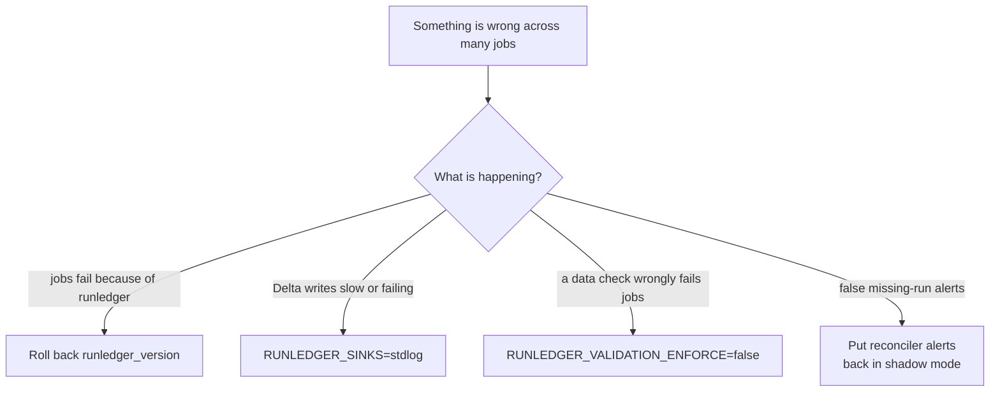
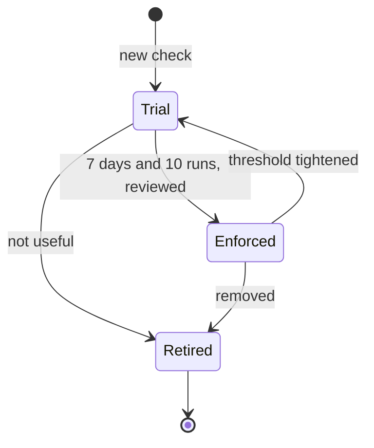
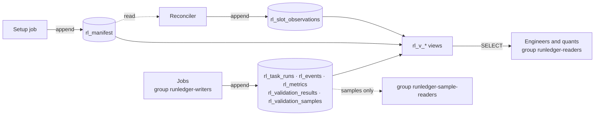
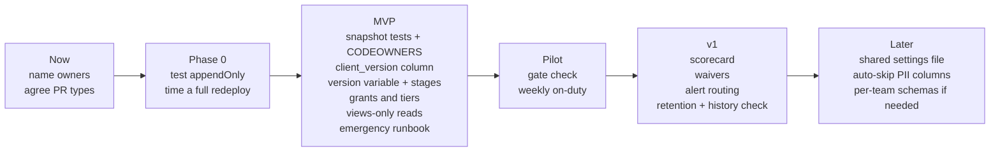

# Governance

> **Status: proposal** for the design review. Nothing here is decided yet.
> Open questions are in [§11](#11-open-questions).

## The idea on one page

We are a small team running hundreds of jobs. We can't check each job by hand, so the rules live
in **files, CI checks and one dashboard**, not in meetings.



| Rule | In practice |
|---|---|
| **Defaults, not reviews** | A job that uses the template is compliant. Nobody has to sign it off. |
| **Strict only where a change hits every job** | Table columns, key formats, the Python API: two approvals. Everything else: a normal PR. |
| **Effort matches importance** | `high` jobs get everything. `low` jobs need almost nothing. |
| **Measure with our own tables** | One scorecard query instead of audits. |

**Do these five before the pilot:**

1. Name the owners → [§2](#2-who-does-what)
2. Let CI spot risky changes → [§3](#3-changing-runledger)
3. Pin one library version and roll it out in stages → [§4](#4-releases-and-rollout)
4. Define job tiers and check them in CI → [§5](#5-job-tiers)
5. Set permissions and write the emergency runbook → [§4](#emergency-switches), [§7](#7-permissions-and-data)

### Words used here

| Term | Meaning |
|---|---|
| **Tier** | How important a job is: `high`, `medium` or `low`. Set as `criticality` in `runledger.yml`. |
| **Contract** | Anything jobs or saved queries depend on: table columns, key formats, status values, the Python API, env vars. |
| **Snapshot test** | A test that saves a contract to a file. If a PR changes that file, a contract changed. |
| **Trial check** | A data check that runs and records results, but can't fail a job or send an alert. |
| **On-duty** | The maintainer handling runledger's own alerts this week. |
| **Manifest** | The list of jobs and tasks we expect to run, built from the bundle. |
| **Reconciler** | The scheduled job that compares the manifest with what actually ran. |

## 1. Why we need this

| Risk | What it looks like |
|---|---|
| One change hits every job | A bad release breaks 300 tasks overnight |
| Too many jobs to check by hand | 300 jobs × 5 min = 25 hours, every review cycle |
| Noisy alerts get ignored | 20 false "missed run" alerts a day, so the real one is missed |
| Jobs drift apart | Five different SLAs for the same kind of job; three library versions in prod |
| Knowledge in one head | Only one person knows how to release |

Much of the fix is already in the design. We just use it on purpose:

| Already in the design | What it gives us |
|---|---|
| `schema/tables.py` + generated DDL + CI drift check | All schema changes go through one reviewed file |
| Manifest built from the bundle, with versions and dates | A history of what we expected to run, and when |
| `rule_key` + `definition_hash` | Every threshold change shows up in the data |
| `effective_policy` on every validation result | Proof that a check was enforced, on trial or switched off |
| Shadow mode, canary, `reconcile explain` | New jobs can't page anyone until their verdicts are trusted |

## 2. Who does what

| Role | Who | Owns |
|---|---|---|
| **Product owner** | 1 person + a deputy | Final decisions, scope, sign-off at each phase |
| **Maintainers** | at least 2 people | Library, template, releases, schema changes |
| **On-duty** | weekly rotation of maintainers | runledger's own alerts, emergency switches |
| **Job owner** | `owner` in `runledger.yml` | The job's tier, SLA, data checks and alerts |
| **Data owner** *(optional)* | owner of a published dataset | Approves `critical` checks on that dataset |

One person can hold several roles, but every role needs a name.

**Where an alert goes:**



## 3. Changing runledger

Every PR is one of three types. Files decide the type, so nobody has to argue about it.



Defaults live in `config.py` and the alert SQL, so CODEOWNERS can flag them too.

| Example | Type |
|---|---|
| Rename `failed_rows` to `bad_rows` | Contract |
| Add a new verdict `LATE` | Contract |
| Change how `rule_key` is generated | Contract |
| Flush time limit 30 s → 20 s | Default |
| Shadow period 7 → 14 days | Default |
| Add `password` to the redaction list | Default |
| Refactor the write buffer | Internal |

- **Snapshot tests cover:** table and view columns, every status and verdict value, `to_dict()` for
  each rule type, `rule_key` and `definition_hash` for a fixed set of rules, config keys, env vars
  and `runledger --help`.
- **CODEOWNERS** requires two maintainers on `tests/contracts/` and `schema/`.
- **A default that would make more jobs fail or alert** ships switched off for one release first.

### Decisions

Every decision gets an owner and a date. After the design review, each one gets a one-page file:

```markdown
# 0007 · Dashboards and alerts read views, never tables
- Status: Decided · Owner: <name> · Date: 2026-12-01
- Decision: dashboards, alerts and saved queries read rl_v_* views only.
- Why: a view can absorb a table change; 300 saved queries can't.
- Revisit if: a view gets too slow for the dashboard.
```

The quarterly review checks every *Revisit if* line.

### Phase gates



The product owner signs off each gate when every box is ticked:

| Gate | Pass when |
|---|---|
| **1** | ☐ Every spike item settled or its fallback chosen ☐ D10 (build or wrap DQX) decided |
| **2** | ☐ Test tiers 1–3 green ☐ Canary green for 7 days in dev ☐ Pilot jobs' shadow verdicts checked, no unexplained false alarms |
| **3** | ☐ 2+ weeks on pilots with 0 failures caused by runledger ☐ Health targets met ([§8](#8-health-and-alerts)) ☐ A runbook for every alert |

A feature joins a phase only if a pilot job needs it or it fixes a correctness problem. Everything
else waits on the *Later* list.

## 4. Releases and rollout

### Schema: add columns, never break them

```sql
-- ✅ Fine in any release: add a nullable column
ALTER TABLE ops_prod.runledger.rl_task_runs ADD COLUMNS (client_version STRING);

-- ❌ Major release only, after a deprecation period
ALTER TABLE ops_prod.runledger.rl_validation_results RENAME COLUMN failed_rows TO bad_rows;
```

### Views are what people read



The alert example in [features.md H6](features.md#h6-databricks-sql-alerts-v1-one-alert-in-mvp)
reads a table directly. It should read a view.

### One pinned version for all jobs

```yaml
# databricks.yml
variables:
  runledger_version: {default: "0.3.2"}
targets:
  prod:
    variables: {runledger_version: "0.3.1"}   # prod stays one step behind until the pilots pass

# each job (or injected by the bundle mutator in v1)
environments:
  - environment_key: default
    spec:
      dependencies: ["lakehouse-runledger==${var.runledger_version}"]
```

- Upgrade = change one line. Roll back = revert it.
- New `client_version` column on `rl_task_runs`, so "which jobs run which version" is one query.
- We support the latest two minor versions. Anything removed logs a warning for one release first.

### Rollout stages



**Release checklist**
- [ ] Contract snapshot changes reviewed
- [ ] Old library works with the new tables, and so does the new library
- [ ] Release notes list every contract and default change
- [ ] Rollback tested

### Emergency switches



| Switch | Who can flip it in prod | Where it shows afterwards |
|---|---|---|
| Roll back `runledger_version` | On-duty | `client_version` |
| `RUNLEDGER_SINKS=stdlog` | On-duty | Gaps in `rl_v_delivery_completeness` |
| `RUNLEDGER_VALIDATION_ENFORCE=false` | On-duty during an incident; otherwise a PR | `effective_policy` on every result |
| `RUNLEDGER_VALIDATION_EVALUATE=false` | PR only | The "dataset not validated in 24h" alert |
| Reconciler alerts → shadow mode | On-duty | Reconciler config in the bundle |

Every emergency flip gets a follow-up PR within one business day, to undo it or make it permanent.

> **Open (G-Q5):** flipping a switch for every job means redeploying every bundle. With many
> bundles that is slow during an incident. Alternative: a small settings file on a UC Volume that
> every job reads at start-up.

## 5. Job tiers

| | `high` | `medium` | `low` *(default)* |
|---|---|---|---|
| Listed in the manifest | ✅ | ✅ | ✅ |
| Owner | ✅ | ✅ | ✅ (bundle default is fine) |
| SLA and grace period | ✅ | ✅ | — |
| Code changes | `@rl.task` + `@rl.step` on publish steps | `@rl.task` or the one-line import | none |
| Data checks | enforced suite\* | trial suite | — |
| Alerts | on-call, any hour | team channel, business hours | dashboard only |

\* At least: schema contract, `row_count(min=…)`, and `not_null` + `unique` on key columns.

```yaml
# runledger.yml
defaults: {owner: data-eng, criticality: low, grace_minutes: 30}

jobs:
  orders_daily:
    criticality: high
    sla_max_duration_minutes: 90
    tasks:
      publish: {expected_datasets: [main.silver.orders]}
    waivers:                     # new: a temporary exception, with an end date
      - {requirement: enforced_suite, reason: "tuning thresholds", expires: 2027-01-15}
```

CI blocks the PR when a job doesn't meet its tier *(proposed output)*:

```text
$ runledger manifest build --strict
✗ orders_daily    high job has no sla_max_duration_minutes
✗ prices_eod      exclude has no reason
✗ risk_snapshot   waiver "enforced_suite" expired on 2027-01-15
3 problems. Fix them, or add a waiver with an end date.
```

- **Unclassified jobs default to `low`**, so onboarding 300 existing jobs doesn't wait on
  classifying them. The scorecard lists them until someone does (G-Q4).
- **Prod deploys run from CI on `main` only.** The manifest is synced at deploy time, so a deploy
  from a laptop would record a manifest that matches no commit.

## 6. Data checks



| Stage | Runs? | Can fail the job? | Can alert? |
|---|---|---|---|
| Trial | ✅ | — | — |
| Enforced | ✅ | ✅ | ✅ |
| Retired | — | — | — (history kept under its `rule_key`) |

```python
# New checks go in a trial suite: they run and record, but never fail the job or alert
orders_trial = rl.Suite(
    name="orders_silver_trial", dataset="main.silver.orders",
    policy=rl.ValidationPolicy(enforce=False, notify=False),
    rules=[c.in_range("amount", min=0, max=1_000_000, key="orders.amount.range")],
)

# Enforced checks: error and critical rules always set an explicit key
orders_suite = rl.Suite(
    name="orders_silver", version="4", dataset="main.silver.orders",
    rules=[c.unique("order_id", key="orders.order_id.unique", severity="critical")],
)
```

- **Explicit `key`** on `error` and `critical` checks, named `<dataset>.<column>.<check>`. A
  generated key changes when a column is renamed, and that splits the check's history in two.
- **`critical` stops downstream tasks.** Say why in the PR; the data owner approves.
- **Loosening** a threshold can skip trial. **Tightening** can't.
- **On trial for 30+ days?** Promote it or delete it:

```sql
SELECT rule_key, dataset, min(evaluated_at) AS first_seen
FROM rl_validation_results
GROUP BY rule_key, dataset
HAVING min(evaluated_at) < now() - INTERVAL 30 DAYS
   AND NOT max_by(effective_policy.enforce, evaluated_at);   -- latest result is still on trial
```

## 7. Permissions and data

**A job can report on itself, but can't change what was expected of it or the verdict about it.**



```sql
GRANT USE CATALOG ON CATALOG ops_prod TO `runledger-writers`;
GRANT USE SCHEMA ON SCHEMA ops_prod.runledger TO `runledger-writers`;
GRANT MODIFY, SELECT ON TABLE ops_prod.runledger.rl_events TO `runledger-writers`;
GRANT SELECT ON TABLE ops_prod.runledger.rl_v_task_runs TO `runledger-readers`;
```

- **One catalog per environment** (`ops_dev`, `ops_prod`), so dev jobs can't write to the prod ledger.
- **Grant to groups**, never to individuals.

`MODIFY` also allows updates and deletes (claim C7). Two cheap guards:

| Guard | How |
|---|---|
| **Detect** | Weekly, run `DESCRIBE HISTORY` on each table and flag anything that isn't an append, `OPTIMIZE` or the retention job |
| **Prevent** (only if Q-G1 needs tamper-proof records) | `SET TBLPROPERTIES ('delta.appendOnly' = 'true')` on runs, results, manifest and observations. Test it in the Phase 0 spike first |

**How long we keep data** (until Q-G1 and Q-G2 are answered):

| Table | Keep | Who can read |
|---|---|---|
| Runs, validation results, observations, metrics | 13 months (allows year-over-year) | all readers |
| `rl_events` | 90 days | all readers (sensitive keys redacted) |
| `rl_validation_samples` | 14 days | restricted group only |
| `rl_manifest` | forever (it is small) | all readers |

Failing-row samples are off in prod unless `sample_columns` lists which columns may be stored.

## 8. Health and alerts

**Health targets for runledger itself** (the on-duty maintainer watches these):

| Target | Goal |
|---|---|
| Canary last ran | < 30 min ago |
| Reconciler last ran | < 30 min ago |
| Rows delivered to the tables | ≥ 99.9% per day |
| Job failures caused by runledger | 0 |
| Alerts later proven wrong | < 1% per week |

**Alert rules:**
- One SQL alert per destination, filtered by owner and tier.
- Every alert links a runbook. Step 1 is always `runledger reconcile explain <slot_key>` or the
  failing `rule_key`.
- An alert that fires 3+ times in a week with no action gets its SLA or threshold reviewed.

## 9. The scorecard

One view, `rl_v_governance_scorecard`, and one dashboard page. An example of what it would show:

| Check | This week | Target |
|---|---|---|
| Prod jobs in no manifest | 3 | 0 |
| Jobs still on the default tier | 212 | going down |
| `high` / `medium` jobs with no SLA | 4 | 0 |
| `high` jobs with no runledger code | 1 | 0 |
| `high` datasets not validated in 24h | 0 | 0 |
| Checks on trial for 30+ days | 6 | 0 |
| Checks that errored in the last 7 days | 2 | 0 |
| Jobs on an unsupported library version | 9 | 0 |
| Expired waivers | 1 | 0 |
| Unexpected updates or deletes on `rl_*` | 0 | 0 |
| Most alerts for one job this week | 5 | ≤ 3 |

The first row matters most: it is the only way to catch jobs created outside a bundle.

## 10. Calendar

| When | Who | What | Time |
|---|---|---|---|
| Every PR | CI | DDL drift, banned APIs, contract snapshots, compatibility tests, `manifest build --strict` | automatic |
| Weekly | On-duty | runledger alerts, noisy alerts, unexpected writes | 15 min |
| Monthly | Maintainers + job owners | Scorecard: promote or delete trial checks, classify jobs, close waivers | 30 min |
| Quarterly | Product owner + maintainers | *Revisit if* lines, supported versions, retention, health targets | 45 min |
| Each release | Maintainers | Release checklist and rollout stages | — |

## 11. Open questions

| # | Question | What the answer changes |
|---|---|---|
| G-Q1 | Who is the product owner? Who are the two or more maintainers? | Every approval needs a name |
| G-Q2 | Does our team own every job, or do other teams own some? | One team: shared tables and one alert channel are fine. Several teams: routing and Q-G6 matter more |
| G-Q3 | Roughly how many bundles hold the jobs? | Whether one version variable and redeploy-based switches are practical |
| G-Q4 | Default tier `low` (quiet) or `medium` (safer, noisier)? | How many alerts on day one |
| G-Q5 | Emergency switches by redeploy, or a shared settings file? | Incident speed vs one extra read per task |
| G-Q6 | Who approves `critical` checks: engineers or data owners? | Who reviews rule changes (same as Q-V3) |

This proposal also suggests answers to questions in [review-brief §6](review-brief.md#6-key-questions-about-our-needs-and-environment):

| Question | Proposed answer |
|---|---|
| Q-G3 · who reads the tables | Everyone reads views; samples are restricted |
| Q-G4 · job identities | Whatever they are, grant to one writers group |
| Q-G6 · `MODIFY` on shared tables | Accept it, with the detect and prevent guards in [§7](#7-permissions-and-data) |
| Q-O3 · who owns the schema and reconciler | The maintainers, one deployment per environment |

It depends on Q-G1, Q-G2 (retention, tamper-proofing), Q-O1, Q-O2 (alert channels and hours),
Q-E1 (catalog layout), Q-E8 (how many jobs are in bundles) and Q-E9 (where CI runs).

## 12. What gets built, and when



Changes this implies in the other docs:

| Change | Where |
|---|---|
| Owner and date on every decision | [review-brief §3](review-brief.md#3-decision-log) |
| `client_version` column on `rl_task_runs` | [design › Data model](design.md#data-model-uc-managed-delta-one-configurable-catalogschema-prefix-rl_) |
| `runledger_version` variable, grants file, per-environment catalogs | [design › DAB template](design.md#dab-template-bundle_template) |
| Tier meanings, required owner, waivers, `--strict` | [features G1](features.md#g1-a-manifest-built-from-the-bundle-mvp) |
| Alerts read views only | [features H6](features.md#h6-databricks-sql-alerts-v1-one-alert-in-mvp) |
| Retention per table, history check | [features H7](features.md#h7-retention-and-maintenance-job-v1) |
| `delta.appendOnly` test | [design › Roadmap, Phase 0](design.md#roadmap) |
